# Nyishi IPA-ASR: a reproducible narration baseline

**Project report and repository guide · Updated 10 November 2026**

## Abstract

This project studies speech-to-IPA transcription for low-resource Nyishi Narration audio. It preserves an auditable data-preparation record, a frozen speaker/session-aware split, and a declared corpus-level character error rate (CER) policy. Starting from `neurlang/ipa-whisper-base`, the study compared zero-shot inference, supervised pilots, full fine-tuning, decoding and learning-rate choices, and LoRA on validation data. The validation-selected full fine-tuned checkpoint achieved **44.57% CER** on all **683 held-out test clips**, compared with **101.23%** for the zero-shot baseline. The result shows substantial adaptation but leaves significant transcription errors and label uncertainty. This README follows the structure of a technical report while retaining the project phases in chronological order.

**Keywords:** Nyishi; automatic speech recognition; International Phonetic Alphabet; Whisper; low-resource speech; character error rate.

## Current status at a glance

| Area | Status | Evidence |
|---|---|---|
| Dataset A Narration curation | Complete for the frozen scope | Phase 0–3.5B notebooks and manifests |
| Frozen split | Accepted and locally hashed | `phase3_5b_v1`: 3,629 / 732 / 683 clips |
| Processor/model engineering | Passed | Phase 4 reports |
| B0 zero-shot validation | Complete | 732/732 validation clips; 103.13% corpus CER |
| Phase 6A training smoke | Passed | Two finite AMP updates and checkpoint resume; no accuracy metric was produced |
| Phase 6B P1 pilot | Complete | Best Epoch 3 CER 107.26%; B0 remained better; insertion-heavy |
| Phase 6C validation optimization | Passed | Batch 8 exactly matched single-example outputs; validation speed improved 2.14× |
| Phase 7 F1 full fine-tuning | Complete | Best Epoch 3 CER 51.35%; validation-only repetition-penalty sweep selected 1.08 at 48.39% |
| Phase 7 F1 learning-rate mini-sweep | Complete | `2e-5`, Epoch 5: 47.24% validation CER; selected before the test was opened |
| Phase 7 LoRA comparison | Complete; not selected | Best LoRA: rank 8, LR `1e-4`, Epoch 7, 60.68% validation CER; full fine-tuning remains lower at 47.24% |
| Final sealed test evaluation | Saved results checked | B0 101.23% versus selected F1 44.57% CER on all 683 test clips |
| Phase 8 descriptive EDA | Complete; post-hoc | Dataset balance and test-error slices recomputed from saved predictions; no new inference or model selection |

## Contents

1. [Introduction](#1-introduction)
2. [Data preparation and evaluation design](#2-data-preparation-and-evaluation-design)
3. [Model and pilot methodology](#3-model-and-pilot-methodology)
4. [Full-data experiments and validation results](#4-full-data-experiments-and-validation-results)
5. [Final test results and discussion](#5-final-test-results-and-discussion)
6. [Reproducibility and project materials](#6-reproducibility-and-project-materials)
7. [Conclusions, limitations, and future scope](#7-conclusions-limitations-and-future-scope)
8. [References](#references)

For a report or presentation, start with the [end-to-end handoff](docs/REPORT_PRESENTATION_HANDOFF.md). It distinguishes measured results, interpretation, and later recommendations and links the reusable figures and code.

---

## 1. Introduction

### 1.1 Motivation and scope

The objective is a controlled first baseline for Nyishi speech transcribed in IPA. The first benchmark uses Dataset A Narration; Dataset B YouTube remains outside this comparison pending separate linguistic, provenance, and rights review. The chosen starting model is an IPA-adapted Whisper Base checkpoint, not a model already proven to recognize Nyishi. The research contribution here is the evaluated adaptation and its documented data and scoring contract.

### 1.2 Research question and objectives

> How much does supervised adaptation improve Nyishi IPA transcription over a fixed zero-shot reference, under a frozen speaker/session-disjoint evaluation design?

- Curate and freeze a short-clip Narration benchmark without changing source audio or raw labels.
- Verify processor behavior, training updates, generation settings, and scoring before full training.
- Select checkpoint and decoding settings using validation CER, then compare the selected model with the zero-shot baseline on the held-out test set.
- Preserve the run evidence and describe remaining errors without tuning on the final test.

### 1.3 Evidence and reading guide

Tables identify the dataset partition used for each result. “Validation” denotes model selection or diagnostics; “test” denotes the single declared final comparison. Saved notebook outputs are run evidence, while linked aggregate reports and plots make the results easier to inspect. No model inference or training was rerun to restructure this README.

---

## 2. Data preparation and evaluation design

### 2.1 Frozen data and scoring contract

- Scope: Dataset A Narration only; Dataset B YouTube is out of scope.
- Train: **3,629 clips / 10.851637 hours**.
- Validation: **732 clips / 1.881808 hours**.
- Test: **683 clips / 1.891057 hours**; evaluated once for the two declared Phase 8 configurations after validation selection.
- Known component, speaker-group, session, and exact-audio overlaps across the accepted split: zero.
- Primary metric: corpus-level character error rate (CER) over NFD-normalized IPA strings, with substitutions, deletions, and insertions reported separately. Apply NFD, outer trim, and repeated ordinary-space collapse to each reference and hypothesis; retain spaces and IPA marks. Sum per-clip edits over summed reference code points; lower CER is better and insertions can make CER exceed 100%.
- Raw audio and frozen manifests remain outside the public release. Some executed notebook outputs and saved result archives contain reference or prediction text.

### 2.2 Chronological curation and split record

Each phase presents its measured outcome, supporting figures, and interpretation. Candidate split figures document historical decisions; Phase 3.5B defines the frozen benchmark.

---

### Phase 0 — inventory and local setup

- **Purpose:** establish what is available before any filtering, transcript editing, or model work.
- The source-of-truth Narration master contained **6,718 rows and 54 columns**, and matched the 59 raw Narration shards row-for-row.
- The inventory recorded raw audio locations, transcript fields, duration basis, speaker/session fields, review flags, and provenance without rewriting the source.
- Dataset B (YouTube) was explicitly kept out of the first baseline scope.
- The initial audit identified **5,651 rows with a non-empty reference**, **708 clips flagged longer than 30 seconds in the inventory**, and **three zero-frame recordings**. These are inventory facts, not deletion instructions.

| Inventory item | Measured value | Why it mattered |
|---|---:|---|
| Dataset A Narration master rows | 6,718 | Complete starting population |
| Master columns | 54 | Preserved metadata, transcript, review, and provenance fields |
| Rows with a usable-looking reference | 5,651 | Upper bound before audio/duration checks |
| Clips flagged over 30 seconds in the inventory | 708 | Must be segmented deliberately; never silently truncated |
| Zero-frame recordings | 3 | Require exclusion from the first supervised candidate view and retention in the audit |

**Figure — Narration source inventory.** Summarizes the source collection before exclusions and split design. Inventory counts should not be read as model-training counts.

---

### Phase 1 — eligibility and audio checks

- **Purpose:** apply explicit first-pass rules to create a candidate pool for later grouping and split design.
- The master and full-decode audit joined one-to-one (**6,718 / 6,718**). There were no full-decode failures and no sample-rate or channel-count disagreements.
- Every row received a reason and boolean flags; source rows were not deleted. The first applicable reason was used for the mutually exclusive waterfall below.

| First-pass outcome | Clips | Decoded hours remaining | Interpretation |
|---|---:|---:|---|
| All master rows | 6,718 | 25.792 | Starting population |
| After missing/empty reference | 5,651 | 20.877 | 1,067 rows had no usable reference |
| After zero-frame check | 5,648 | 20.877 | Three labelled rows had no decoded frames |
| After audio-issue review hold | 5,647 | 20.876 | One duration-discrepancy record was held for review |
| After the 0.5–30 s rule | **5,086** | **14.826** | Initial structurally valid candidate pool |

The 5,086 candidates were not yet the train/validation/test split. They were the input to transcript normalization, review queues, and group-aware split construction. The duration rule excluded 561 rows in the mutually exclusive waterfall. The detailed Phase 1 review counted **528 reference-present clips over 30 seconds**; this is narrower than the Phase 0 inventory flag because Phase 1 applies the usable-reference predicate before describing labelled durations. Short-clip and other edge-case flags were retained in the all-row audit. Long recordings remained preserved for future alignment-aware segmentation.

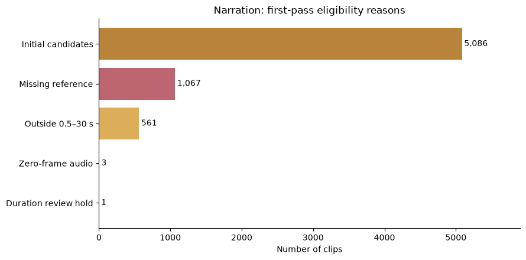

**Figure — Eligibility reasons.** Shows which mechanical checks limited the candidate pool. These are rule-based counts, not judgements that excluded audio is linguistically unusable.

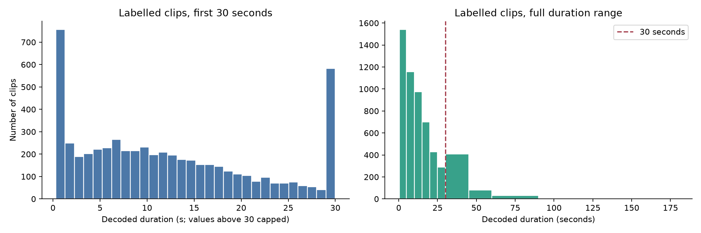

**Figure — Clip-duration distribution.** Shows how recording lengths vary and why the first Whisper recipe uses a bounded short-clip candidate pool.

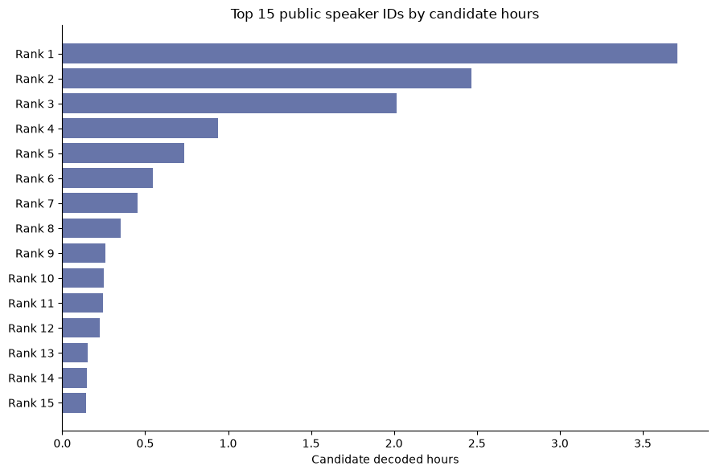

**Figure — Speaker-hour distribution.** Shows uneven contribution across the available speaker metadata, a consideration for later group-disjoint evaluation.

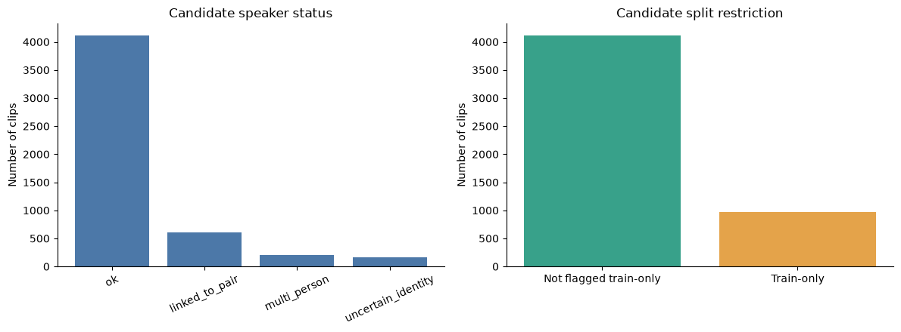

**Figure — Speaker metadata status.** Distinguishes recorded speaker information from missing or uncertain assignments; video identifiers were not treated as proof of identity.

**Figure interpretation — Phase 1 plots.** The eligibility chart explains why rows leave the first candidate view; it is not a quality score. The duration plot shows why the 30-second boundary was treated as a preparation rule rather than a truncation rule. The speaker-hour and speaker-status plots show that the 5,086 candidates were not automatically safe for random splitting: the largest public speaker IDs contributed a disproportionate share of hours, and **967 candidates were marked train-only**. That evidence motivated the group-aware split work in Phase 3.

---

### Phase 2 — transcript formatting

- **Purpose:** define a conservative, reproducible text representation for tokenizer checks and CER without making linguistic substitutions.
- Input: the 5,086 Phase 1 candidates. The approved policy was:

| Operation | Applied? | Effect |
|---|---|---|
| Unicode NFD | Yes | Makes combining-mark representation consistent |
| Trim outer whitespace | Yes | Removes accidental leading/trailing whitespace |
| Collapse repeated ordinary U+0020 spaces | Yes | Removes formatting-only repeated spaces |
| Rewrite IPA symbols, diacritics, punctuation, or tone marks | **No** | Linguistic meaning remains unchanged |
| Preserve `transcript_raw` beside the derived label | **Yes** | Every transformation remains auditable |

- **497 rows** changed under the final mechanical policy; all 497 changes were repeated ordinary-space cleanup. NFD alone changed zero rows, and no normalized label became empty.
- The inventory contained **102 distinct raw and normalized code points**. The normalized labels contained 521,747 code points, including IPA combining marks; these counts describe Unicode code points, not phonemes.
- The policy was idempotent: applying it a second time produced the same normalized label. No model tokenizer or split assignment was used in this phase.

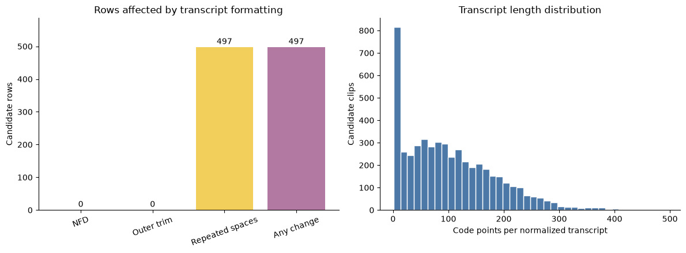

**Figure — Normalization and label length.** Shows the effect of the declared mechanical text view and the spread of reference lengths. It does not imply linguistic correction of labels.

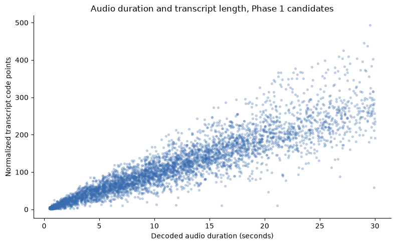

**Figure — Audio duration versus label length.** Helps identify recordings whose text length warrants review; a point away from the main trend is a review cue, not an automatic deletion.

**Figure interpretation — Phase 2 plots.** These figures describe the text representation before training. One compares raw and normalized label-length distributions; the other relates decoded duration to reference length. They are useful for spotting formatting changes and unusually long/short examples, but they are not evidence of recognition accuracy. The downstream CER contract uses the same NFD, outer-trim, and repeated-space policy for references and hypotheses.

---

### Phase 2.5 — targeted review

- **Purpose:** isolate small, high-impact uncertainties before constructing speaker/session-disjoint splits.
- A targeted symbol queue contained **42 clips (0.201 decoded hours)**: 3 with `:`, 20 with `;`, 19 with `[`, plus one combining-acute case. Categories overlap, so their bars must not be added together.
- A separate group-readiness review covered **five proposed speaker-ID merges**, **nine train-only/proposed groups**, **1,745 recording sessions**, and **398 repeated normalized transcript rows**. Repeated text was not treated as duplicate audio.
- The 967 train-only candidates represented **2.474 hours** and were kept out of automatic held-out assignment. Exact-audio duplicate grouping and final split assignment were deliberately deferred to Phase 3.
- Review queues preserved exact source locators privately, but no automatic linguistic correction, speaker merge, or split decision was applied here.

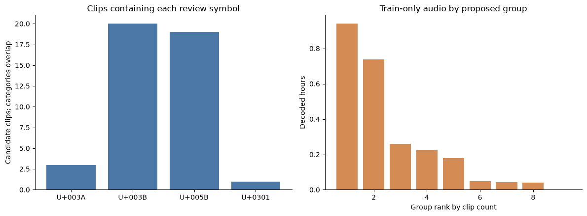

**Figure — Targeted review workload.** Summarizes the kinds of unresolved cases. Queue size indicates review effort, not the number of confirmed errors.

**Figure interpretation — review workload.** This plot is a queue-sizing and risk-management view. It shows which symbol classes and proposed group workloads needed human attention; it does not claim that those symbols were wrong or that proposed speaker merges were true identities. The practical outcome was a clean handoff to group-aware split construction with uncertainty explicitly recorded.

### What these four phases established

The early pipeline moved from **6,718 preserved source rows** to **5,086 mechanically eligible candidates**, while keeping the rejected/uncertain records and their reasons available for audit. Phase 0 measured the population, Phase 1 made audio/reference eligibility explicit, Phase 2 fixed only formatting-level transcript variation, and Phase 2.5 surfaced human-review and leakage risks. None of these phases produced a model accuracy result; they made the later frozen split and CER comparison scientifically interpretable.

---

### Phase 3 — first group split proposal

- Constructed indivisible groups from proposed speaker/session links and exact waveform duplicates.
- Found zero known structural leakage but rejected the first proposal because short-clip and recording-month balance was unsuitable.

| Check | Outcome |
|---|---|
| Known structural cross-split leakage | None detected in the proposal |
| Balance decision | Rejected: short-clip and recording-month distributions were unsuitable |

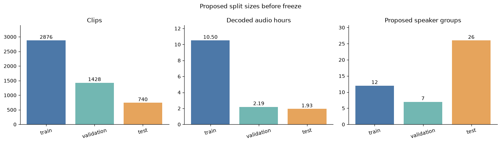

**Figure — split sizes.** This figure compares the number of clips and hours assigned to the first train, validation, and test proposal. It is a planning diagnostic: a numerically large split is not automatically a representative split.

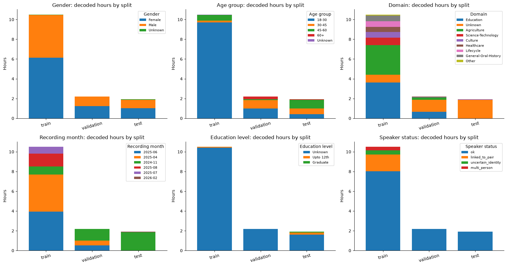

**Figure — category balance.** These panels show why the proposal was rejected. Short clips and recording-month composition were uneven across held-out sets, creating a risk that the model would be evaluated on a different recording regime from the one it learned.

---

### Phase 3.5 — category-aware revision

- Searched whole-component assignments while considering hours, month, age, duration, gender, and held-out balance.
- Rejected the revision because validation was dominated by one component and female hours, despite a better internal search score.

| Check | Outcome |
|---|---|
| Component integrity | Preserved during reassignment |
| Balance decision | Rejected: validation concentration remained too high |

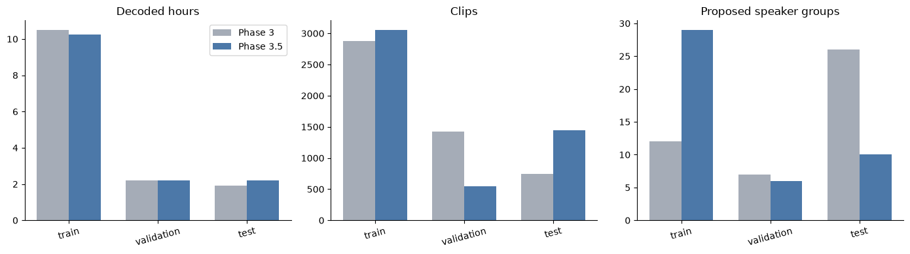

**Figure — revised split sizes.** The category-aware search moved whole components between partitions while preserving group integrity. The chart is useful for comparing candidate allocations, but the internal search objective alone was not sufficient for acceptance.

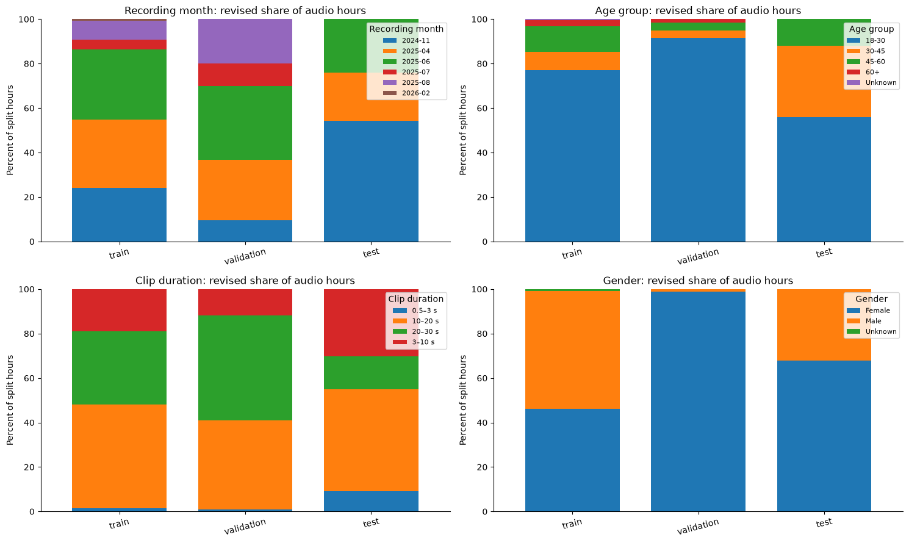

**Figure — revised categories.** The revised candidate improved some numerical balance measures but concentrated validation in one component and one gender distribution. It was therefore rejected in favor of a more usable design.

---

### Phase 3.5B — accepted frozen split

- Selected the more balanced split while preserving component/speaker/session/exact-audio separation.
- Frozen membership and hashes are retained privately.

| Frozen partition | Clips | Audio hours |
|---|---:|---:|
| Train | 3,629 | 10.851637 |
| Validation | 732 | 1.881808 |
| Test, sealed | 683 | 1.891057 |

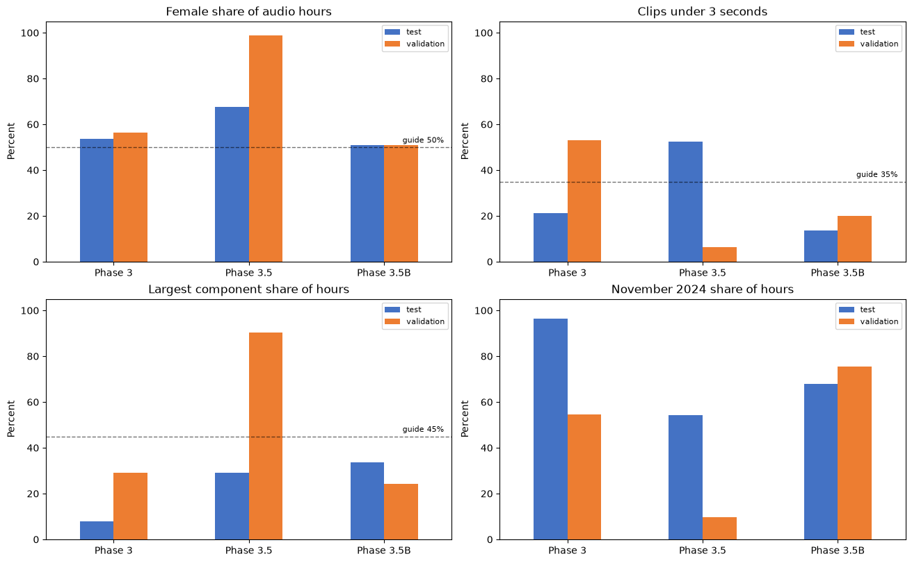

**Figure — accepted split comparison.** This is the final design comparison used to select `phase3_5b_v1`. It shows the trade-off between train capacity and held-out balance after enforcing component, speaker/session, and exact-audio separation. The split is frozen; it must not be redesigned after seeing model scores.

---

## 3. Model and pilot methodology

The model and processor checks, baseline, pilot, and validation-speed audit establish the procedure used by the full-data experiments. The headings below retain the recorded phase order.

### 3.1 Starting model: IPA-Whisper Base

[`neurlang/ipa-whisper-base`](https://huggingface.co/neurlang/ipa-whisper-base) is a **Whisper Base encoder-decoder Transformer adapted to produce IPA text**. Its model card describes an additional fine-tuning stage on 15,000 synthetic IPA-labelled Common Voice recordings spanning more than 70 languages. The `WhisperProcessor` turns audio into log-Mel features and converts model tokens back into text. This provides a phonetic-output starting point; it does **not** establish that the pretrained model already recognizes Nyishi or reliably preserves its diacritics.

This project pinned revision `949f7c4e4ee374b5202bc5886f6e4552e5ae2371`, checked the processor against actual NFD Nyishi references, and then adapted the model with the frozen Narration training data. The zero-shot B0 score measures the starting point; later supervised scores measure adaptation under the declared evaluation policy. The [model card](https://huggingface.co/neurlang/ipa-whisper-base) describes the source checkpoint, while [Phase 4](docs/PHASE4_RESULTS.md) records the project-specific processor and generation checks.

### Phase 4 — processor and model engineering

- Verified processor/tokenizer round trips, feature shape and finiteness, model loading, generation configuration, and a training-only smoke path.
- This phase established compatibility; it did not establish Nyishi accuracy.

| Engineering check | Observed result |
|---|---|
| Label tokenizer checks | 5,086 candidate labels checked |
| Audio/feature smoke | 12 training-only clips |
| Full-sequence generation | EOS and cap diagnostics recorded; no validation score |

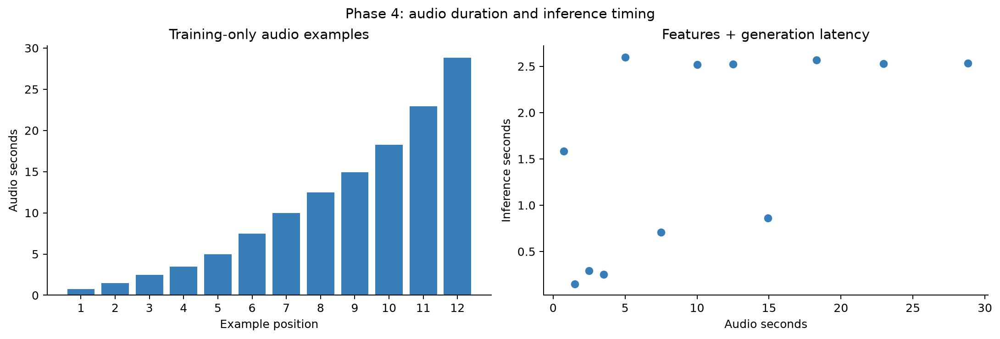

**Figure — processor/model smoke checks.** The figure summarizes input duration coverage and basic timing behavior during the engineering smoke test. It establishes that the processor and model can accept the intended waveform format; it does not measure transcription quality.

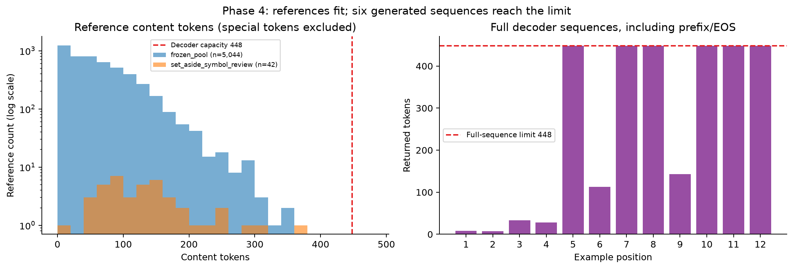

**Figure — Target token lengths.** Shows whether references fit the decoder target budget before training.

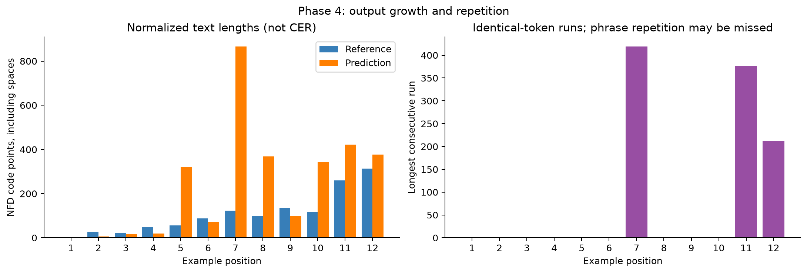

**Figure — Output growth and repetition.** Diagnoses repeated output in the training-only smoke test; this is not a validation score.

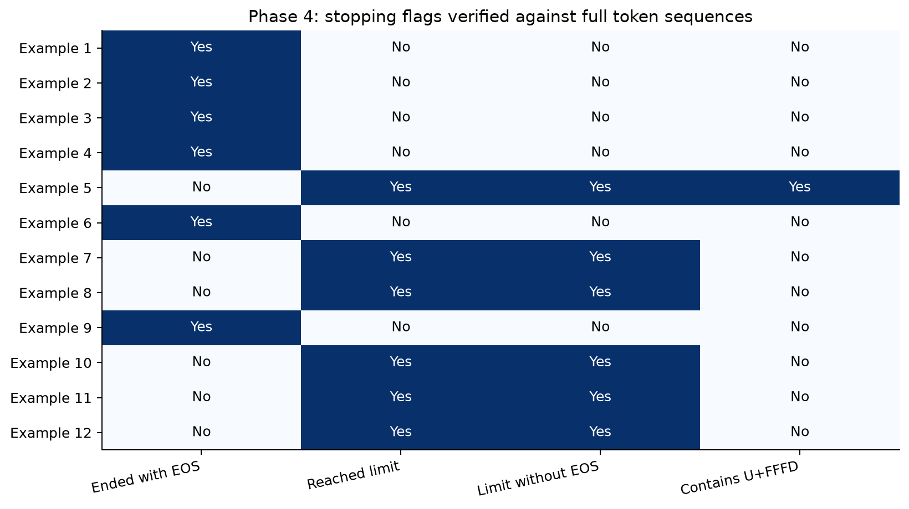

**Figure — Stopping and Unicode flags.** Shows EOS, cap-hit, and replacement-character behavior in the engineering smoke test.

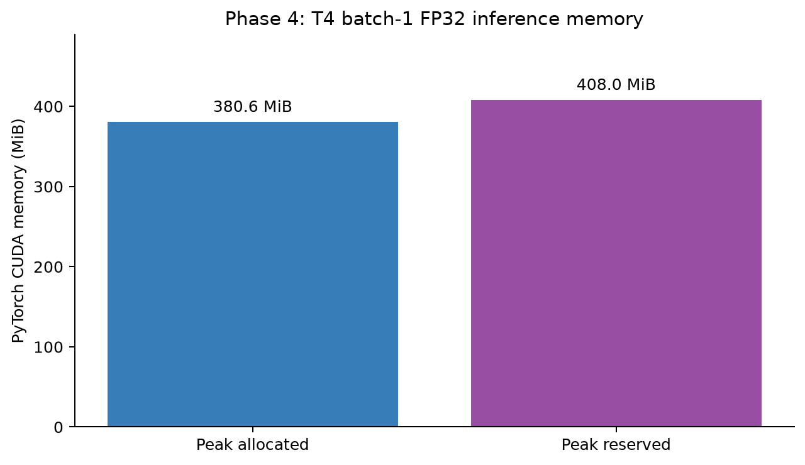

**Figure — Inference memory.** Shows measured device memory for the smoke run; hardware-specific.

---

### Phase 5A — validation-input preparation

- Prepared and independently checked the private 732-clip validation bundle.
- Confirmed waveform hashes, audio decoding, references, and the 64,137-code-point denominator.

| Validation-bundle check | Result |
|---|---:|
| Verified clips | 732 |
| Audio duration | 1.881808 h |
| Normalized reference code points | 64,137 |

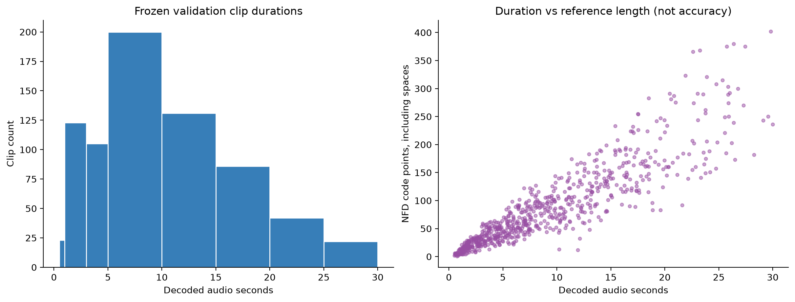

**Figure — Validation duration and reference length.** Describes the held-out clips and the text-length distribution behind the CER denominator.

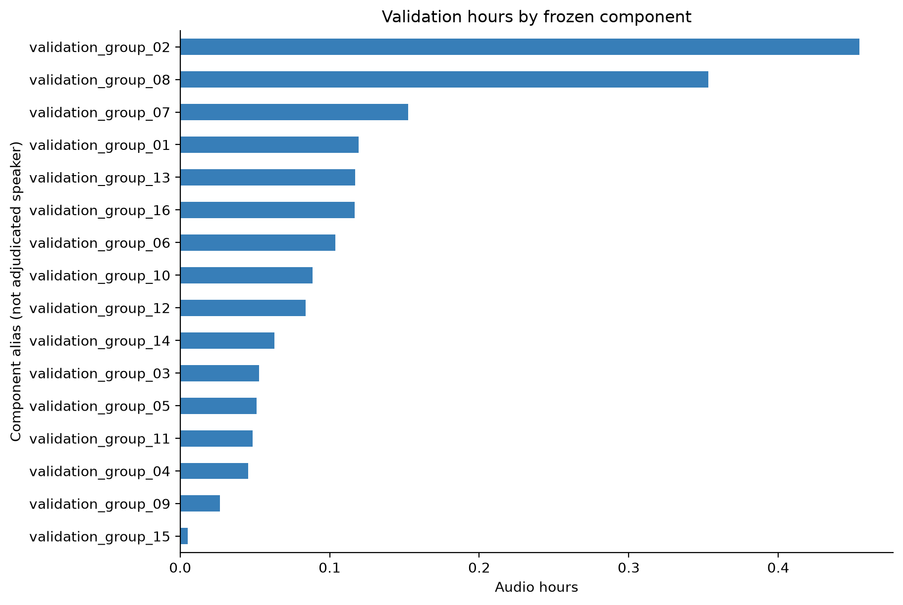

**Figure — Validation component hours.** Shows audio-hours distribution across anonymous groups without exposing identities.

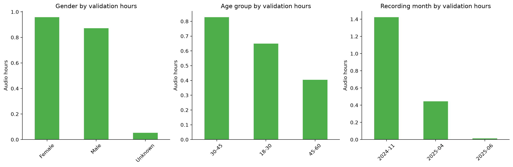

**Figure — Validation metadata coverage.** Indicates available descriptive fields; absent attributes are not inferred.

---

### Phase 5B — B0 full-validation zero-shot baseline

- Ran the pinned model on all 732 validation clips under the declared greedy FP32 policy.
- Result: **103.12924% corpus CER** with 66,144 edits over 64,137 reference code points.
- Counts: **36,780 substitutions, 4,171 deletions, 25,193 insertions**.
- Diagnostics: 130 generation-cap hits without EOS and 52 U+FFFD-containing outputs.
- Corrected plots were regenerated from saved predictions; inference was not rerun.

| B0 validation measure | Result |
|---|---:|
| Coverage | 732 / 732 clips |
| Corpus CER | 103.12924% |
| Substitutions / deletions / insertions | 36,780 / 4,171 / 25,193 |
| No-EOS cap hits / U+FFFD outputs | 130 / 52 |

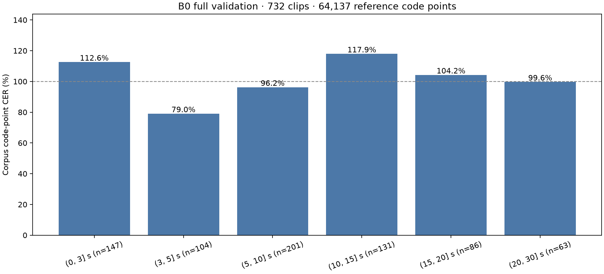

**Figure — CER by duration.** Each duration bin reports corpus CER for the validation clips in that bin. This shows whether errors are concentrated in short or long recordings, but bins with different reference-character totals should not be compared as if they had equal statistical weight.

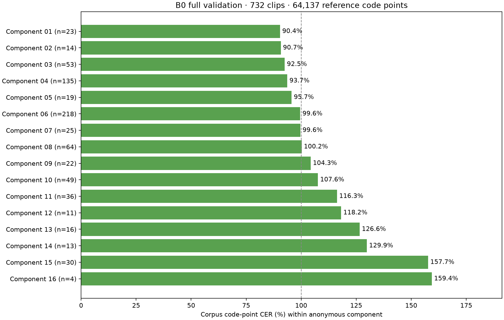

**Figure — CER by anonymous component.** This plot checks whether the baseline behaves differently across recording components. Large differences may indicate acoustic, speaker/session, or data-distribution variation; they are diagnostic, not proof of a single cause.

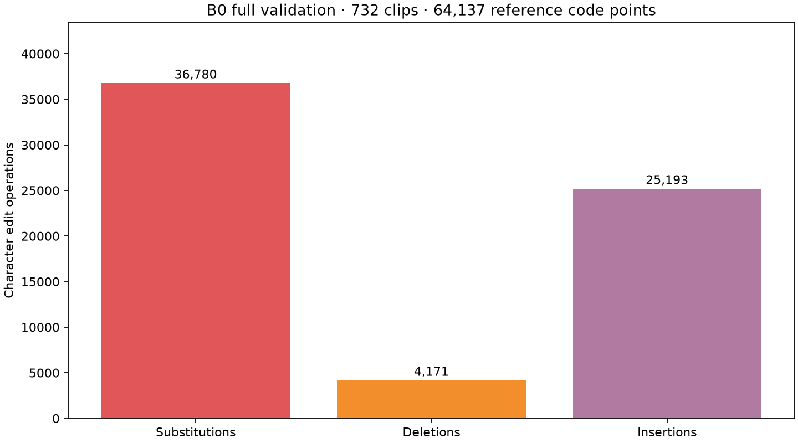

**Figure — edit composition.** Substitutions change one character into another, deletions omit reference characters, and insertions add extra characters. Insertions are a particularly important B0 failure signal because they indicate over-generation rather than only IPA symbol confusion.

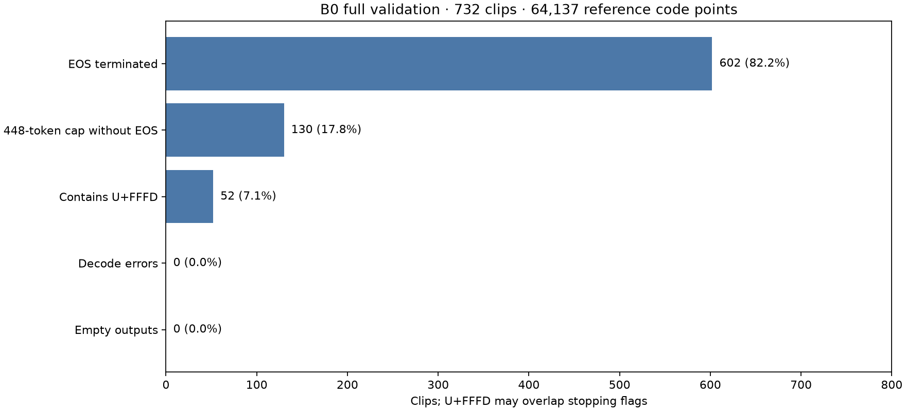

**Figure — generation health.** These counts show how often decoding reached the token cap, produced replacement characters, or otherwise returned an unusual output. These outputs remain included in CER; they are not silently discarded.

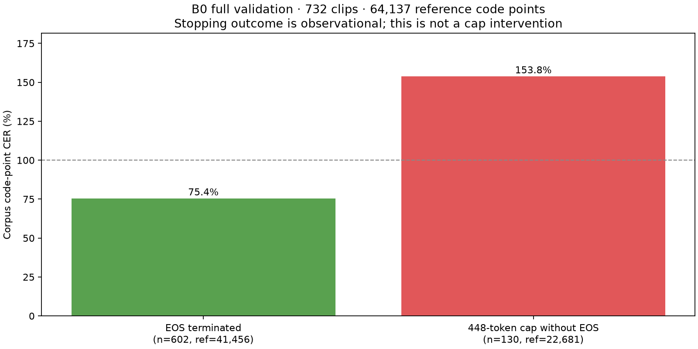

**Figure — stopping behavior.** The plot compares CER for EOS-terminated and cap-hit predictions. A higher cap-hit CER would indicate that failing to stop is associated with severe over-generation, but this remains an association rather than a causal diagnosis.

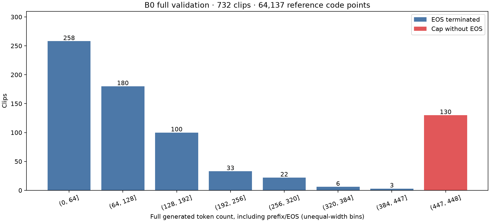

**Figure — output lengths.** The length distribution reveals whether the decoder tends to produce short omissions, plausible-length strings, or unusually long continuations. The 448-token limit is an evaluation safeguard, not a claim that every clip should have that many tokens.

---

### Phase 6A — supervised training smoke

- Ran two real FP16 AMP optimizer updates on eight frozen training examples.
- Verified finite losses/gradients, nonzero parameter changes, and save/reload of optimizer, scheduler, scaler, and RNG state.
- This passed the engineering gate but produced no validation CER.

**Meaning of the result.** Phase 6A answered “can the supervised training loop update and resume safely?” It did not answer “does the model recognize Nyishi IPA?” The lower loss on the second update is therefore an engineering observation, not a generalization result.

**Plots.** No privacy-safe accuracy plot was produced for Phase 6A because it used eight training clips only and did not run validation. Its evidence is the aggregate engineering report and checkpoint-resume checks.

| Training-loop check | Measured result |
|---|---:|
| Frozen training examples in probe | 8 |
| Finite optimizer updates | 2, including resumed update |
| Validation CER | Not measured |

---

### Phase 6B — P1 controlled pilot

- Trained independently from the pinned pretrained checkpoint on 581 training clips for three epochs.
- Validation covered all 732 clips after every epoch.
- CER improved during the pilot from 159.66% to the latest verified Epoch 3 value of 107.26%, but did not beat B0's 103.13%.
- Epoch 3 remained insertion-heavy, so the pilot demonstrates learning but not a finished recipe.

**Figure and result interpretation.** The falling training loss and falling validation CER show that the model learned from the supervised subset. However, Epoch 3 still remained worse than B0 and had many insertions, so “learning occurred” must not be reported as “the model is accurate.”

| Pilot epoch | Training loss | Validation CER | Insertions | No-EOS cap hits |
|---:|---:|---:|---:|---:|
| 1 | 3.948 | 159.66% | 61,949 | 200 |
| 2 | 2.293 | 129.72% | 49,678 | 122 |
| **3** | **1.884** | **107.26%** | **37,493** | **93** |

**Figure — learning and validation.** This plot shows the P1 training-loss curve beside validation CER and generation diagnostics. It demonstrates learning on the one-hour pilot, but the best P1 CER remained above B0, so it was a pilot for recipe validation rather than the final model.

**Figure — duration slices.** This plot shows how the selected P1 checkpoint behaved across duration bins. It is diagnostic only: the official selection criterion remains the full-validation corpus CER, not the best-looking subgroup.

---

### Phase 6C — validation optimization and F1 preparation

The audit compared single-example generation with batch 4 and batch 8 on a deterministic 12-clip duration-spread subset.

| Validation path | Runtime | Peak GPU memory | Equivalence |
|---|---:|---:|---|
| Single clip | 10.99 s | 380.6 MiB | Reference |
| Batch 4 | 5.49 s | 663.3 MiB | Exact match; 2.00× faster |
| Batch 8 | 5.14 s | 941.7 MiB | Exact match; 2.14× faster |

Batch 8 is the selected validation configuration. It preserved token IDs, decoded text, normalized text, and aggregate S/D/I counts. The private examples still show repeated sequences, high insertions, and one no-EOS cap hit; these are model-error signals, not batching failures.

**Figure interpretation.** The Phase 6C timing comparison is an engineering plot rather than an accuracy plot. Its purpose is to show that validation can be accelerated without changing predictions. The memory bars show the measured allocation on the T4 audit run; they are not a universal memory guarantee for every batch or software environment.

Evidence is in [`docs/PHASE6C_RESULTS.md`](docs/PHASE6C_RESULTS.md) and [`docs/PHASE6C_EQUIVALENCE_AGGREGATE.json`](docs/PHASE6C_EQUIVALENCE_AGGREGATE.json).

**Plots.** Phase 6C did not produce an accuracy plot because it was a 12-clip generation-equivalence and runtime audit. Its evidence is the timing/memory table and exact token/text/CER equality report; no plot was necessary to establish the gate.

---

## 4. Full-data experiments and validation results

All checkpoint, learning-rate, and decoding choices in this chapter were made on validation data. The later test result appears only in Chapter 5.

### Phase 7 F1 — full supervised fine-tuning

F1 started independently from `neurlang/ipa-whisper-base` revision `949f7c4e4ee374b5202bc5886f6e4552e5ae2371`, rather than from the P1 checkpoint.

- All 3,629 frozen training clips.
- Effective batch size 8: physical batch 2 with accumulation 4, with physical batch 1/accumulation 8 as the measured fallback.
- Learning rate `1e-5`; AdamW weight decay `0.01`.
- FP16 AMP training and FP32 validation.
- Batch-8 validation, once per epoch.
- Initial maximum of 10 epochs with patience-3 early stopping.
- Checkpoint every epoch; select minimum full-validation corpus CER.
- Save resumable optimizer/scheduler/scaler/RNG state and epoch telemetry.
- Retain full per-epoch state in the original run; the selected checkpoint archive is indexed below.

The executed F1 run completed six epochs before patience-3 early stopping. The best checkpoint was **Epoch 3: 51.35% validation CER**, compared with B0's 103.13%. The model used all 3,629 training clips and all 732 validation clips; the test set remained sealed.

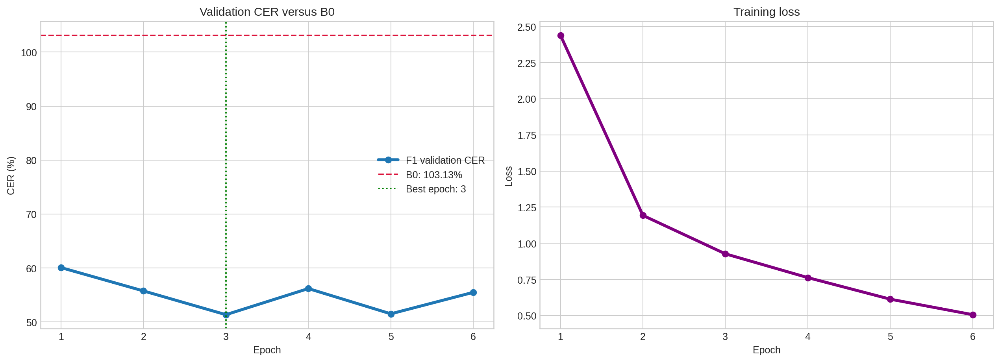

**Figure — Training versus validation.** Training loss falls steadily, but validation CER reaches its minimum at Epoch 3 and then oscillates. This is why the best validation checkpoint—not the final checkpoint—is selected.

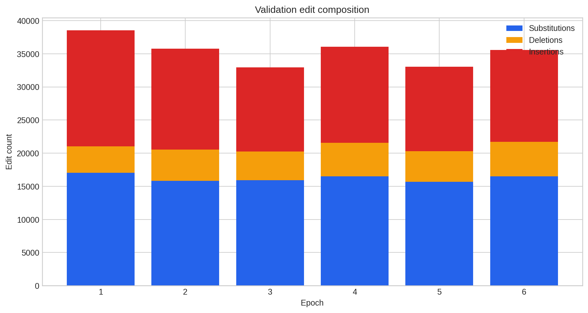

**Figure — Validation edit composition.** F1 reduces insertions strongly relative to B0, while substitutions remain the largest remaining error family at the selected epoch. The error breakdown is a diagnostic, not a change to the CER definition.

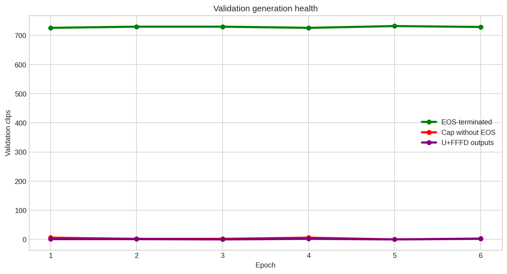

**Figure — Generation health.** At Epoch 3, 730/732 validation clips ended with EOS, two reached the generation cap, and no replacement-character outputs were recorded. This indicates that stopping behavior is no longer the dominant failure mode.

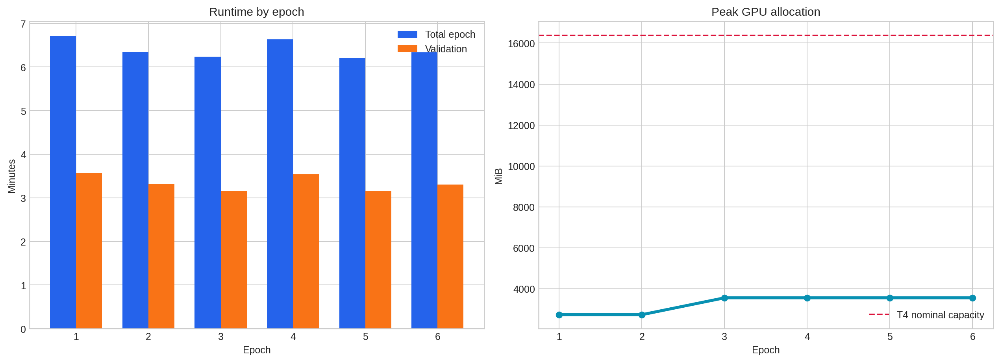

**Figure — Runtime and GPU memory.** The run stayed well within the T4 memory budget. Runtime includes training and batched validation, and is reported as an engineering measurement rather than a quality metric.

#### Validation decoding ablation

After F1, a validation-only audit supplied an explicit attention mask and modern `task="transcribe"` configuration. It reproduced the original Epoch 3 predictions exactly on all 732 clips. A declared repetition-penalty ablation reached **48.55% CER**, with insertions falling from 12,669 to 11,117 and cap hits falling from 2 to 0. A no-repeat 3-gram rule worsened CER to 53.00% and was rejected.

Epoch 3 has **32,932 edits / 64,137 reference code points**: 15,940 substitutions, 4,323 deletions and 12,669 insertions. The repetition-penalty candidate has **31,138 edits / 64,137**, under a separately tuned decoding configuration.

The aggregate F1 report is [`docs/PHASE7_F1_RESULTS.md`](docs/PHASE7_F1_RESULTS.md), with the public results notebook at [`notebooks/Phase-7-F1-Results-Public.ipynb`](notebooks/Phase-7-F1-Results-Public.ipynb).

The six recorded epoch durations sum to **2,308.25 seconds (38.47 minutes)** on a T4, including training and validation but excluding setup, checkpoint writes and restart downtime. F1 resumed after Epoch 2. The exported wall-time field of 1,528.74 seconds (25.48 minutes) covers only the final session; it is not the full-run runtime.
---

#### Phase 7 F1 repetition-penalty sweep

The [self-contained Kaggle sweep notebook](notebooks/Phase-7-F1-Repetition-Penalty-Sweep-Kaggle.ipynb) contains the declared generation settings and export cells; the [public results notebook](notebooks/Phase-7-F1-Repetition-Penalty-Sweep-Public.ipynb) reads only aggregate metrics and public plots.

The selected F1 Epoch 3 checkpoint was re-evaluated on all 732 validation clips
with a predeclared sweep of `repetition_penalty` values `1.00`, `1.02`, `1.05`,
`1.08`, and `1.10`. All other generation settings, normalization and CER
scoring remained fixed; the test set was not used.

| Penalty | Validation CER | Substitutions | Deletions | Insertions | Cap hits |
|---:|---:|---:|---:|---:|---:|
| 1.00 | 51.34634% | 15,940 | 4,323 | 12,669 | 2 |
| 1.02 | 50.88638% | 15,290 | 4,655 | 12,692 | 2 |
| 1.05 | 48.54920% | 14,785 | 5,236 | 11,117 | 0 |
| **1.08** | **48.39172%** | **14,542** | **5,739** | **10,756** | **0** |
| 1.10 | 48.48527% | 14,513 | 6,093 | 10,491 | 0 |

Penalty `1.08` is the validation-selected candidate. It reduces decoder
over-generation relative to `1.00`, but its margin over `1.05` is only 0.1575
absolute CER points. This is not a test-set result or a claim of statistically
significant generalization.

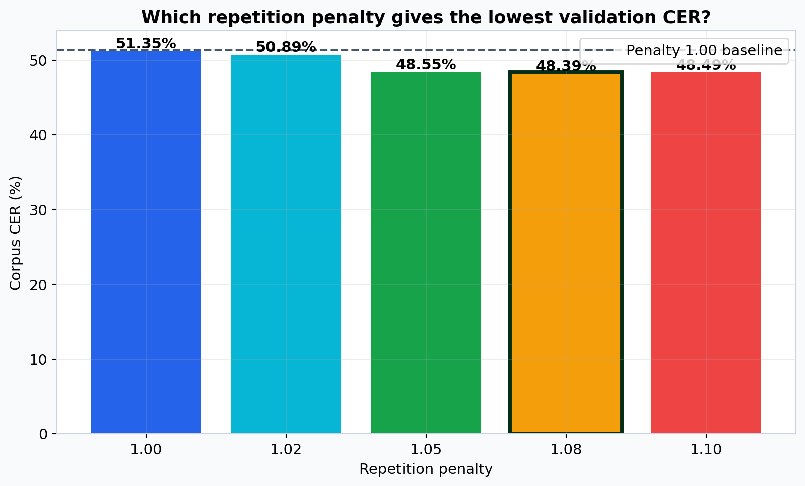

**Figure — Penalty versus CER.** Compares corpus validation CER for the declared values 1.00, 1.02, 1.05, 1.08, and 1.10; the minimum is at 1.08.

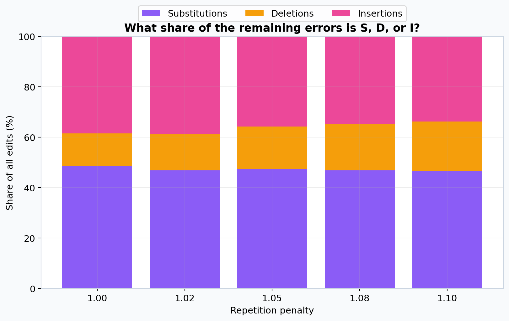

**Figure — Error composition.** Shows the trade-off among substitutions, deletions, and insertions as the penalty rises; suppressing insertions alone does not guarantee the lowest CER.

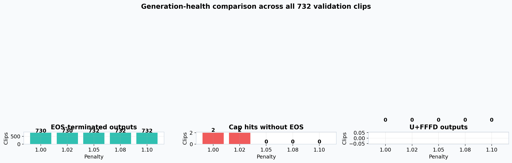

**Figure — Generation health.** Compares EOS and generation-cap behavior across the same validation clips.

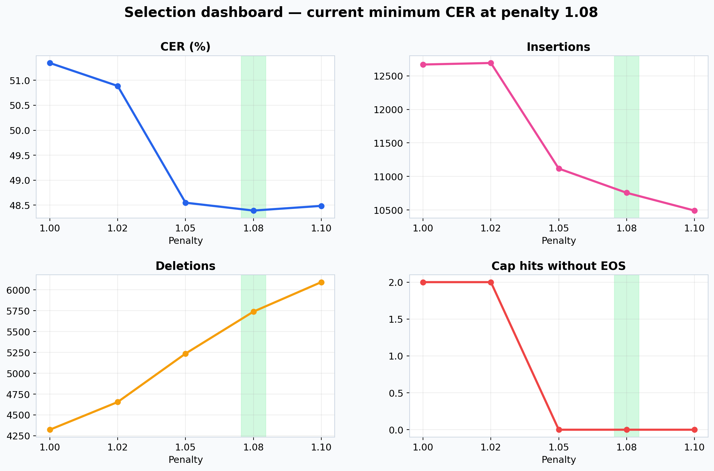

**Figure — Decoding selection dashboard.** Brings CER and generation diagnostics together for the validation-only selection at 1.08.
See the full public report at [`docs/PHASE7_F1_REPETITION_PENALTY_SWEEP_RESULTS.md`](docs/PHASE7_F1_REPETITION_PENALTY_SWEEP_RESULTS.md), aggregate data at [`docs/PHASE7_F1_REPETITION_PENALTY_SWEEP_AGGREGATE.json`](docs/PHASE7_F1_REPETITION_PENALTY_SWEEP_AGGREGATE.json), and the public notebook at [`notebooks/Phase-7-F1-Repetition-Penalty-Sweep-Public.ipynb`](notebooks/Phase-7-F1-Repetition-Penalty-Sweep-Public.ipynb).

---

#### Phase 7 F1 learning-rate mini-sweep

Two independent full-data F1 runs were completed at learning rates `5e-6` and
`2e-5`, retaining the existing `1e-5` result as the reference. Both runs used
the frozen 3,629-clip training set and 732-clip validation set, effective batch
8, FP16 AMP training, batch-8 validation, and the validation-selected
`repetition_penalty=1.08` policy. The test set was not attached or evaluated.

| Configuration | Best epoch | Validation CER | S | D | I | EOS | Cap hits |
|---|---:|---:|---:|---:|---:|---:|---:|
| `5e-6` | 3 | 51.05477% | 15,212 | 5,021 | 12,512 | 732 | 0 |
| `1e-5` reference | 3 | 48.39172% | 14,542 | 5,739 | 10,756 | 732 | 0 |
| **`2e-5`** | **5** | **47.23950%** | **14,503** | **5,583** | **10,212** | **732** | **0** |

The `2e-5` run is the current validation-selected candidate, improving the
`1e-5` reference by 1.15222 absolute CER points. Its validation CER worsened
after Epoch 5 while training loss continued to fall, so Epoch 5—not the final
Epoch 8 checkpoint—is selected. The lower-rate run peaked at Epoch 3 and then
oscillated. This was the validation-only selection decision made before the final test.

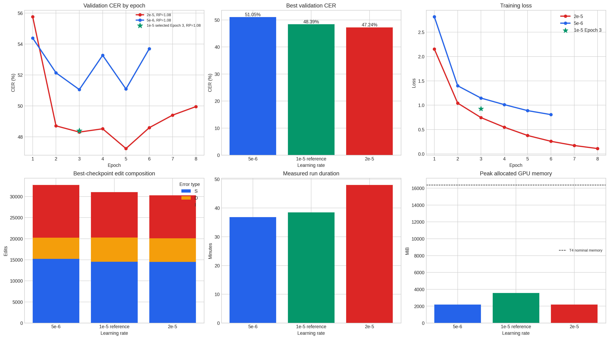

**Figure — Learning-rate comparison.** Summarizes the independently trained full-data runs; 2e-5 reached the lowest validation CER.

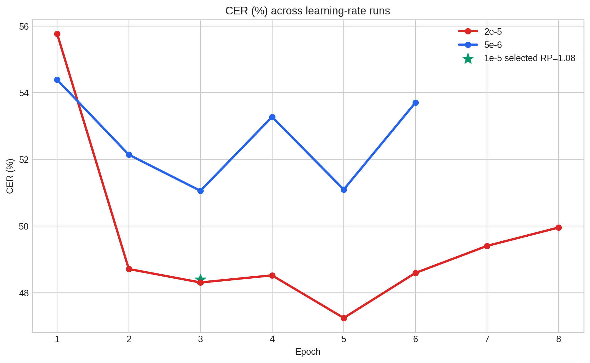

**Figure — Validation CER by epoch.** Shows why each run is selected at its best epoch instead of its final epoch.

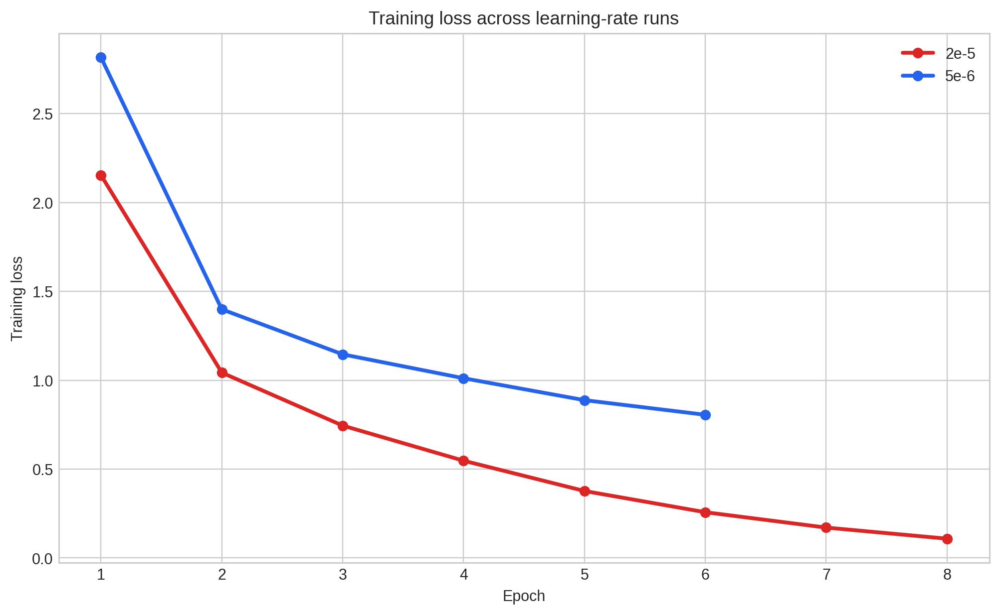

**Figure — Training loss by epoch.** Tracks optimization, while validation CER remains the model-selection criterion.

Measured runtime was 36.83 minutes for `5e-6` and 48.00 minutes for `2e-5`;
peak allocated memory was approximately 2,190 MiB for both. The executed
notebook, compact results export, and both best-checkpoint archives are indexed
below. The 14 GB archive of intermediate epoch states is omitted.

See the [learning-rate report](docs/PHASE7_F1_LR_RESULTS.md),
[aggregate metrics](docs/PHASE7_F1_LR_RESULTS_AGGREGATE.json), and [public
results notebook](notebooks/Phase-7-F1-Learning-Rate-Results-Public.ipynb).

#### Overfitting and underfitting: what the logs show

The [retrospective analysis](docs/PHASE7_OVERFITTING_UNDERFITTING_ANALYSIS.md) compares saved **training loss** with **validation corpus CER** for all three full fine-tuning runs. In the selected `2e-5` run, training loss fell from **0.377 at Epoch 5** to **0.108 at Epoch 8**, while validation CER rose from **47.24% to 49.95%**. The same broad post-best divergence appears in the other runs, although their validation curves fluctuate. This **later-epoch overfitting pattern** supports selecting the minimum-CER checkpoint and using patience-3 early stopping.

It does **not** establish that the selected Epoch 5 model was underfit, nor does it quantify a train–validation error gap: the logs contain teacher-forced training loss and free-running validation CER, which are different measures, but no training-set CER or validation loss. The selected model's later **44.57% held-out test CER** measures its performance on another partition; it was not used to revise the checkpoint choice.

### Phase 7 L1 — LoRA comparison

Three independent LoRA runs started from the pinned original checkpoint and used the same frozen 3,629/732 train/validation split, IPA normalization, CER, validation batch, and repetition penalty 1.08. The 683-clip test set remained sealed.

| Configuration | Best epoch | Validation CER | Training time | Peak allocated memory |
|---|---:|---:|---:|---:|
| Rank 8, alpha 16, LR `1e-4` | 7 / 10 | **60.68416%** | 71.872 min | 1,216.46 MiB |
| Rank 8, alpha 16, LR `2e-5` | 7 / 10 | 65.79509% | 71.568 min | 1,216.46 MiB |
| Rank 16, alpha 32, LR `1e-4` | 3 / 6 | 61.12540% | 42.844 min | 1,222.51 MiB |

**Interpretation.** LoRA is complete as a comparison but was not selected. Its best validation CER is 13.44 absolute points above full fine-tuning at `2e-5`, Epoch 5 (47.23950%). Rank 16 did not improve on rank 8 at `1e-4`; using the full fine-tuning learning rate with rank 8 also performed worse. LoRA used less GPU memory, but did not improve validation transcription quality.

The full table includes S/D/I counts and run details in [`docs/PHASE7_LORA_RESULTS.md`](docs/PHASE7_LORA_RESULTS.md). The [self-contained LoRA Kaggle notebook](notebooks/Phase-7-L1-LoRA-Self-Contained-Kaggle.ipynb) documents the run code and export workflow; [`scripts/build_phase7_lora_notebook.py`](scripts/build_phase7_lora_notebook.py) rebuilds it from the F1 trainer source. The [executed LoRA notebook](notebooks/executed/phase7/lora_sweep.ipynb) retains its output cells. No LoRA checkpoint archive was present in the supplied local downloads.

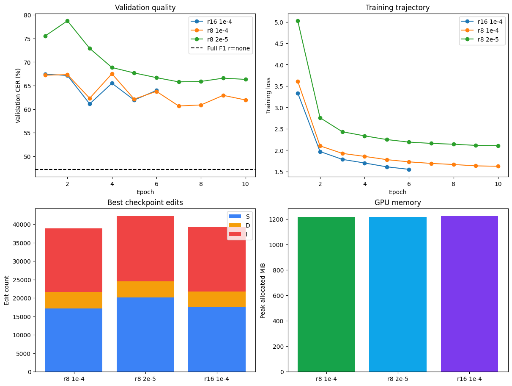

**Figure — LoRA validation comparison.** The saved aggregate plot compares validation CER, training curves, and resources across the three LoRA configurations. The rank-8, `1e-4` run is best among LoRA runs, but remains above the selected full fine-tuning CER. This is validation evidence, not a test result.

**How F1 is interpreted.** Training loss is diagnostic. The selected model is the epoch with the lowest full-validation CER. If CER stops improving for three validations, early stopping ends the run. The repetition penalty was selected on validation before the Phase 8 test comparison.

---

## 5. Final test results and discussion

### Phase 8 — final held-out test evaluation

The frozen 683-clip test bundle was prepared locally. The [self-contained Kaggle notebook](notebooks/Phase-8-Final-Sealed-Test-Kaggle.ipynb) and [matching evaluator](scripts/phase8_final_test.py) fixed two configurations before inspecting test outcomes: the original B0 zero-shot model and the validation-selected full fine-tuning checkpoint (`2e-5`, Epoch 5, repetition penalty `1.08`). The [test-bundle preparation code](scripts/prepare_phase7_test_bundle.py) checked the frozen split and packaged its audio and references outside this repository.

| Final test configuration | Corpus CER | S | D | I | EOS endings | Cap hits |
|---|---:|---:|---:|---:|---:|---:|
| B0 zero-shot | 101.23214% | 36,940 | 4,395 | 25,050 | 550 / 683 | 133 |
| Selected F1 | **44.57355%** | 13,525 | 6,158 | 9,547 | 683 / 683 | 0 |

The selected model reduces test CER by **56.66 absolute points** relative to B0. Insertions fall from 25,050 to 9,547, and all 683 selected-model outputs end with EOS. Deletions rise from 4,395 to 6,158, so the model still makes meaningful transcription errors. The saved prediction rows were checked against the frozen test manifest and rescored; no inference was rerun for this publication.

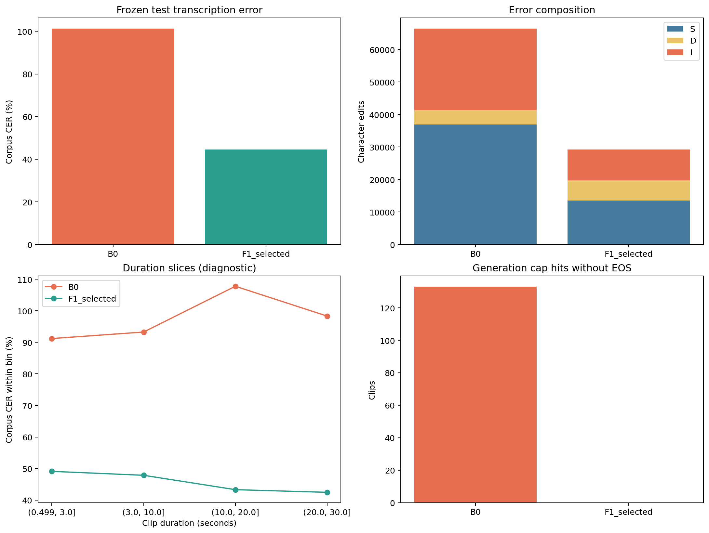

**Figure — Final sealed-test comparison.** The panels show overall CER, S/D/I composition, duration-range CER, and generation-cap failures. Duration slices are diagnostic; corpus CER is the primary score. See the [Phase 8 report](docs/PHASE8_RESULTS.md), [aggregate JSON](docs/PHASE8_RESULTS_AGGREGATE.json), [original executed Kaggle notebook](notebooks/executed/phase8/final_sealed_test.ipynb), and [compact results notebook](notebooks/Phase-8-Final-Test-Results-Public.ipynb).

### 5.1 Interpretation

The selected full fine-tuned configuration reduced test CER by 56.66 percentage points relative to the zero-shot baseline and ended every test generation normally. It is a strong first research baseline for the declared Nyishi Narration task, not a claim of production-ready transcription. Insertions and substitutions fell, while deletions increased; the remaining 44.57% CER and the absence of expert label adjudication limit conclusions about linguistic accuracy and transfer to other domains. The test was opened after validation selection and is not used for additional tuning.

#### Examples of individual test outcomes

The table and expandable examples below show **18 complete dataset references, 18 B0 zero-shot outputs, and 18 final F1 outputs** on the **same matched test clips**. The saved NFD-normalized strings, S/D/I counts and CER were checked against the Phase 8 archive. No model was changed using these clips. IDs, audio, speaker metadata and provenance are omitted.

The set was deliberately selected after the test to span low and high clip CER, short and longer recordings, one B0 cap hit, and two examples where F1 is worse. It is **illustrative, not a random or representative sample**; the primary result remains corpus CER over all 683 test clips. A positive change below means B0 CER minus F1 CER.

| Example | Duration | Reference code points | B0 CER | Final F1 CER | Change | B0 cap hit |
|---:|---:|---:|---:|---:|---:|---|
| 01 | 1.96 s | 31 | 35.48% | 16.13% | +19.35 pp | No |
| 02 | 9.73 s | 45 | 33.33% | 15.56% | +17.78 pp | No |
| 03 | 14.25 s | 93 | 51.61% | 19.35% | +32.26 pp | No |
| 04 | 3.17 s | 30 | 126.67% | 26.67% | +100.00 pp | No |
| 05 | 8.90 s | 98 | 60.20% | 39.80% | +20.41 pp | No |
| 06 | 9.80 s | 112 | 88.39% | 25.89% | +62.50 pp | No |
| 07 | 2.00 s | 22 | 95.45% | 54.55% | +40.91 pp | No |
| 08 | 7.95 s | 111 | 60.36% | 42.34% | +18.02 pp | No |
| 09 | 16.22 s | 122 | 76.23% | 41.80% | +34.43 pp | No |
| 10 | 20.36 s | 139 | 65.47% | 43.88% | +21.58 pp | No |
| 11 | 4.01 s | 44 | 36.36% | 77.27% | -40.91 pp | No |
| 12 | 11.98 s | 102 | 96.08% | 60.78% | +35.29 pp | No |
| 13 | 15.14 s | 126 | 94.44% | 61.90% | +32.54 pp | No |
| 14 | 2.66 s | 32 | 90.62% | 84.38% | +6.25 pp | No |
| 15 | 9.18 s | 66 | 84.85% | 80.30% | +4.55 pp | No |
| 16 | 15.27 s | 131 | 99.24% | 83.21% | +16.03 pp | No |
| 17 | 4.70 s | 27 | 59.26% | 166.67% | -107.41 pp | No |
| 18 | 16.03 s | 75 | 518.67% | 130.67% | +388.00 pp | Yes |

##### Full paired transcriptions

Example 01 — 1.96 s; B0 35.48%, final F1 16.13%

**Dataset reference:** `ŋo so piɟikal diparment pori do`

**B0 zero-shot prediction:** `mozopizikel depamentso porido`

**Final fine-tuned prediction:** `ŋoso piɟikel diparmentso porido`

**Edit counts:** B0 S/D/I = 5/4/2; final F1 S/D/I = 1/2/2. B0 EOS: yes; final F1 EOS: yes.

**Reading:** F1 has fewer edits than B0, while substitutions, deletions or insertions remain.

Example 02 — 9.73 s; B0 33.33%, final F1 15.56%

**Dataset reference:** `ane suilo ane pajilo dente teminko ale nikune`

**B0 zero-shot prediction:** `ne suʒilou anepoiʒilou dintɛ temiko alɛni kunɛ`

**Final fine-tuned prediction:** `ane suɨjilo o ane bajilo dente teminko aleni kune`

**Edit counts:** B0 S/D/I = 8/3/4; final F1 S/D/I = 1/1/5. B0 EOS: yes; final F1 EOS: yes.

**Reading:** F1 insertions exceed its other edit types combined; extra output remains a visible failure mode.

Example 03 — 14.25 s; B0 51.61%, final F1 19.35%

**Dataset reference:** `ɟun nam marcam am am biɟo nopa aldo ho marc epril meŋam meŋam meŋas rule ŋul ɟunam am am dido`

**B0 zero-shot prediction:** `dʒun maɾxam abam biʝonapaldo maɾx epɾelmẽɣa nẽɣa sɾolãgul dʒunam am ðjɾo`

**Final fine-tuned prediction:** `ɟunnam maːrcəm abam biɟunə paldo ho marʈ hepril meŋəm meŋəm meŋəs role ŋul ɟunəm am am dido`

**Edit counts:** B0 S/D/I = 28/19/1; final F1 S/D/I = 12/4/2. B0 EOS: yes; final F1 EOS: yes.

**Reading:** F1 has fewer edits than B0, while substitutions, deletions or insertions remain.

Example 04 — 3.17 s; B0 126.67%, final F1 26.67%

**Dataset reference:** `ma ŋulo ho pagoa ŋo bende lama`

**B0 zero-shot prediction:** `maɪː˧˥mɔː˧˥loː˧˥hɔː˧˥ paːguaː˧˥muː˧˥ bjɛn˥˩˧tɛl maɪː˧˥`

**Final fine-tuned prediction:** `maːŋulo ho paɡoaːm ŋo bendrla maː`

**Edit counts:** B0 S/D/I = 14/0/24; final F1 S/D/I = 3/1/4. B0 EOS: yes; final F1 EOS: yes.

**Reading:** F1 has fewer edits than B0, while substitutions, deletions or insertions remain.

Example 05 — 8.90 s; B0 60.20%, final F1 39.80%

**Dataset reference:** `ama dedub lod̪a lik bohel mulɡe pas moinaŋəm pas moinaŋəm mule pura aməm pel nalde pule amcerlendo`

**B0 zero-shot prediction:** `amɛdɛduɠlo daɫik bolhɛmuɫgɛ pasmɔjnɛᵑɛm pasmɔjnɛᵑɛlɛmɛlɛmɛlɛmɛlɛmɛl pɔblɛdko ɛmtɛɾlɛndo`

**Final fine-tuned prediction:** `amədə dublo likbol həm mulge pas moɪnaŋəm pas moɪnaŋəm pas moɪnaŋəm pijəl nardəpublɯk həmcir lendo`

**Edit counts:** B0 S/D/I = 48/11/0; final F1 S/D/I = 23/8/8. B0 EOS: yes; final F1 EOS: yes.

**Reading:** F1 has fewer edits than B0, while substitutions, deletions or insertions remain.

Example 06 — 9.80 s; B0 88.39%, final F1 25.89%

**Dataset reference:** `mul sopa padɔm sopa masina madohəm mule sapa pandub mado hoɡe sinəme simɯ pardob nəma kalaɡe hai hara mananedodo`

**B0 zero-shot prediction:** `mulˌsaːpˌaːpˌaːdɐmˌsaːpˈama sinˌɛmˌaːdɐwˌhɐmulˈaːsˌaːpˈaːpˌaːnˌduːmˌaːdɐwˌhɔgɐ siːnˈnˌeːmˌeːsˌeːmˌɐlɐpˈɐɾnduːkˌ neːmˌeːkɐlɐmˌgɐ ɦɾɐmˈaːnˌaːlɐnˌeː dɔˈdɔːdɔː`

**Final fine-tuned prediction:** `mul səpa padəm səpa məsinəm mado həm mule səpa mandub mado hoɡe sineməm siməməl siməpərndob nəma kalam ɡahara manale dodo`

**Edit counts:** B0 S/D/I = 56/0/43; final F1 S/D/I = 14/3/12. B0 EOS: yes; final F1 EOS: yes.

**Reading:** F1 has fewer edits than B0, while substitutions, deletions or insertions remain.

Example 07 — 2.00 s; B0 95.45%, final F1 54.55%

**Dataset reference:** `mah mule heb madu mule`

**B0 zero-shot prediction:** `mɑm mɪlɛhɛ biːd ʒyːdnumɑdɛ wɯl`

**Final fine-tuned prediction:** `maː mule habijet momado`

**Edit counts:** B0 S/D/I = 11/1/9; final F1 S/D/I = 11/0/1. B0 EOS: yes; final F1 EOS: yes.

**Reading:** F1 has fewer edits than B0, while substitutions, deletions or insertions remain.

Example 08 — 7.95 s; B0 60.36%, final F1 42.34%

**Dataset reference:** `nokəm niŋe mulɡa text̪a mulu ɡinəm inaməm muluɡ denəm tinaməm noh tot̪ab apa ekdom mulpa pajalinco nampali ɟido`

**B0 zero-shot prediction:** `no kamɲiŋa mulgɑrtexta mululuginam unamamuluk dɛnam tɾinam amnotata ɓɑpɑ ɛtɗɔmulpɑjlɛntʃon nɑmɑlidʒɑm ɓɑlidʒɑm ɓɑpɑdɔ`

**Final fine-tuned prediction:** `nokam ɲiŋe mul gef tekʰ t̪aːb ŋulu ɡinəm unam unaməm denəm tenəm t̪anəməm no t̪at̪ab pa edum mumpajelinson nəm palicɔp`

**Edit counts:** B0 S/D/I = 35/13/19; final F1 S/D/I = 24/8/15. B0 EOS: yes; final F1 EOS: yes.

**Reading:** F1 has fewer edits than B0, while substitutions, deletions or insertions remain.

Example 09 — 16.22 s; B0 76.23%, final F1 41.80%

**Dataset reference:** `ŋo e aːrt̪em cjɔgʌ mɔ paːs baːɟe saːre paːs baːɟe gɔrʌb laːjel ɔgmo hɔŋhoroŋo ɨd̪ɔ rɔŋo uɪlaːjl or naː laːjel mosɪ opjud̪o`

**B0 zero-shot prediction:** `ɡuɛ ɑɾkɛɴ tʃoka ɡuɛ pɑsɛbɑ ʄi sɑɾipa sɔɾɑɓɛl ɔɓɛl ɦoɛᵑɛɾɔᵑɛɛ ɦoɛ ɦoɔᵑɛɾɔᵑɛ ɦoɛ ɔnɑnɛlɛ mɔsi ɔpjɔbɔ`

**Final fine-tuned prediction:** `ŋɔ iː ɪ aːrtəm ɟjoge ŋo pas baɟi sari pasa baɟi korəblajel hoŋo hoŋo roŋo roŋo udo roŋo ulajil o nalajel mosi opijedo`

**Edit counts:** B0 S/D/I = 67/25/1; final F1 S/D/I = 28/14/9. B0 EOS: yes; final F1 EOS: yes.

**Reading:** F1 has fewer edits than B0, while substitutions, deletions or insertions remain.

Example 10 — 20.36 s; B0 65.47%, final F1 43.88%

**Dataset reference:** `oge so esco debləpment oge so roŋo nampo e mane egrikalcaram oʃe mədot məto e mane he plantiʃon hugub məta e iskim iskim nalal məte saɟeʃən`

**B0 zero-shot prediction:** `oɠe soɛsʃo doblɛmɛnto ɔgɛso ɛ ɾɔmɔnɛm po iɛ manɛ eɣɾikɑl tʃɛɾɛm ɔmʃɛmɔdɔtɔ mɛto iɛ manɛ ɛhɛlɛnti sɔn hɔgumɛtɛlɛn hɑm manɛ ɪskɛm sɪskɛm nɑlɛl hɛmɛt kɑhɛsɑ sɪsɔn sɪtɔ`

**Final fine-tuned prediction:** `oge soesco sobes ɟo doblument hoge so roŋonam po iː mane egrikal cʰaram ocemodot mədok meʈo iː mane ehe plan tison hogu matailen ham mane iskim siskin nalel həb`

**Edit counts:** B0 S/D/I = 58/4/29; final F1 S/D/I = 16/12/33. B0 EOS: yes; final F1 EOS: yes.

**Reading:** F1 insertions exceed its other edit types combined; extra output remains a visible failure mode.

Example 11 — 4.01 s; B0 36.36%, final F1 77.27%

**Dataset reference:** `pebuari tonti por se tonti siks tək ɲokɯm am`

**B0 zero-shot prediction:** `tʃeboarɨ tontʃi poɾsiɛ tontʃi sɪkstak jokumam`

**Final fine-tuned prediction:** `peboəri t̪ot̪ʰɔt̪ʰiː pɔrse t̪o t̪ɔncɪ sɪsɪst̪a kʰɔnjokumən`

**Edit counts:** B0 S/D/I = 11/2/3; final F1 S/D/I = 16/2/16. B0 EOS: yes; final F1 EOS: yes.

**Reading:** F1 makes more edits than B0 on this clip. This counterexample prevents treating the aggregate gain as universal.

Example 12 — 11.98 s; B0 96.08%, final F1 60.78%

**Dataset reference:** `porilehi asamo bakma porlai malal eiɡo hora aʔkaləm pirnəm bareŋəm mara cenu pare porilai hoɡe cint̪ai`

**B0 zero-shot prediction:** `poriʎi bolgiŋa asama paqomadu poɾleʃtuʃiʋɔʋɔʋɔʋɔʋɔʋɛl ɛlgoʊɦɾɑ ʔɑtɯʋɔnɔɔm ʋɑɾɛgɛmʊʋɔɾɛgɛmʊ ʋɑɾɛgɔmɛrɔʃɛndu pɑɾɛporiʎɛlɔgɾui ʋɛnʃiʋɛnɛtʃiʋɛ`

**Final fine-tuned prediction:** `pori lehi bolniŋa asa pak ŋado por lehtut̪is maɡku ohab male el ko hara aʔi nampinəm bareŋəm cenup pori lai hoɡlui`

**Edit counts:** B0 S/D/I = 60/1/37; final F1 S/D/I = 16/17/29. B0 EOS: yes; final F1 EOS: yes.

**Reading:** F1 has fewer edits than B0, while substitutions, deletions or insertions remain.

Example 13 — 15.14 s; B0 94.44%, final F1 61.90%

**Dataset reference:** `lokəl dubai ded̪am aiko alpa həm dekəm bulom mahəmso osai tomahəb d̪aika aico alaɡe dohəmho maledo lokəl hamo aicodeməm laɡido`

**B0 zero-shot prediction:** `lo kando waɗɛnɛmɑɗi ɛɗɛlɛlɛlɛl pɑlɛlɛl mɑɑ mɑɗɛ kɛmɑlumɛl ɛɑmɑ hɛlɛlɛl tɔ ɛsɑjɛtɛpɪk tɔɔmɑ hɑmɑ ɑl kɛmɔ mɪlɛl ɔlɔ kɛlɛlɛmɛl mɑ mɔ mɔ ɛtʃɛmɗɛnɑm ɛlɛkidɑ`

**Final fine-tuned prediction:** `lokendu bedena mədi eiko alpa hamdik bulum dihamahem hamdolom dihamahem do asaipito amahaŋo ecub laɡido həmmo maledho loket ho hemhəm ŋɔ`

**Edit counts:** B0 S/D/I = 92/1/26; final F1 S/D/I = 36/16/26. B0 EOS: yes; final F1 EOS: yes.

**Reading:** F1 has fewer edits than B0, while substitutions, deletions or insertions remain.

Example 14 — 2.66 s; B0 90.62%, final F1 84.38%

**Dataset reference:** `alɟiba pura akma skul e kam alma`

**B0 zero-shot prediction:** `alʒgib`

**Final fine-tuned prediction:** `alɡe ba`

**Edit counts:** B0 S/D/I = 1/27/1; final F1 S/D/I = 2/25/0. B0 EOS: yes; final F1 EOS: yes.

**Reading:** F1 deletions are its largest edit type; it omits part of the reference.

Example 15 — 9.18 s; B0 84.85%, final F1 80.30%

**Dataset reference:** `komlaŋ ŋo si əki dena xeti to ŋul si tikma mana istatiŋ eicemab ie`

**B0 zero-shot prediction:** `kwamlɑŋ ɛmɑlɯʃiɛ ɑkiɾɑnɑ hɛtɪtɑ sɑm mʊlʃi ɑhɛɑvɑ tiʃ mɑmɑ nɑ ɛstɑ tɛnʋɑ tʃɑmɑ viɦɛ`

**Final fine-tuned prediction:** `komɛmləŋe ŋaŋoŋ siː akiː rana hetɨ t̪usa sam ŋul sija əjab tik məmana satik məma mana satin məcema bi`

**Edit counts:** B0 S/D/I = 38/1/17; final F1 S/D/I = 12/3/38. B0 EOS: yes; final F1 EOS: yes.

**Reading:** F1 insertions exceed its other edit types combined; extra output remains a visible failure mode.

Example 16 — 15.27 s; B0 99.24%, final F1 83.21%

**Dataset reference:** `mule pɛstɪsʌɪde kom juːz mado topom kadub pat̪a d̪amub mado mula kapopəm mado hoɡe muluɡe moha mara lekiŋəm moha bura eniŋəm mahate`

**B0 zero-shot prediction:** `mulɛpɛstisɛ ɛzɛpɛfɛ ɛkɛmɛjɔdʒmɔ mɛmɛdɔhɔl ɛtɔpɛmɛkɑdɔ patɑdɑ mɛmɑdɛ mɛnɛ tɑpɔ kɔmɛdɔ ɔgɛ hɔnɛgɑ maɦɑ mɑɦɑ lɛlɛkɛnɛ buɦɑ brɑlɛlɛ lɛlɛ ɪnjɛ mlɛnjɪ kɔ maɦɑɛtɛdɔ hɔ tɔpɑdɛd kɔulɛkw`

**Final fine-tuned prediction:** `ŋule pestisaːʈisaːɪzəb u akəm ɨuɟ məmaːd̪o ŋul sɪto pəmkado pata d̪a mamad̪ab məmaːd̪ab ŋule t̪apo kəmado hoɡe məleɡe məha mara lakiŋəm buhə bura leleleb aɲiŋɔm leɪniŋəm likɔ mahadu ho topo d̪ad̪adkuɬlik`

**Edit counts:** B0 S/D/I = 81/2/47; final F1 S/D/I = 29/4/76. B0 EOS: yes; final F1 EOS: yes.

**Reading:** F1 insertions exceed its other edit types combined; extra output remains a visible failure mode.

Example 17 — 4.70 s; B0 59.26%, final F1 166.67%

**Dataset reference:** `sat sati xosa e taŋari taŋe`

**B0 zero-shot prediction:** `sa sati osaiia ɗuani alita iɾi`

**Final fine-tuned prediction:** `saːtʰ saːtʰ saːtʰiː ho saː iː ɪ aːnd̪ kaːn naːliː t̪aːɲɔrjʊt̪aːjʈ`

**Edit counts:** B0 S/D/I = 7/3/6; final F1 S/D/I = 7/0/38. B0 EOS: yes; final F1 EOS: yes.

**Reading:** F1 makes more edits than B0 on this clip. This counterexample prevents treating the aggregate gain as universal.

Example 18 — 16.03 s; B0 518.67%, final F1 130.67%

**Dataset reference:** `oririminko alenikunde anesujine anepajilo sominkokuŋe nermin kuŋe alenikune`

**B0 zero-shot prediction:** `ɔmɔl ɔfɑti ɗɑiɛ ɔmɔn ɑlbɛ mʄɛlɛjɑ ɔsɑ sɑmɔl pɹɑ ɛklɛl ɦɑpɛtɔ ɔ kɛɔn ɔ tɑbiɛn mɔ ɛvɛl ɔmɔl tsɔkɛɛl mɔl ɦɑ kɑm kɛl kɛl kɛl kɛl kɛl kɛl kɛl kɛl kɛl kɛl kɛl kɛl kɛl kɛl kɛl kɛl kɛl kɛl kɛl kɛl kɛl kɛl kɛl kɛl kɛl kɛl kɛl kɛl kɛl kɛl kɛl kɛl kɛl kɛl kɛl kɛl kɛl kɛl kɛl kɛl kɛl kɛl kɛl kɛl kɛl kɛl kɛl kɛl kɛl kɛl kɛl kɛl kɛl kɛl kɛl kɛl kɛl kɛl kɛl kɛl kɛl kɛl kɛl kɛl kɛl kɛl kɛl kɛl kɛl kɛl kɛl kɛl kɛl kɛl kɛl kɛl`

**Final fine-tuned prediction:** `oɡatid̪a iː əmulab malaje hoso so so pula eklael hab bato oke oke ŋun ŋun tʰɔu mulsike ŋul mul nulu kam kiɯba mat hoɟujen pili`

**Edit counts:** B0 S/D/I = 52/0/337; final F1 S/D/I = 47/0/51. B0 EOS: no; final F1 EOS: yes.

**Reading:** B0 reached the generation cap without EOS; F1 ended with EOS and made fewer edits, though it remains inaccurate.

The references have not been independently adjudicated by a Nyishi expert, and no English translations are claimed. CER above 100% is possible when insertions exceed the reference length. For a standalone copy with the selection and scoring notes, see the [18-pair gallery](docs/PHASE8_PAIRED_TRANSCRIPTION_EXAMPLES.md).
### 5.2 Post-hoc dataset and final-test EDA

The [self-contained EDA notebook](notebooks/Phase-8-Descriptive-EDA-Public.ipynb) joined the **saved** B0 and selected-F1 test predictions to the unchanged frozen manifests. It verified manifest hashes, ZIP integrity, all 683 references per model, and the published S/D/I and generation totals before calculating the slices below. **No inference, training, checkpoint selection, or decoding change occurred.** Every subgroup CER is the sum of edits divided by the sum of reference code points *within that subgroup*, rather than an average of clip CERs. The [full aggregate report](docs/PHASE8_DESCRIPTIVE_EDA.md), [JSON](docs/PHASE8_DESCRIPTIVE_EDA_AGGREGATE.json), and [CSV tables](docs/phase8_eda_tables/) contain the detailed denominators.

#### Dataset preparation and split composition

| Versioned view or frozen partition | Clips | Hours | Independent components | Median duration |
|---|---:|---:|---:|---:|
| Narration master | 6,718 | — | — | — |
| Rows with a reference | 5,651 | — | — | — |
| Phase 1 candidates | 5,086 | — | — | — |
| Frozen train | 3,629 | 10.8516 | 15 | 9.76 s |
| Frozen validation | 732 | 1.8818 | 16 | 7.46 s |
| Frozen test | 683 | 1.8911 | 13 | 8.89 s |

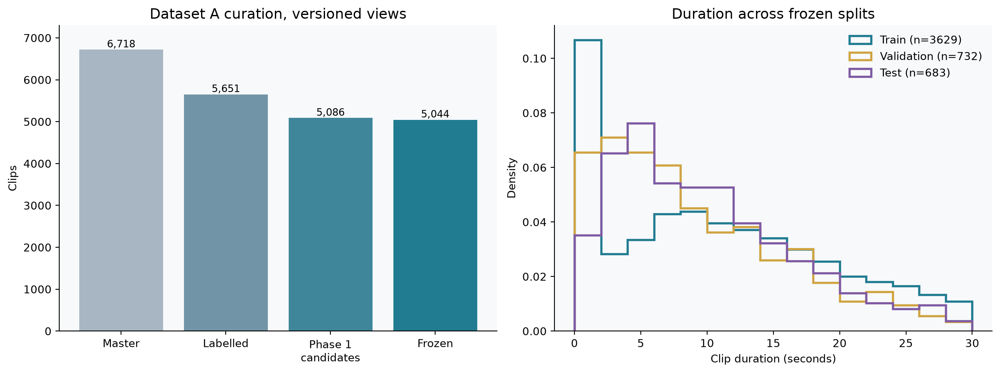

**Figure — Dataset flow and durations.** The left panel follows the versioned views from the full Narration master to the 5,044 frozen clips; the right panel compares duration distributions across train, validation, and test. These stages describe successive eligibility and split decisions, not interchangeable sample counts or a claim that excluded source rows were deleted.

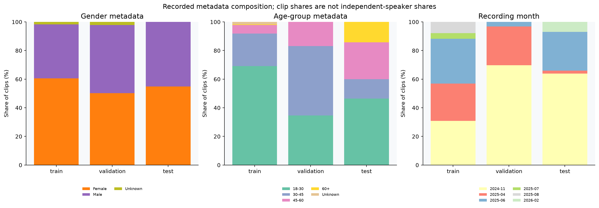

**Figure — Split composition.** Clip shares differ by recorded gender, age group, and recording month. In particular, 60+ appears in **17 training clips (0.5%)** and **97 test clips (14.2%)**. These are clip shares, not independently sampled speaker shares; the demographic labels have not been separately adjudicated. This imbalance is relevant when interpreting test subgroups.

#### Overall test errors and clip-level variation

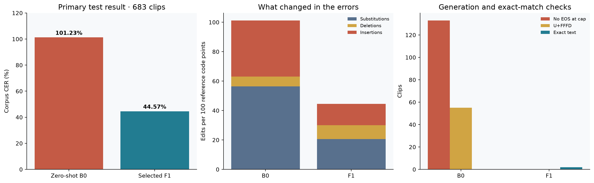

**Figure — Primary result and error composition.** On the same 683 test clips and 65,577 reference code points, corpus CER falls from **101.23% (B0)** to **44.57% (selected F1)**. Substitutions and insertions fall substantially; deletions rise. F1 has zero cap hits and replacement-character outputs, but only two exactly matching full transcripts. Error-rate improvement therefore does not mean that complete transcripts are usually error-free.

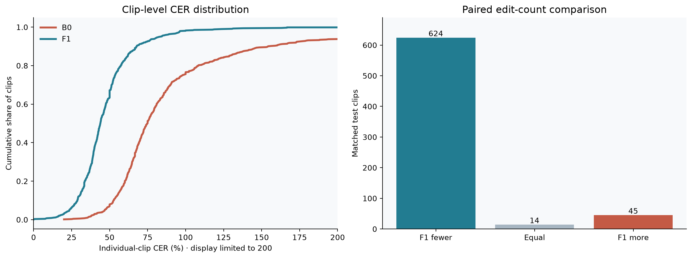

**Figure — Variation behind the corpus score.** The cumulative curves show a broad shift toward lower per-clip CER after fine-tuning. F1 makes fewer edits than B0 on **624 clips**, the same number on **14**, and more on **45**. This paired count is descriptive; corpus CER remains the primary score. The displayed CER axis stops at 200%, with higher-CER clips still included in every aggregate.

#### How many test clips meet a CER threshold?

For each clip, **clip CER = 100 × (substitutions + deletions + insertions) / reference code points**. The thresholds below are strict: a clip at exactly 50% is excluded from the `<50%` count. These clip shares complement the character-weighted **corpus CER**, which remains the primary result. The [aggregate JSON](assets/phase8/clip_cer_distribution/clip_cer_distribution_aggregate.json) and [commented calculation code](scripts/phase8_clip_cer_distribution.py) were produced from the two saved Phase 8 prediction files; no inference or tuning was run.

| Clip CER | B0 clips | B0 share | Selected F1 clips | Selected F1 share |
|---|---:|---:|---:|---:|
| **<25%** | 1 / 683 | 0.15% | **41 / 683** | **6.00%** |
| **<50%** | 47 / 683 | 6.88% | **432 / 683** | **63.25%** |
| **<75%** | 341 / 683 | 49.93% | **631 / 683** | **92.39%** |
| **<100%** | 515 / 683 | 75.40% | **669 / 683** | **97.95%** |
| **≥100%** | 168 / 683 | 24.60% | **14 / 683** | **2.05%** |

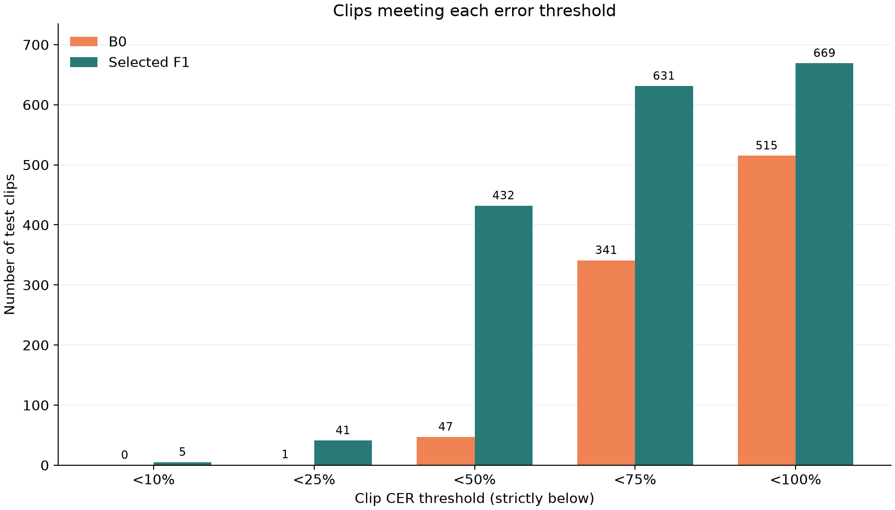

**Figure — Threshold counts.** Fine-tuning moves many clips below 50% CER: **432**, compared with **47** for B0. A threshold is a descriptive cutoff, not an accuracy score or model-selection rule.

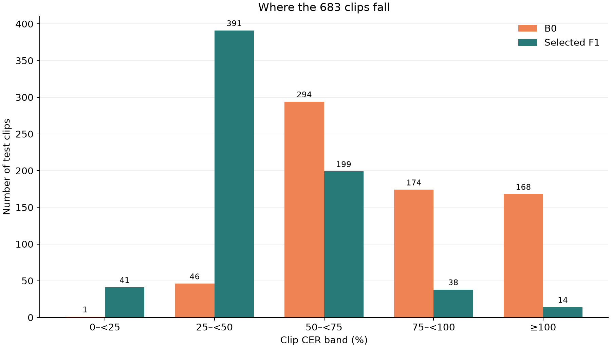

**Figure — Exclusive error bands.** Each clip appears in exactly one band, so each model’s bars total **683**. The selected model still has **14 clips at or above 100% CER**, where edits equal or exceed reference length.

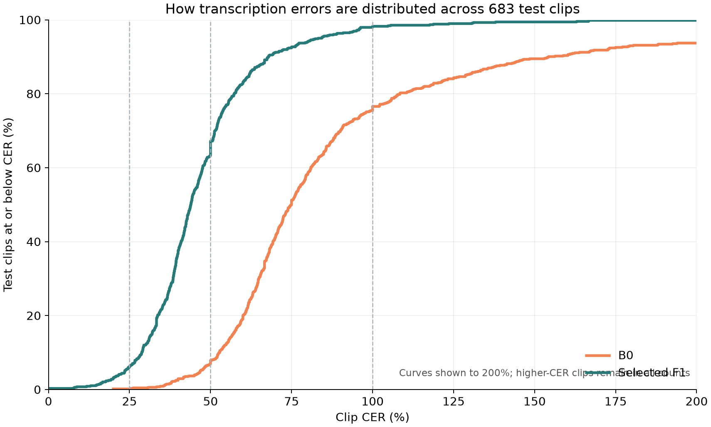

**Figure — Cumulative clip CER.** At any point on the horizontal axis, the curve shows the percentage of clips with CER at or below that value. The plotted axis stops at 200% to keep the main distribution readable; the higher-error clips remain in the threshold table and aggregate JSON.

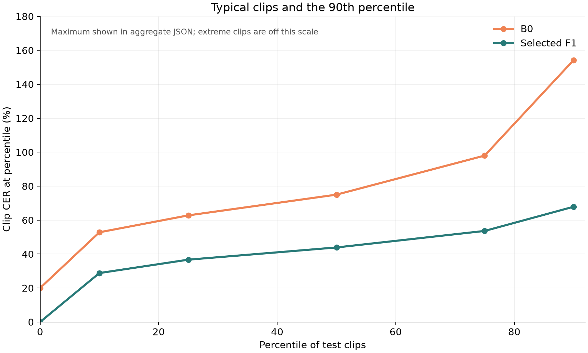

**Figure — Median and upper-tail errors.** Median clip CER drops from **75.00% (B0)** to **43.90% (F1)**; the 90th percentile drops from **154.23%** to **67.87%**. The figure stops at the 90th percentile because a few very short-reference clips have extremely high percentages. Quantiles give every clip equal weight, unlike corpus CER.

#### CER versus duration and reference length

| Test duration | Clips | F1 corpus CER |
|---|---:|---:|
| 0.5–3 s | 94 | 49.10% |
| >3–6 s | 148 | 50.03% |
| >6–10 s | 145 | 46.45% |
| >10–20 s | 234 | 43.29% |
| >20–30 s | 62 | 42.46% |

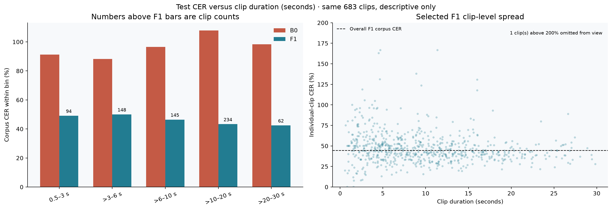

**Figure — CER versus clip duration.** The bars compare B0 and F1 corpus CER within five duration bins; the scatter shows the selected model's individual-clip spread. In this test partition the shortest bins have higher F1 CER than the 20–30-second bin. One clip above 200% is hidden from the zoomed scatter **only** and remains in the bars and totals. Duration, transcript length, speaker, and recording conditions can overlap, so the plot does not isolate a causal duration effect.

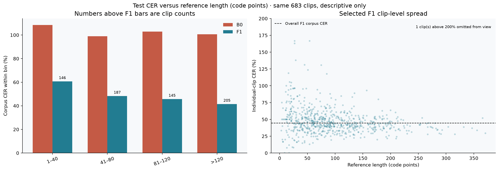

**Figure — CER versus reference length.** F1 reaches **60.71% CER** on 1–40-code-point references, versus **41.51%** above 120 code points. Errors in a short reference have a large percentage effect because its denominator is small. Reference length and audio duration are related; these are diagnostic bins under the original NFD code-point metric, not a revised scoring policy.

#### Recorded demographic and context slices

| Test metadata | Clips | Independent components | F1 corpus CER |
|---|---:|---:|---:|
| Female | 375 | 6 | 44.36% |
| Male | 308 | 7 | 44.86% |
| Age 18–30 | 317 | 3 | 45.78% |
| Age 30–45 | 93 | 3 | 43.36% |
| Age 45–60 | 176 | 5 | 41.48% |
| Age 60+ | 97 | **2** | 48.98% |

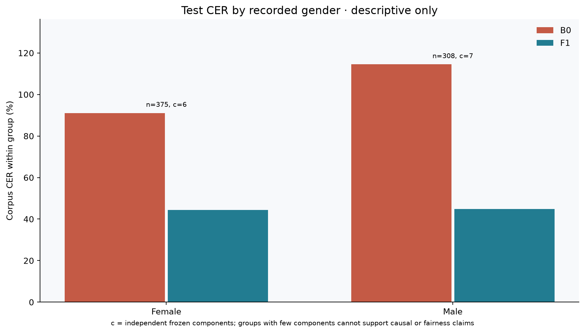

**Figure — Recorded gender slices.** The selected model's female and male corpus CERs are close in this split, with six and seven independent components respectively. The figure describes these recordings; it does not establish demographic parity for the wider population.

**Figure — Recorded age-group slices.** Each bar includes its clip and component counts. The 60+ slice has the highest observed F1 CER here, but it contains only two independent components and differs from training representation. These data cannot establish an age effect or its cause.

**Figure — Recording context diagnostics.** Month and domain values vary, but most named categories are represented by just **one component**. They are useful descriptions of particular recordings and should not be ranked as general domain performance. Test education metadata are entirely `Unknown` and were not analyzed.

All these comparisons are **post-hoc test descriptions**. They strengthen the report's account of where errors remain; they cannot be used to choose a different model, decoding penalty, or data split. The EDA report also includes a paired component-resampling interval, explicitly limited by the test set's 13 components.

---

## 6. Reproducibility and project materials

### 6.1 Where to start

For a compact result, open the [learning-rate public results notebook](notebooks/Phase-7-F1-Learning-Rate-Results-Public.ipynb). The [executed-notebook index](notebooks/executed/README.md) contains Kaggle downloads with saved output cells, and the [artifact index](artifacts/README.md) lists checkpoints and result archives. To reproduce training with authorized inputs, follow the [learning-rate Kaggle run guide](docs/PHASE7_F1_LR_KAGGLE_RUN.md) and [self-contained notebook](notebooks/Phase-7-F1-Learning-Rate-Mini-Sweep-Kaggle.ipynb). Training and inference were not rerun for this publication.

### 6.2 Executed notebooks and saved artifacts

The [executed-notebook index](notebooks/executed/README.md) links nine downloaded Kaggle notebooks with saved output cells, from Phase 4 through the final test. These are saved run evidence, not reruns performed for this publication. The [artifact index](artifacts/README.md) lists result exports and available selected checkpoints. Plots used in this README are also ordinary image files under `assets/`.

The [Phase 8 descriptive EDA notebook](notebooks/Phase-8-Descriptive-EDA-Public.ipynb) is a separate **local** analysis of saved predictions. It includes Markdown explanations, commented cells, progress output, and embedded aggregate figures; no GPU or new test inference is required. The [report and presentation handoff](docs/REPORT_PRESENTATION_HANDOFF.md) provides the full chronology, recommended figure set, source links, and a claims checklist.

### 6.3 Run records and artifact access

- Pin the model revision and compatible package versions in the Kaggle notebooks.
- Record seed, GPU, package versions, data/configuration hashes, optimizer steps, runtime, memory, and checkpoint paths.
- This public repository includes the supplied executed Kaggle notebooks, selected checkpoint archives through Git LFS, and saved run-result archives at the project owner's request. Some exported notebooks and archives contain prediction-level text, identifiers, and training state.
- Raw dataset audio, frozen manifests, source shards, interrupted downloads, and the full 14 GB per-epoch learning-rate archive are not copied into this repository. The best learning-rate checkpoints and compact results are retained separately.

### 6.4 Repository map

- `notebooks/` — source, public-results, and `executed/` Kaggle notebooks in chronological phase order.
- `scripts/` — preprocessing, split, rendering, and audit code.
- `docs/` — phase reports, protocols, aggregate metrics, and next steps.
- `assets/` — privacy-safe aggregate plots and processor illustrations.
- `artifacts/exports/` — saved compact run-result archives and Phase 6C diagnostics.
- `artifacts/models/` — available selected checkpoint and training-state archives, stored with Git LFS.

---

## 7. Conclusions, limitations, and future scope

### 7.1 Conclusions

The complete first comparison supports a measured conclusion: supervised adaptation of the pinned IPA-Whisper Base checkpoint substantially improved corpus CER on the frozen Narration test set relative to its zero-shot baseline. The full fine-tuning candidate outperformed the tested LoRA configurations on validation; this does not establish that it is the best possible model architecture for Nyishi.

### 7.2 Limitations

Labels and proposed identities lack expert Nyishi adjudication. Recording-month shift and one overlapping prompt on distinct train/validation audio remain documented limitations. The held-out result covers only Dataset A Narration and does not establish accuracy on singing, other domains, or individual tone distinctions. The 12-clip Phase 6C equivalence result is scoped to that checkpoint, sample and runtime.

### 7.3 Future scope

1. Consolidate the verified methods, final test table, and principal plots into the BTP report and presentation.
2. Audit remaining test errors descriptively; do not revise model selection or decoding using these test labels.
3. In a later study, compare IPA-Whisper Small, multilingual Whisper Small, and an IPA-trained XLS-R CTC model under a predeclared matched protocol.
4. Review Dataset B YouTube by speech/song type, transcript alignment, duplication, and permitted use before considering a separate data-addition experiment.

See [`docs/NEXT_STEPS.md`](docs/NEXT_STEPS.md), [`SPRINT_PLAN.md`](SPRINT_PLAN.md), and the [end-to-end handoff](docs/REPORT_PRESENTATION_HANDOFF.md). Future model and Dataset B work is proposed, not completed.

## References

- Radford, A. et al. [*Robust Speech Recognition via Large-Scale Weak Supervision*](https://arxiv.org/abs/2212.04356). Whisper model architecture and pretraining.
- Neurlang. [`ipa-whisper-base` model card](https://huggingface.co/neurlang/ipa-whisper-base). Starting IPA-adapted checkpoint; the exact revision used here is recorded in the Phase 7 results.
- Project primary evidence: [public decision summary](docs/DECISIONS_PUBLIC.md), [sprint plan](SPRINT_PLAN.md), [model research](docs/MODEL_RESEARCH_PUBLIC.md), [Phase 7 learning-rate results](docs/PHASE7_F1_LR_RESULTS.md), and [Phase 8 final test results](docs/PHASE8_RESULTS.md).
