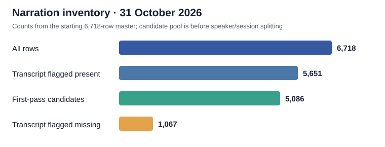

# Nyishi Narration ASR research

Source code and output-free analysis notebooks for a Nyishi IPA speech-recognition research project. Current scope is Dataset A Narration; YouTube is deferred.

## Status

This initial snapshot preserves historical data exploration, staged metadata/IPA-policy reconstruction, and experimental curation code. No final speaker-disjoint split, trained baseline or Nyishi accuracy result is supplied. The newer working decision is minimal formatting normalization; the historical A_v1/A_v2 phonetic substitutions remain provisional research alternatives.

## Phase 0: local inventory

The [Phase 0 notebook](notebooks/Phase-0.ipynb) records the 31 October 2026 local environment and data inventory. Its published copy contains source cells and a written conclusion; saved execution outputs remain in the local research copy. All required local inputs were found. The 59 Narration Parquet shards and the starting `master_A_v1_1.parquet` each contain 6,718 rows; the master has 54 columns. The local Python 3.11.1 environment had NumPy 2.3.5, pandas 2.2.3, PyArrow 26.0.0 and SoundFile 0.13.1. PyTorch and the model-training packages were not installed there. Kaggle GPU type, memory and quota have not been recorded.

The first-pass manifest counts are 5,651 rows flagged with transcripts, 1,067 flagged missing, 6,714 marked `audio_ok`, three with zero decoded duration, and 708 over 30 seconds. Combining labelled, audio-OK and 0.5–30-second conditions gives 5,086 candidate rows. These conditions have not yet undergone a final QC waterfall or speaker/session split; the candidate count is not a training-set size.

## Findings from the recovered Narration analyses

The local recovered notebooks retain the original plots and outputs for thesis reporting. Their aggregate findings are summarized here; the original notebooks, review fields and individual transcripts are not published.

- The original row-level splits overlap heavily in speakers: 57 of 60 public speaker IDs appear in multiple splits and 49 in all three. A new speaker/session-aware split is needed before a held-out evaluation.
- Earlier proposed grouping reduces 60 public speaker IDs to 55 groups, but name-based merges are unverified. The current status distribution is 5,712 `ok`, 622 `linked_to_pair`, 208 `multi_person`, and 176 `uncertain_identity`.
- Narration audio is 16 kHz, mono PCM16. Three IDs have zero frames: `A_004973`, `A_006614`, `A_006615`. `A_004972` is 2.531 seconds decoded versus 3.89 seconds stated and needs boundary review. There are 708 clips above 30 seconds; 528 have transcript references. Long clips stay in the master for possible later aligned segmentation.
- Raw references contain 107 distinct code points including space and are already in Unicode NFD. Repeated ordinary spaces occur in 640 references. Plain `g` and IPA `ɡ` both occur frequently. The old A_v1 and A_v2 conventions differ in 51 transcript strings; fewer unresolved flags under A_v2 do not validate its linguistic choices.
- The audio signal audit found no decoding failures, three empty recordings and no nonempty all-zero recordings. It flagged 104 clips below −50 dBFS RMS. Those level measurements are review signals, not evidence that the speech is unusable.

The next research step uses `transcript_raw`, `transcript_missing`, `audio_ok`, `audio_issue`, `duration_decoded`, and stable `sample_id`/`audio_path` fields for a derived eligibility manifest. Speaker and session fields are needed for splits. In the starting master, `transcript_normalized`, `duplicate_group_id`, and `final_split` are unfilled; no final target policy or split can be inferred from them.

## Contents

- `notebooks/`: three adapted analysis notebooks without saved outputs, execution counters or embedded media. Original notebooks with results remain private in the local workspace for thesis reporting.
- `src/nyishi_asr/` and `run_preprocessing.py`: historical staged reconstruction and integrity checks.
- `scripts/prepare_narration_baseline.py`: earlier candidate-pool, duplicate-waveform and grouping analysis; its IPA-policy assumptions are not the selected minimal-normalization baseline.
- `tests/`: normalization, integrity, source-recovery and dataset-dependent checks.
- `requirements.txt`: exact package versions from the existing reconstruction environment, not a model-training environment.

## Data is not included

Audio, transcripts, manifests, speaker/reviewer metadata, review workbooks, local inventories, recovery archives and model weights are intentionally excluded. The source dataset is [Eries1506/nyishi-speed-tb-phase1](https://huggingface.co/datasets/Eries1506/nyishi-speed-tb-phase1); observe its license and attribution requirements. This repository does not grant a license to the dataset.

## Running the historical code

Use Python 3.11 and the listed dependencies. This snapshot is not a standalone training package: historical recipes expect privately supplied files in their former layout, including `raw/A_narration`, `manifests`, `cleaning`, `metadata`, reconstruction evidence, and some original recovery inputs. A fresh raw download alone does not recreate those inputs. Source-recovery/dataset tests require those fixtures and should not be presented as passing without them. The local directory cleanup changed their locations; the historical code is retained here as a research record, not an already-integrated pipeline for that layout.

The normalization and integrity unit tests can run without dataset fixtures. Notebooks also contain staged historical assumptions and must be inspected before execution. Some notebook source cells include short linguistic examples; bulk transcripts and saved data outputs are absent.

## Next experiment

1. Implement a new minimal-cleaning workflow from original reference text, preserving IPA marks and pronunciation differences.
2. Exclude missing-label/empty-audio examples in a derived view; retain source data.
3. Freeze speaker/session-aware splits and one evaluation policy.
4. Validate IPA tokenization and run an IPA-Whisper Base pilot before substantive comparisons.

Do not infer linguistic correctness, tone recognition or model superiority from code checks or candidate membership.
