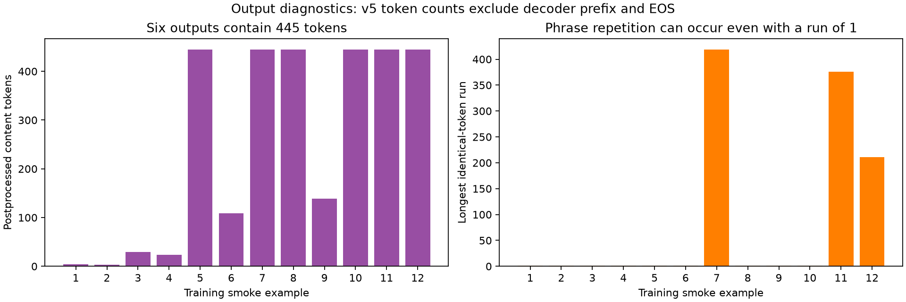
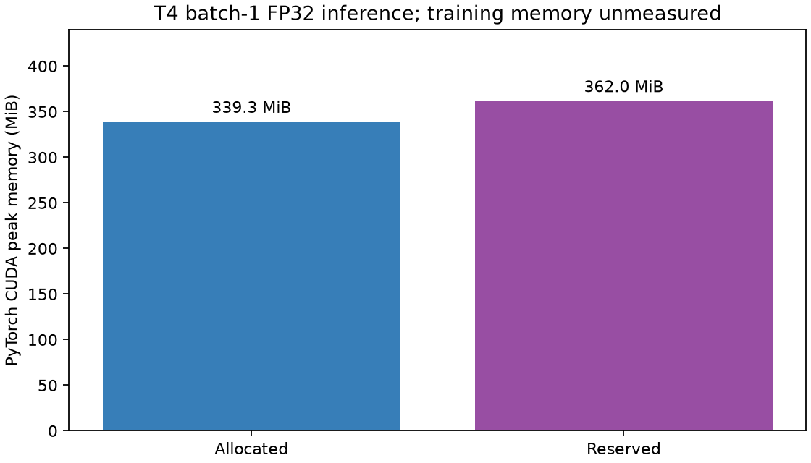

# Nyishi Narration ASR research

Source code and analysis notebooks with saved plots and tables for a Nyishi IPA speech-recognition research project. Current scope is Dataset A Narration; YouTube is deferred.

## Status

The Phase 3.5B split was accepted, frozen and hashed locally on 1 November 2026. **Phase 4 core engineering checks passed on Kaggle's Tesla T4.** A stopping-diagnostic correction still needs a small verification run. No Nyishi fine-tuning or validation/test CER has been completed. Raw/derived datasets and private predictions remain local.

## Phase 0: local inventory

The [Phase 0 notebook](notebooks/Phase-0.ipynb) records the 31 October 2026 local environment and data inventory, with its saved cell outputs. All required local inputs were found. The 59 Narration Parquet shards and the starting `master_A_v1_1.parquet` each contain 6,718 rows; the master has 54 columns. The local Python 3.11.1 environment had NumPy 2.3.5, pandas 2.2.3, PyArrow 26.0.0 and SoundFile 0.13.1. PyTorch and the model-training packages were not installed there. At Phase 0, Kaggle compute was unmeasured; Phase 4 now records a Tesla T4 and inference memory, while quota remains unrecorded.

The first-pass manifest counts are 5,651 rows flagged with transcripts, 1,067 flagged missing, 6,714 marked `audio_ok`, three with zero decoded duration, and 708 over 30 seconds. Combining labelled, audio-OK and 0.5–30-second conditions gives 5,086 candidate rows. These conditions have not yet undergone a final QC waterfall or speaker/session split; the candidate count is not a training-set size.

## Phase 1: eligibility and audio checks

The [Phase 1 notebook](notebooks/Phase-1.ipynb) now includes its saved output tables and plots. Its 6,718 master rows joined one-to-one with the full-decode facts. There were no full-decode failures, sample-rate disagreements, channel disagreements or disagreements between decoded-duration fields. The filtering waterfall is:

| First applicable outcome | Clips |
|---|---:|
| Initial 0.5–30-second candidates | 5,086 |
| Missing or empty reference | 1,067 |
| Outside initial duration range | 561 |
| Zero audio frames | 3 |
| Duration discrepancy held for review | 1 |

The candidates contain **14.826 decoded hours** before any speaker/session split. The 561 duration exclusions comprise 528 labelled clips above 30 seconds and 33 labelled, nonempty clips below 0.5 seconds. Another three labelled clips below 0.5 seconds have zero frames and are counted under that earlier exclusion. One duration-mismatch clip, `A_004972`, is held for review. Of the candidates, 967 are provisionally train-only because of pair linkage, multiple speakers or uncertain identity. The source master and decode-facts hashes did not change during the Phase 1 run.

The eligibility, speaker-hours and speaker-status images come from saved Phase 1 notebook outputs. The duration image was generated separately from the same saved Phase 1 audit because its notebook plot cell had not been executed. No train/validation/test split or model baseline is implied by these figures.

## Phase 2: transcript formatting policy

The [Phase 2 notebook](notebooks/Phase-2.ipynb) includes its saved tables and plots. It reads the 5,086 first-pass candidates and retains every `transcript_raw`. Its derived `transcript_phase2` applies Unicode NFD, trims outer whitespace and collapses repeated ordinary spaces. The run changed **497 rows (9.77%)**, entirely because of repeated spaces; NFD and outer trimming changed zero rows. The character total fell from 522,368 to 521,747, a difference of 621 spaces. Both versions contain 102 distinct code points in this candidate subset. The source hash was unchanged and the policy was idempotent.

The plots describe label formatting and length, not transcription quality or model accuracy. The Unicode inventory includes dental combining marks, nasalization, length marks and rare combining accents. Their frequency does not determine whether they are linguistically meaningful. The first baseline preserves these marks and does not automatically convert `g`/`ɡ` or punctuation-like symbols.

## Phase 2.5: targeted review before splitting

The [Phase 2.5 notebook](notebooks/Phase-2.5.ipynb) saved its review tables and plot. Its queue contains **42 distinct clips / 0.201 hours**: 41 clips with `:`, `;` or `[`, and one clip with combining acute accents. These symbols are not automatically deleted or rewritten. The first split proposals conservatively set all 42 clips aside; they remain in the source data. The notebook also lists five proposed speaker merges, 967 provisionally train-only candidate rows spanning nine groups, and one recording session linking two proposed groups. The review decisions remain pending.

The pinned IPA-Whisper processor's tokenizer round-trip and target-length checks remain a model-compatibility gate; no processor or weights were downloaded in Phase 2 or 2.5.

## Phase 3: first leakage-aware split proposal

The [Phase 3 notebook](notebooks/Phase-3.ipynb) removed the 42 uncertain-symbol clips from the initial supervised pool, leaving **5,044 clips / 14.625 hours**. It hashed decoded waveforms and connected rows that share a proposed speaker group, public/raw speaker ID, recording session or exact audio. The resulting 44 indivisible components were assigned as whole units. The proposed split was **2,876 train / 1,428 validation / 740 test clips** (**10.50 / 2.19 / 1.93 hours**). Known speaker, session and exact-audio overlap across splits was zero; no train-only rows entered held-out sets. One complete transcript string appeared across splits, which is prompt overlap, not evidence of identical audio.

The first proposal was not frozen. **52.9% of validation clips were under 3 seconds**, so validation could overemphasize very short utterances when choosing a checkpoint. The test set was also 96.4% November 2024 by audio hours. Month is a diagnostic rather than an automatic reason to reject a split, but it may signal changed speakers or recording conditions.

## Phase 3.5: category-aware revision

The [Phase 3.5 notebook](notebooks/Phase-3.5.ipynb) searched whole-component assignments using hours and metadata for month, age, duration and gender. Its revised counts were **3,055 train / 542 validation / 1,447 test clips** (**10.23 / 2.20 / 2.19 hours**). Known structural overlap remained zero. Its internal search score improved, but that score is a design objective, not model accuracy.

The revision exposed two more important problems: **one component supplied 90.5% of validation hours**, validation was **98.8% female by hours**, and **52.3% of test clips** were under 3 seconds. This proposal was not frozen.

## Phase 3.5B: preferred split proposal

The [Phase 3.5B notebook](notebooks/Phase-3.5B.ipynb) and its [deterministic proposal script](scripts/phase3_5b_proposal.py) put train-only components and four dominating components in training, then searched the remaining whole-component assignments. The criteria emphasize useful validation and test sets: both genders by audio hours, multiple independent components, limited influence from any one component, and a manageable share of clips under 3 seconds. They do not optimize model results.

| Phase 3.5B split | Clips | Hours | Components | Female share of hours | Clips under 3 s | Largest component share of hours |
|---|---:|---:|---:|---:|---:|---:|
| Train | 3,629 | 10.85 | 15 | 59.7% | 24.0% | 33.7% |
| Validation | 732 | 1.88 | 16 | 50.9% | 19.9% | 24.1% |
| Test | 683 | 1.89 | 13 | 50.9% | 13.8% | 33.7% |

The saved Phase 3.5B audit passes its stated design gates: zero known cross-split overlap for component, speaker-group, public/raw speaker, session and exact-waveform keys; zero train-only rows held out. Validation and test include 75.6% and 67.8% November 2024 audio hours respectively, while training is 10.6% November 2024. This distribution shift should be reported, especially if month corresponds to recording conditions; it does not outweigh the severe validation and short-clip problems above for this first baseline. **Historical proposal status: Phase 3.5B was subsequently accepted and frozen locally on 1 November 2026; see current Status above.** The local derived manifests and audit JSON are excluded from this public source repository.

## Phase 4: processor and model smoke test

The measured run verified tokenizer round trips on **5,044 frozen + 42 set-aside labels**, audio/features on **12 training-only clips**, repeated first-clip generation and checkpoint save/reload. Loaded/installed Transformers both report **4.57.1**. Batch-1 FP32 generation took **18.82 seconds** in the measured loop; peak PyTorch allocated/reserved GPU memory was **339.26 / 362 MiB**. These are inference measurements, not training requirements.

Predictions exhibit substantial omissions and repetition. Six returned content sequences contain 445 tokens; the earlier zero EOS/cap flags were a measurement bug because Whisper's default tensor strips prefix/EOS. The corrected **v6 source is prepared but not yet run**. Preserve these poor outputs in later evaluation; no CER has been computed.

- [Corrected Kaggle notebook](notebooks/Phase-4B-Kaggle-Smoke-Test.ipynb)
- [Results notebook with saved aggregate figures](notebooks/Phase-4B-Results-Public.ipynb)
- [Detailed results, limitations and next actions](docs/PHASE4_RESULTS.md)
- [Machine-readable aggregate metrics](docs/PHASE4_RESULTS_AGGREGATE.json)

Next: verify the corrected full-sequence stopping diagnostics on the same training clips, then establish corpus-level NFD code-point CER on the **732 frozen validation clips**. Keep test reserved for final evaluation. No additional split search or IPA mark removal is required.

## Findings from the recovered Narration analyses

The local recovered notebooks retain complete originals for thesis reporting. The three published analysis notebooks now include their saved non-audio plots, tables and textual results. Embedded WAV playback outputs are omitted from the public copies; the originals remain in the local BTP directory. The aggregate findings are summarized here; bulk datasets and review workbooks are not published.

- The original row-level splits overlap heavily in speakers: 57 of 60 public speaker IDs appear in multiple splits and 49 in all three. A new speaker/session-aware split is needed before a held-out evaluation.
- Earlier proposed grouping reduces 60 public speaker IDs to 55 groups, but name-based merges are unverified. The current status distribution is 5,712 `ok`, 622 `linked_to_pair`, 208 `multi_person`, and 176 `uncertain_identity`.
- Narration audio is 16 kHz, mono PCM16. Three IDs have zero frames: `A_004973`, `A_006614`, `A_006615`. `A_004972` is 2.531 seconds decoded versus 3.89 seconds stated and needs boundary review. There are 708 clips above 30 seconds; 528 have transcript references. Long clips stay in the master for possible later aligned segmentation.
- Raw references contain 107 distinct code points including space and are already in Unicode NFD. Repeated ordinary spaces occur in 640 references. Plain `g` and IPA `ɡ` both occur frequently. The old A_v1 and A_v2 conventions differ in 51 transcript strings; fewer unresolved flags under A_v2 do not validate its linguistic choices.
- The audio signal audit found no decoding failures, three empty recordings and no nonempty all-zero recordings. It flagged 104 clips below −50 dBFS RMS. Those level measurements are review signals, not evidence that the speech is unusable.

The staged work derives eligibility from `transcript_raw`, `transcript_missing`, `audio_ok`, `audio_issue`, `duration_decoded`, and stable `sample_id`/`audio_path` fields. Speaker and session fields drive the group-level proposals. In the starting master, `transcript_normalized`, `duplicate_group_id`, and `final_split` are unfilled; the source master itself does not contain a final target policy or frozen split.

## Contents

- `notebooks/`: Phase 0, 1, 2, 2.5, 3, 3.5 and 3.5B notebooks with saved results, plus three adapted historical analysis notebooks with saved non-audio plots/tables. Complete recovered originals, including embedded audio outputs, remain local for thesis reporting.
- `src/nyishi_asr/` and `run_preprocessing.py`: historical staged reconstruction and integrity checks.
- `scripts/prepare_narration_baseline.py`: earlier candidate-pool, duplicate-waveform and grouping analysis; its IPA-policy assumptions are not the selected minimal-normalization baseline.
- `scripts/phase3_5b_proposal.py`: deterministic Phase 3.5B group-level split search and structural audit. It needs the local Phase 3.5 derived manifest, which is intentionally not published.
- `tests/`: normalization, integrity, source-recovery and dataset-dependent checks.
- `requirements.txt`: exact package versions from the existing reconstruction environment, not a model-training environment.

## Data is not included

Audio, transcripts, manifests, speaker/reviewer metadata, review workbooks, local inventories, recovery archives and model weights are intentionally excluded. The source dataset is [Eries1506/nyishi-speed-tb-phase1](https://huggingface.co/datasets/Eries1506/nyishi-speed-tb-phase1); observe its license and attribution requirements. This repository does not grant a license to the dataset.

## Running the historical code

Use Python 3.11 and the listed dependencies. This snapshot is not a standalone training package: historical recipes expect privately supplied files in their former layout, including `raw/A_narration`, `manifests`, `cleaning`, `metadata`, reconstruction evidence, and some original recovery inputs. A fresh raw download alone does not recreate those inputs. Source-recovery/dataset tests require those fixtures and should not be presented as passing without them. The local directory cleanup changed their locations; the historical code is retained here as a research record, not an already-integrated pipeline for that layout.

The normalization and integrity unit tests can run without dataset fixtures. Notebooks also contain staged historical assumptions and must be inspected before execution. Their saved outputs are historical evidence; they do not make the older code directly runnable in the current streamlined layout. Some notebook outputs include small displayed transcript tables, while bulk datasets, audio payloads and review files remain outside this repository.

## Next experiment

1. Review the remaining uncertain speaker/session grouping and the one repeated full-transcript prompt across proposed splits. Keep the 42 uncertain-symbol clips outside the first held-out evaluation under the documented conservative policy. Recheck that Phase 3.5B uses the intended local inputs.
2. Freeze the selected Phase 3.5B train/validation/test membership, save versioned manifests and SHA-256 hashes, and record the final row/hour/component counts. Never revise the test split in response to model scores.
3. In Phase 4, pin `neurlang/ipa-whisper-base` and its processor revision; check NFD IPA and combining-mark encode/decode round trips, label lengths, audio features and a batch-1 inference smoke test. Record actual GPU memory and runtime.
4. Run an IPA-compatible zero-shot diagnostic, then a small supervised pilot using training data and validation for checkpoint choice. Evaluate the selected recipe once on the frozen test set using corpus-level NFD character error rate (CER). Compare later models on the same split and policy.

Do not infer linguistic correctness, tone recognition or model superiority from code checks or candidate membership.
