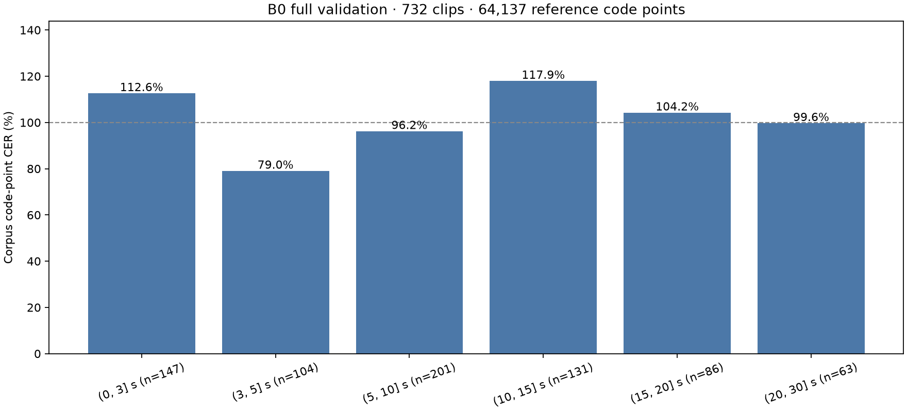
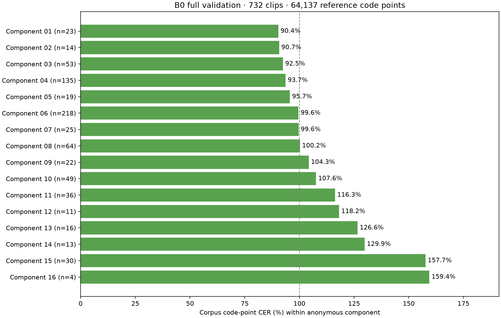
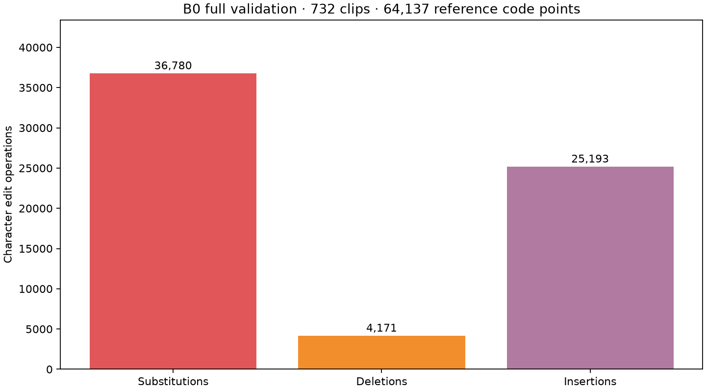
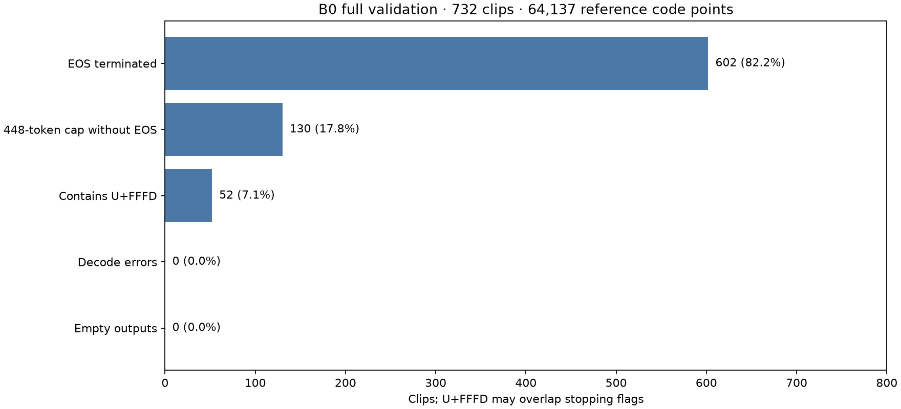
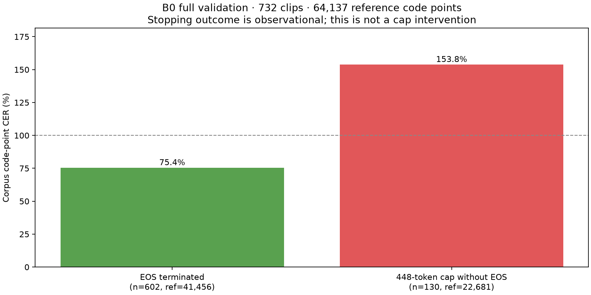
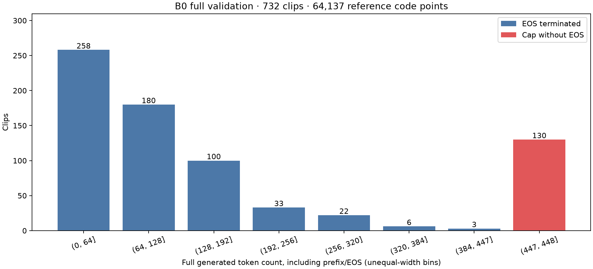
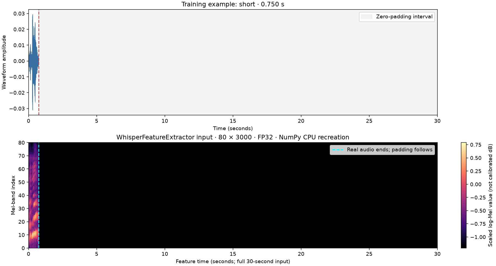
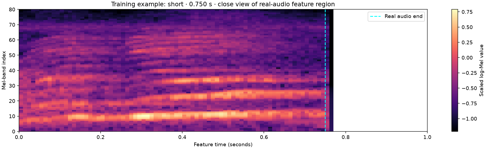
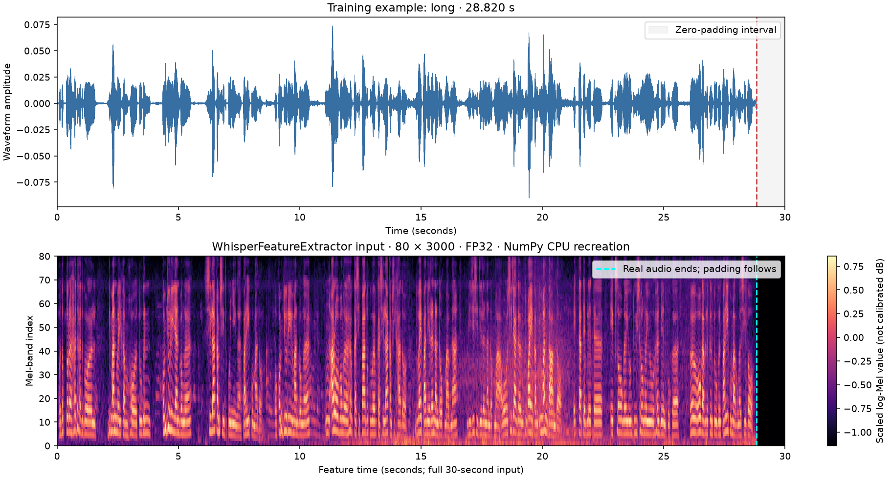
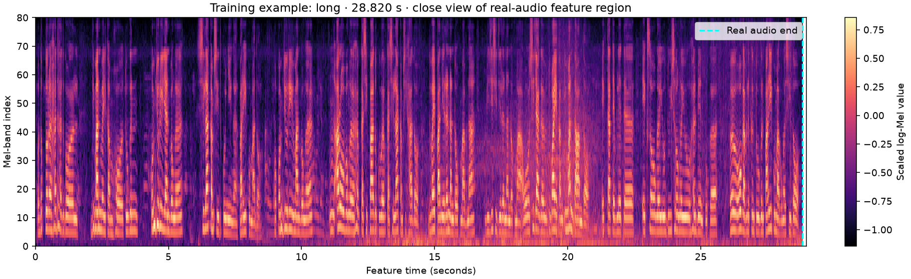

# Phase 5B — B0 full-validation zero-shot baseline

**Phase 5B status: complete for processor/scorer engineering and the full B0 validation measurement · 1 November 2026. Reporting corrected from saved predictions; no model inference rerun.**

## Method and scope

`neurlang/ipa-whisper-base` revision `949f7c4e4ee374b5202bc5886f6e4552e5ae2371`, seed 0, Tesla T4 (`cuda:0`), PyTorch 2.11.0+cu128, Transformers 4.57.1. The executed notebook records Python 3.13.15, Tokenizers 0.22.2, Hub 0.36.2, NumPy 2.1.3 and SoundFile 0.14.0. The source pins Safetensors 0.8.0; its installed version is not printed in the runtime output. FP32, batch 1, greedy decoding (`num_beams=1`, `do_sample=False`), full sequence cap 448 tokens, no forced language/task/decoder prefix, no timestamps. `suppress_tokens=[]`; inherited `begin_suppress_tokens=[220,50257]` was retained. All 732 outputs selected the English/transcribe prefix automatically. This is observed model behavior, not a Nyishi language-token policy.

References and hypotheses use Unicode NFD, outer trim and collapse of repeated ordinary U+0020 spaces. Spaces, punctuation and IPA marks remain. Each clip is scored separately; corpus CER is summed S+D+I divided by summed reference code points. It is neither mean clip CER nor a grapheme/phoneme error rate. Empty or failed predictions remain in the reference denominator; none occurred here. WER and alternate/raw-policy CER were not computed.

The full run reused the 12 preflight predictions and processed the remaining 720 clips. No training or test inference is evidenced by this export; the inputs and results checked here contain validation only. Test remains reserved for final evaluation. No new master-data inventory or audio extraction was performed during this reporting review.

## Verified results

| Measurement | Full-validation result |
|---|---:|
| Clips / existing frozen components | **732 / 16** |
| Evaluated audio | **1.881808 hours** |
| Reference code points, including spaces | **64,137** |
| Substitutions / deletions / insertions | **36,780 / 4,171 / 25,193** |
| Total edits / corpus CER | **66,144 / 103.12924%** |
| Decode errors / empty outputs | **0 / 0** |
| EOS terminated | **602 (82.2%)** |
| 448-token cap without EOS | **130 (17.8%)** |
| Outputs containing U+FFFD | **52 (7.1%)** |
| Automatically selected English prefix | **732 / 732** |
| Sum / mean per-clip elapsed time | **707.3469 s / 0.966321 s** |
| Observed real-time factor | **0.104413** |
| Two inference-pass wall times combined | **709.7663 s** |
| Full pass wall time, 720 newly processed clips | **698.5552 s** |
| Full-pass peak PyTorch allocated / reserved | **426.21 / 460 MiB** |

RTF uses summed per-clip elapsed time divided by audio seconds. These measurements include feature extraction/decoding work timed per clip; they exclude installation, model loading and reporting and are not a steady-state speed benchmark. Pass wall time has a different scope. PyTorch peaks are not total GPU occupancy or training-memory requirements. The private review prose's 446.9/482.3 values confused decimal MB with MiB; the byte telemetry supports the MiB figures above.

## Reporting correction and checks

The original ZIP's aggregate CER and S/D/I were correct, but its three plots still showed the 12-clip preflight. Its mean runtime and last-pass telemetry were also stale. The save cell refreshed only some metrics while reusing earlier reporting globals and plots.

The corrected notebook uses one reporting function. Both its report and save cells reload predictions and pass telemetry, verify references/grouping/durations against the validation bundle, and regenerate every validation plot and summary before export. A local regression check first generated a 12-row report, replaced the saved input with the full run, then executed only the save cell: all 732 rows, six plots, mean runtime and full-pass memory/timing updated correctly. Model imports/generation were not executed for this check.

Independent audit of the supplied results checked:

- Exactly 732 unique prediction IDs equal the private bundle and frozen validation membership; references, raw references, durations and waveform identities match the frozen records.
- Bundle-manifest checksum matches the saved run configuration; every record and pass has the matching run fingerprint. These private identifiers/checksums remain outside the public aggregate.
- CSV and JSONL prediction/reference/S/D/I fields agree. All 732 per-clip S/D/I decompositions were recalculated from saved text, including scorer checks for combining marks, spaces and empty hypotheses.
- Duration and anonymous-component aggregates each sum to 732 clips, 64,137 reference code points and 66,144 edits. The six published validation plots were regenerated and visually inspected.
- Source notebook code cells parse and carry no saved execution outputs. The public report notebook contains only aggregate text and ten figures: six full-validation plots and four anonymous training-only processor illustrations.

## Full-set plots and interpretation

Duration bins are right-closed: `(0,3]`, `(3,5]`, `(5,10]`, `(10,15]`, `(15,20]`, `(20,30]` seconds. The first bin contains 147 clips because it includes a clip exactly 3 seconds long; Phase 5A's strictly-under-3-second count was 146. Bin CER is descriptive, without a consistent monotonic duration trend.

Component numbers are plot positions sorted by CER, with no published mapping to frozen aliases, speakers or source provenance. These are existing evaluation components, not expert-verified speakers. Scores range from approximately 90.4% to 159.4%; group sizes differ substantially, including one with only four clips. No causal or statistical-significance claim follows from this plot.

Substitutions account for 55.6% of edits, insertions 38.1%, deletions 6.3%. CER can exceed 100% because insertions add errors beyond the reference length; 103.13% does not mean that percentage of clips or words is wrong. This is a poor zero-shot result under the declared IPA scoring convention and a usable fixed reference for supervised adaptation. It establishes neither Nyishi competence nor model superiority.

Cap hits and U+FFFD are retained in the score. U+FFFD overlaps stopping categories. These diagnostics motivate private error review; they do not prove that changing the cap, language prefix or normalization would improve recognition.

## Evidence limits and next steps

**Phase 5B is complete for its declared engineering and B0 validation scope.** The supplied executed notebook now closes the earlier evidence gap: all 737 payload checksums passed, CER checks passed, two training-only examples produced finite FP32 `[1,80,3000]` features, the model parameters were FP32, and the 720-clip continuation completed before the full-coverage save. Its report cell was executed before the continuation; those 12-clip plots are preserved in the private original and superseded here.

### Additional full-validation diagnostics

EOS-terminated outputs: 602 clips, 41,456 reference code points, approximately 75.4% CER. Cap-limited outputs: 130 clips, 22,681 reference code points, approximately 153.8% CER. Together they recover all validation clips, reference characters and edits. This comparison is descriptive; it does not isolate the causal effect of the cap.

All 732 sequences are counted, including prefix/EOS tokens. The final unequal-width bin isolates the 130 cap hits at length 448. Counts are not a density, and token length is not transcription accuracy.

### Recreated processor illustrations

The four original processor figures were present in the supplied executed notebook. Public replacements use the same hash-verified private training WAVs, a pinned Transformers 4.57.1 `WhisperFeatureExtractor`, and its NumPy CPU path. Only the public preprocessor configuration was fetched; no model weights were downloaded or inference run. Both regenerated arrays are finite float32 `[1,80,3000]`. The original numeric Kaggle tensors are not saved, so bitwise equivalence is not asserted. Recreation metadata is in [PHASE5B_PROCESSOR_ILLUSTRATIONS.json](PHASE5B_PROCESSOR_ILLUSTRATIONS.json).

These two examples are training illustrations, not validation results. Durations are 0.750 s and 28.820 s, both 16 kHz mono. Full plots show real audio and the 30-second padding region; close views show real-audio features. Colors are scaled log-Mel values, not calibrated dB. FFT window overlap can blur the boundary. No audio player, waveform array, feature tensor, sample identifier or source mapping is published.

Recommended next work, following the existing sprint plan:

1. Preserve B0, frozen splits and scoring as the comparison reference. Privately inspect high/low-CER, capped and U+FFFD outputs against audio and references. Record uncertainty; do not alter labels or exclude clips merely to improve CER.
2. Specify supervised decoder-prefix, target shifting and padding-mask policy; do not invent a Nyishi token. Any changed decoding setup is a separate declared validation experiment.
3. Complete Phase 6A: finite FP16-AMP loss/gradients, a verified optimizer update and checkpoint/resume with optimizer/scaler state. Then run the component-aware 1–2 hour Phase 6B pilot and select by validation CER.
4. Measure training resources before full training or LoRA comparisons. Keep the 683 test clips untouched until final selection.

Unresolved label/identity uncertainty, no expert Nyishi adjudication, month-distribution shift and prompt overlap on distinct audio remain limitations. Supervised improvement, linguistic correctness and tone recognition remain unmeasured.

## Public artifacts and reproduction

- [Corrected source notebook](../notebooks/Phase-5B-Zero-Shot-Validation.ipynb): private frozen-hash expectations are supplied through environment variables; outputs are cleared.
- [Aggregate report notebook](../notebooks/Phase-5B-Results-Public.ipynb): saved figures and summary, with no prediction-level tables.
- [Allowlisted aggregate JSON](PHASE5B_RESULTS_AGGREGATE.json): numeric group totals and declared method only.
- [Audit code](../scripts/audit_phase5b_saved_results.py): recomputes from authorized private ZIP, bundle manifest and frozen manifest; see `--help`. Use a private output location until reviewed.
- [Processor renderer](../scripts/render_phase5b_processor.py): requires private training-smoke inputs; reproduces the four anonymous waveform/feature figures with the pinned processor and no inference.
- [Plot renderer](../scripts/render_phase5b_results.py): `python scripts/render_phase5b_results.py` uses public JSON only (Matplotlib required).

The original ZIP, corrected private ZIP, original executed notebook, prediction tables, transcripts, audio, manifests, sample IDs, source/speaker mappings and private provenance are excluded. Original private evidence is preserved unchanged. This report is derived from exported results; it is not an executed copy of the inference notebook.
