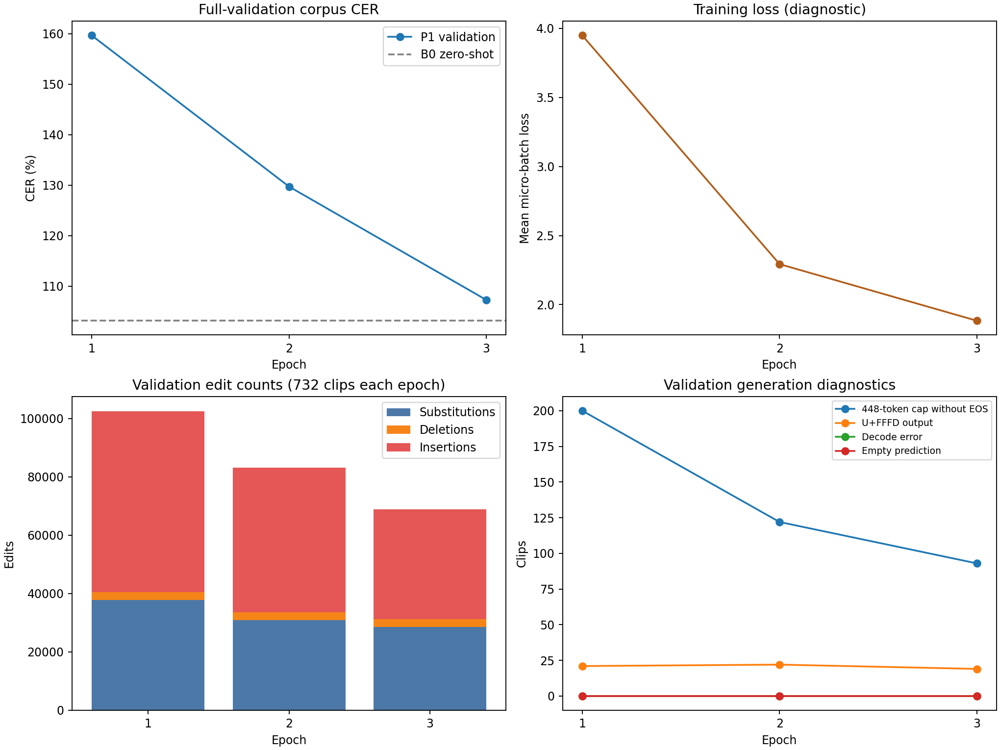
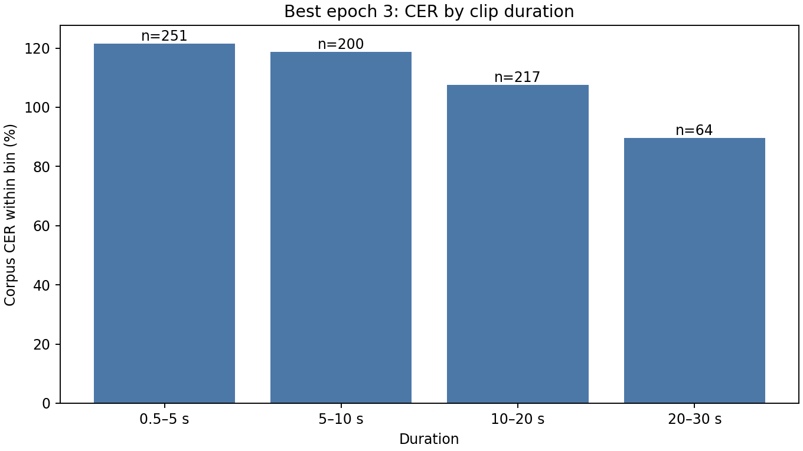

# Phase 6B P1 pilot — aggregate results

Phase 6B completed a three-epoch supervised pilot using 581 frozen-training clips (1.002867 hours) and evaluated every epoch on all 732 frozen validation clips (1.881808 hours; 64,137 NFD reference code points). The test set was not used.

| Epoch | Training loss | Validation CER | Substitutions | Deletions | Insertions | Cap hits without EOS |
|---:|---:|---:|---:|---:|---:|---:|
| 1 | 3.9481 | 159.66% | 37,834 | 2,617 | 61,949 | 200 |
| 2 | 2.2933 | 129.72% | 30,859 | 2,659 | 49,678 | 122 |
| 3 | 1.8837 | **107.26%** | 28,536 | 2,763 | 37,493 | 93 |

The best checkpoint was Epoch 3. The pilot improved steadily but did not beat the B0 zero-shot reference of 103.13% CER. Insertions remain the largest error class at the best epoch. Cap-hit outputs decreased from 200 to 93, which indicates better stopping behavior during the pilot.

The run used `neurlang/ipa-whisper-base` revision `949f7c4e4ee374b5202bc5886f6e4552e5ae2371` on a Tesla T4 with FP16 AMP training, FP32 validation, micro-batch 2, accumulation 4, AdamW learning rate `1e-5`, weight decay `0.01`, and 219 optimizer updates. Total recorded wall time was 2,380 seconds; validation accounted for about 2,291 seconds. This confirms that validation generation, rather than backpropagation, was the main runtime cost.

The latest private rerun is the authoritative P1 artifact for any paired checkpoint audit. A previous private P1 export had slightly different CER values; the public release contains only this latest aggregate run and does not mix per-clip outputs between runs.

## Interpretation and next step

The pilot proves that the supervised pipeline learns the IPA target and reduces uncontrolled generation, but it does not establish that this one-hour recipe is sufficient. At the time of this handoff, Phase 6C validation optimization was the next gate, followed by an independent F1 run on all 3,629 training clips. Those phases are now complete; the current next steps are recorded in [the living next-steps document](NEXT_STEPS.md). The 683 test clips remain sealed.

This public report contains aggregate values and plots only. Private audio, manifests, identifiers, transcript-bearing predictions, checkpoints and training state are excluded.
