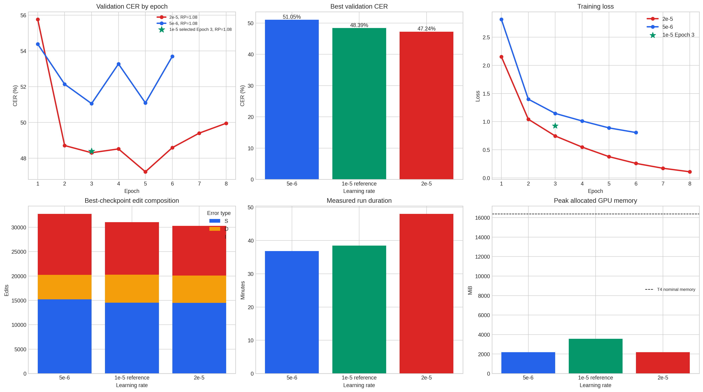
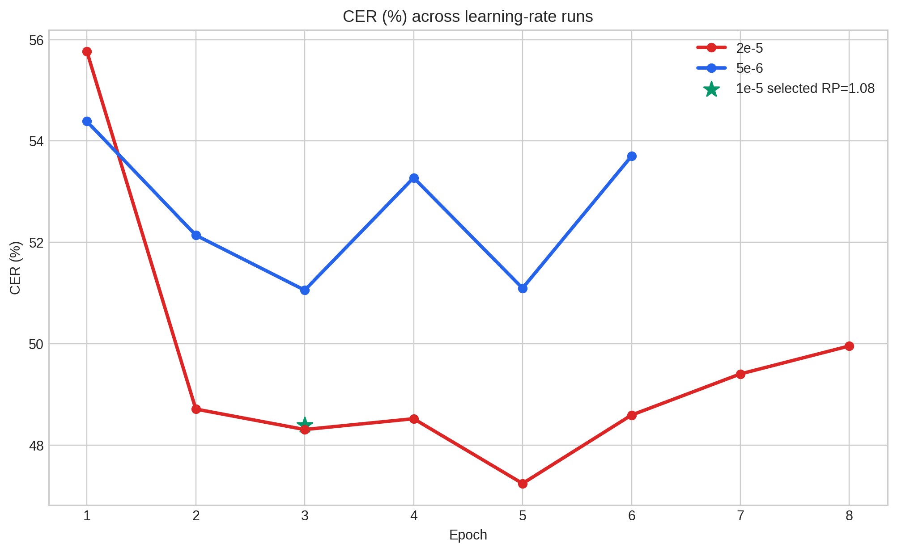
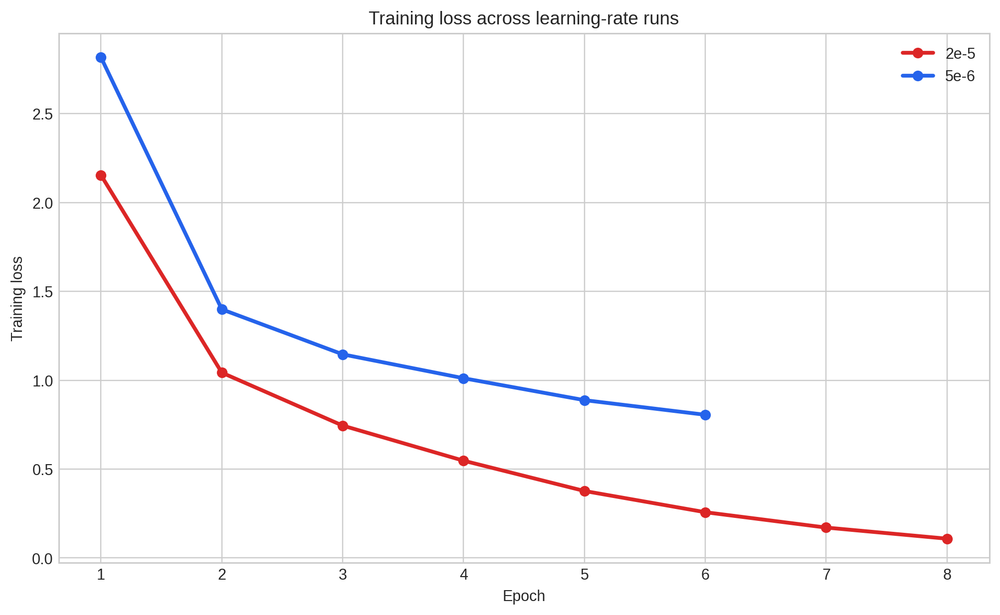

# Phase 7 F1 learning-rate mini-sweep

This validation-only comparison repeated full-data F1 fine-tuning from the pinned `neurlang/ipa-whisper-base` checkpoint at learning rates `5e-6` and `2e-5`. The existing `1e-5` F1 result is retained as the reference. Both new runs used the same frozen 3,629-clip training set, 732-clip validation set, effective batch 8, FP16 AMP training, batch-8 validation, and repetition penalty `1.08`.

The test set was not attached or evaluated.

## Best validation results

| Configuration | Best epoch | CER | Substitutions | Deletions | Insertions | EOS | Cap hits |
|---|---:|---:|---:|---:|---:|---:|---:|
| `5e-6` | 3 | 51.05477% | 15,212 | 5,021 | 12,512 | 732 | 0 |
| `1e-5` reference | 3 | 48.39172% | 14,542 | 5,739 | 10,756 | 732 | 0 |
| **`2e-5`** | **5** | **47.23950%** | **14,503** | **5,583** | **10,212** | **732** | **0** |

The `2e-5` run is the current validation-selected candidate. It improves the `1e-5` reference by 1.15222 absolute CER points. Its validation CER worsened after Epoch 5, so the Epoch 5 checkpoint is selected rather than the final Epoch 8 checkpoint.

## Interpretation

The lower rate (`5e-6`) reached its best result at Epoch 3 and then oscillated. The higher rate (`2e-5`) learned faster, continued improving through Epoch 5, and then showed a mild overfitting pattern: training loss continued to fall while validation CER increased.

The best `2e-5` checkpoint reduced all three edit categories relative to the `1e-5` reference, with the largest practical change in insertions. All 732 validation clips ended with EOS and none hit the generation cap. These are validation results, not unseen-test performance.

## Compute

| Run | Measured duration | Peak allocated GPU memory |
|---|---:|---:|
| `5e-6` | 36.83 minutes | 2,189.65 MiB |
| `2e-5` | 48.00 minutes | 2,190.63 MiB |

The difference in duration is primarily because the `2e-5` run reached Epoch 8 before patience-3 stopping, whereas `5e-6` stopped at Epoch 6.

## Public figures

The machine-readable aggregate is [`PHASE7_F1_LR_RESULTS_AGGREGATE.json`](PHASE7_F1_LR_RESULTS_AGGREGATE.json). The executed public-results notebook contains the corresponding tables and figures.

## Next step

The independent LoRA comparison is complete; its best validation CER was 60.68416%, so the `2e-5` full fine-tuning checkpoint remained selected. The later [Phase 8 report](PHASE8_RESULTS.md) records the predeclared B0 and selected-F1 comparison on the frozen 683-clip test. Do not use those test outcomes to tune the model or decoding policy.
