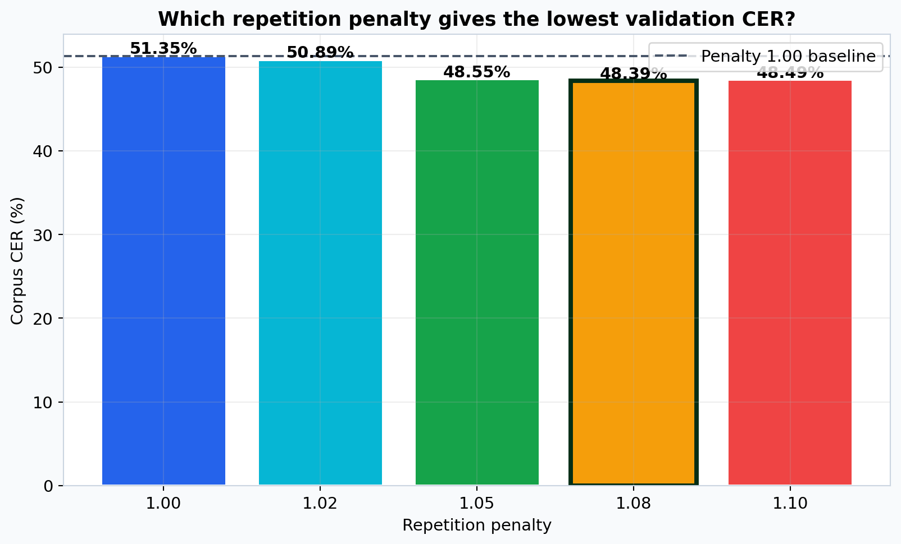
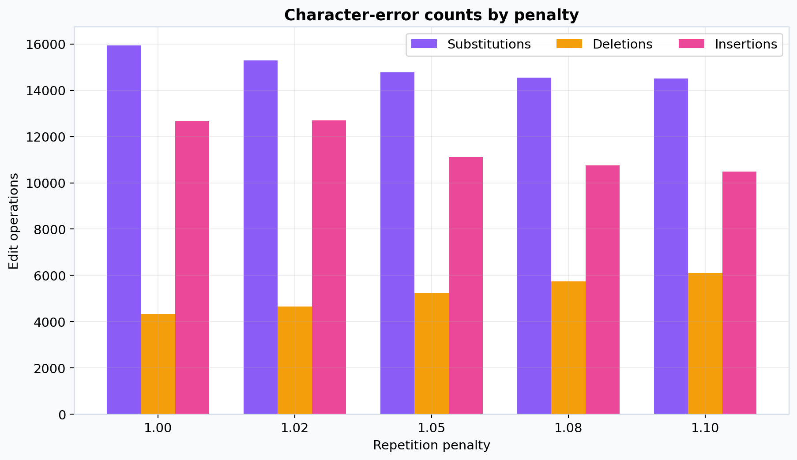
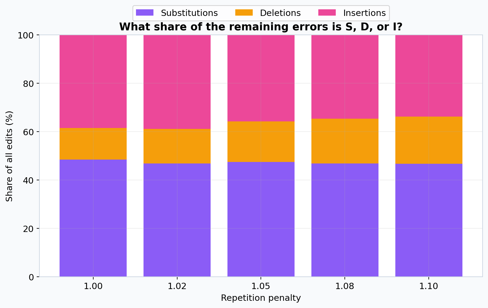
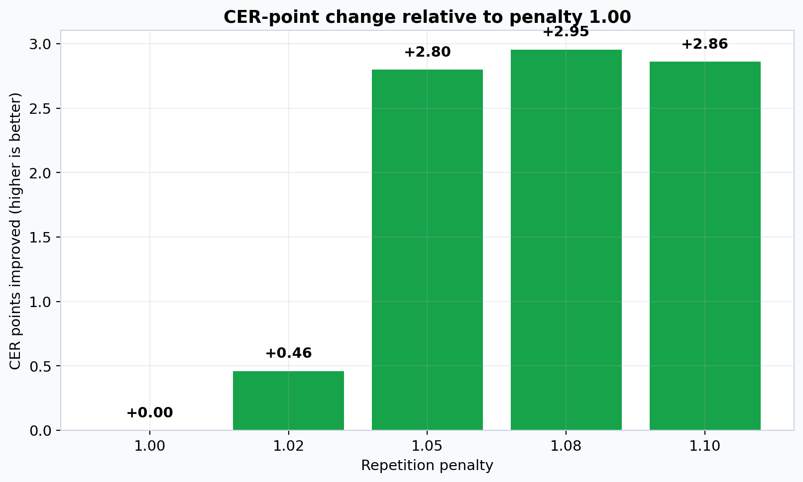
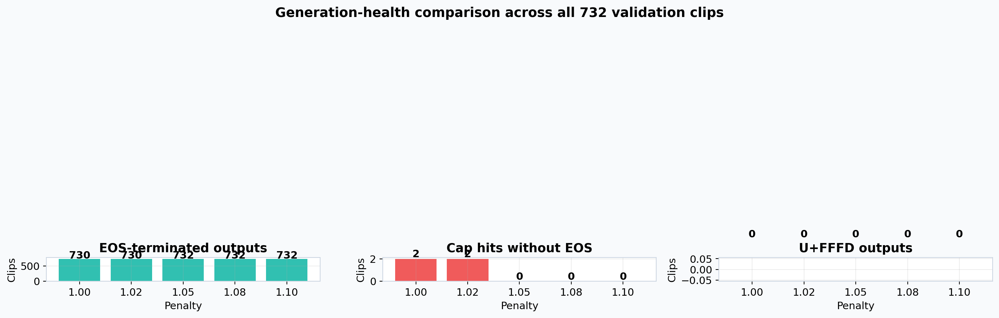
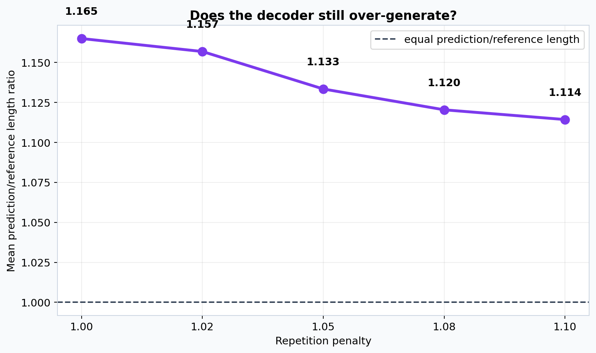
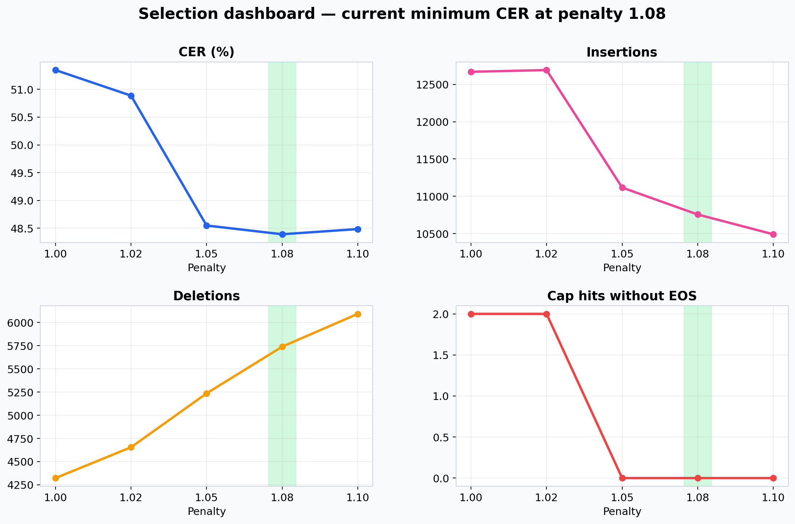
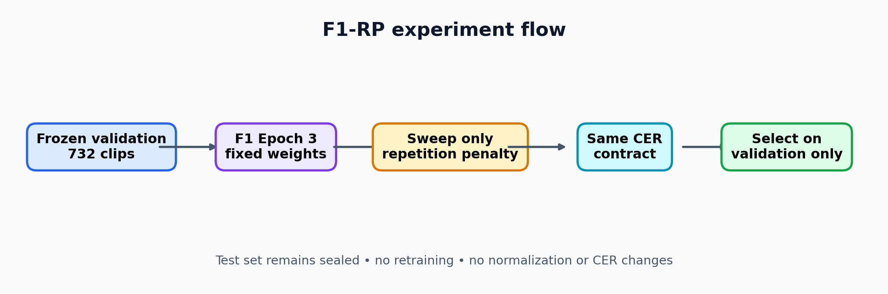

# Phase 7 F1 — repetition-penalty sweep

This validation-only ablation was run from the selected F1 Epoch 3 checkpoint.
It changed only `repetition_penalty`; the model, frozen validation split,
normalization, CER implementation and remaining generation settings were held
constant.

## Scope and configuration

- Model: `neurlang/ipa-whisper-base`, pinned revision
  `949f7c4e4ee374b5202bc5886f6e4552e5ae2371`.
- Validation: all 732 frozen clips and 64,137 NFD reference code points.
- Inference: FP32, batch 8, deterministic greedy decoding, one beam.
- Generation: `task="transcribe"`, automatic language detection,
  `forced_decoder_ids=None`, `no_repeat_ngram_size=0`, maximum length 448.
- Test data: not used.

## Aggregate results

| Repetition penalty | CER (%) | S | D | I | EOS | Cap hits | Prediction/reference length |
|---:|---:|---:|---:|---:|---:|---:|---:|
| 1.00 | 51.34634 | 15,940 | 4,323 | 12,669 | 730 | 2 | 1.16496 |
| 1.02 | 50.88638 | 15,290 | 4,655 | 12,692 | 730 | 2 | 1.15684 |
| 1.05 | 48.54920 | 14,785 | 5,236 | 11,117 | 732 | 0 | 1.13341 |
| **1.08** | **48.39172** | **14,542** | **5,739** | **10,756** | **732** | **0** | **1.12039** |
| 1.10 | 48.48527 | 14,513 | 6,093 | 10,491 | 732 | 0 | 1.11430 |

The validation-selection rule chooses `1.08`. Relative to no penalty, it
reduces CER by 2.95461 absolute percentage points and reduces insertions by
1,913. The increase in deletions at 1.10 shows the trade-off: stronger
penalties suppress more insertions but can begin removing valid output.

The difference between 1.05 and 1.08 is only 0.15748 CER points, so this is a
validation candidate, not evidence that 1.08 will generalize better on the
sealed test set.

## Interpretation and limitation

The penalty primarily reduces decoder over-generation: insertions and output
length fall, and all settings at or above 1.05 end with EOS on all 732 clips.
It does not solve the remaining acoustic/transcription errors, and the
validation sweep has not evaluated the sealed 683-clip test set.

This report contains aggregate evidence. The later owner-authorized
[result archive](../artifacts/exports/phase7/repetition_penalty_results.zip) and
[executed notebook](../notebooks/executed/phase7/f1_repetition_penalty_sweep.ipynb)
may contain prediction-level text and IDs. Frozen manifests and audio remain
outside the repository.
