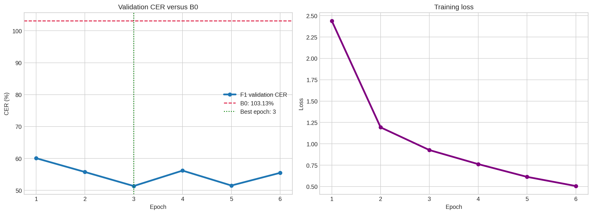
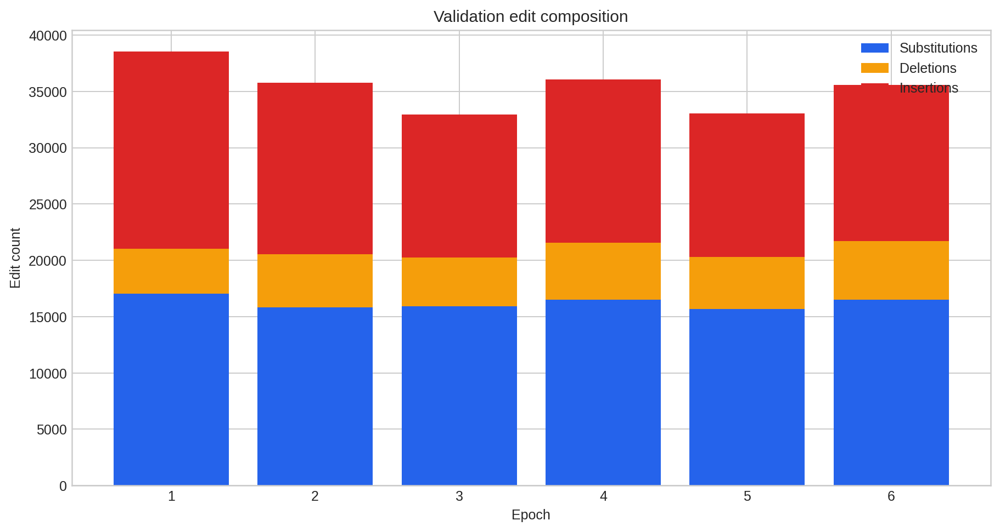
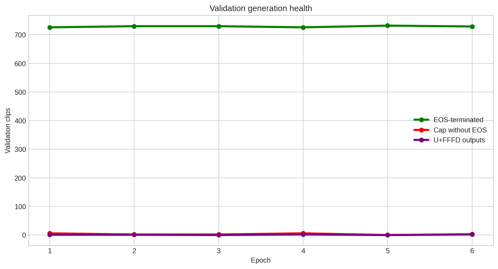
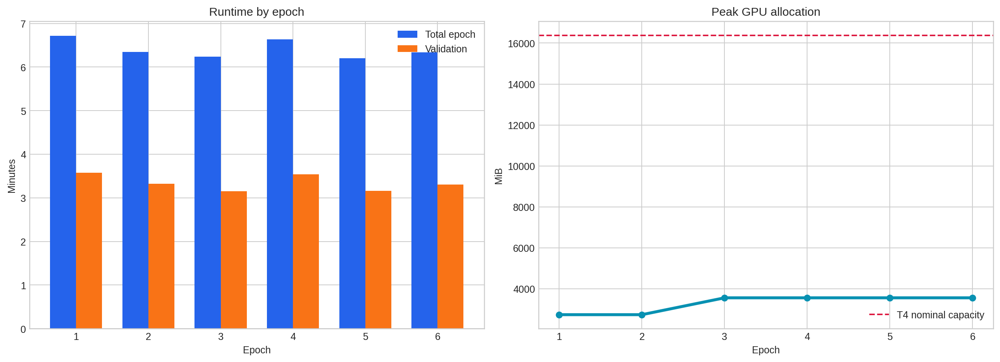

# Phase 7 F1 — full fine-tuning results

## Scope and configuration

F1 started independently from the pinned `neurlang/ipa-whisper-base` checkpoint. It used all **3,629 frozen training clips / 10.851637 hours**, evaluated all **732 validation clips / 64,137 NFD reference code points**, and kept the **683-clip test set sealed**.

- Physical batch: 2; gradient accumulation: 4; effective batch: 8.
- Validation batch: 8, proven equivalent to single-example generation in Phase 6C.
- Learning rate: `1e-5`; AdamW weight decay: `0.01`.
- FP16 AMP training; FP32 feature extraction and validation.
- Maximum: 10 epochs; patience: 3 non-improving validation epochs.
- Checkpoint selection: minimum full-validation corpus CER.

Pinned model revision: `949f7c4e4ee374b5202bc5886f6e4552e5ae2371`. Seed: 0. [Machine-readable results](PHASE7_F1_RESULTS_AGGREGATE.json) retain epoch denominators, S/D/I, runtime and configuration. The saved private result/audit exports and executed notebook were inspected; no training or inference was rerun for this publication.

## Epoch results

| Epoch | Training loss | Validation CER | Insertions | Cap hits |
|---:|---:|---:|---:|---:|
| 1 | 2.439 | 60.07% | 17,499 | 6 |
| 2 | 1.193 | 55.75% | 15,221 | 2 |
| **3** | **0.927** | **51.35%** | **12,669** | **2** |
| 4 | 0.762 | 56.18% | 14,493 | 6 |
| 5 | 0.613 | 51.51% | 12,741 | 0 |
| 6 | 0.506 | 55.48% | 13,893 | 3 |

The selected checkpoint is Epoch 3: **32,932 edits / 64,137 reference code points**, comprising 15,940 substitutions, 4,323 deletions and 12,669 insertions. Training loss continued to fall after Epoch 3 while validation CER oscillated and worsened, which is evidence for early stopping rather than a reason to select the final checkpoint.

**Interpretation.** The training-loss curve shows optimization progress. The validation-CER curve is the model-selection signal. F1 reduced CER from the B0 zero-shot baseline of **103.13%** to **51.35%**, a 51.78-point absolute and approximately 50.2% relative reduction.

**Interpretation.** F1 reduced insertions substantially, but substitutions remain the largest Epoch 3 error class. The model is no longer failing mainly because it cannot stop; it is still confusing IPA characters and occasionally over-generating.

**Interpretation.** EOS behavior is strong at the selected epoch: 730/732 clips terminated with EOS, two reached the cap, and no U+FFFD outputs were recorded at Epoch 3.

**Interpretation.** The run stayed comfortably within the T4 memory budget. The six epoch durations sum to **2,308.25 seconds (38.47 minutes)**, including training and validation but excluding setup, checkpoint writes and restart downtime. The run resumed after Epoch 2; the exported `total_wall_seconds` of 1,528.74 seconds describes only the final session. A complete end-to-end wall time across both sessions is unavailable.

## Validation-only decoding audit

The corrected Epoch 3 validation pass supplied an explicit attention mask and used `task="transcribe"` with automatic language detection. It produced identical predictions to the original Epoch 3 pass on all 732 clips, confirming that the earlier warnings did not change the measured primary result.

A declared decoding ablation tested two conservative controls:

| Decoding policy | CER | Insertions | Cap hits |
|---|---:|---:|---:|
| Corrected primary | 51.35% | 12,669 | 2 |
| Repetition penalty 1.05 | **48.55%** | **11,117** | **0** |
| No-repeat 3-gram | 53.00% | 12,945 | 0 |

The mild repetition penalty is the selected validation candidate; the no-repeat 3-gram rule was rejected. These are validation results, not test results.

## Limitations and next step

- Prediction-level files, audio, manifests, IDs, checkpoints, and provenance remain private.
- The 683-clip test set has not been evaluated.
- Complete the planned matched LoRA comparison and predeclare the final model/decoding set using validation only before final private test evaluation of B0 and the selected supervised configuration(s). No further F1 epoch tuning should occur after opening the test set.
