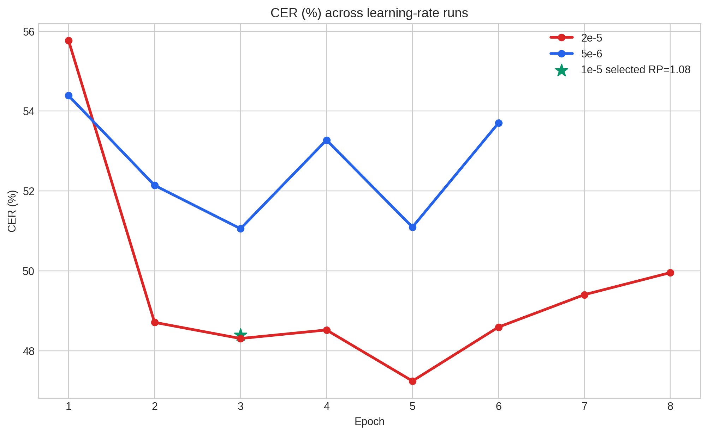
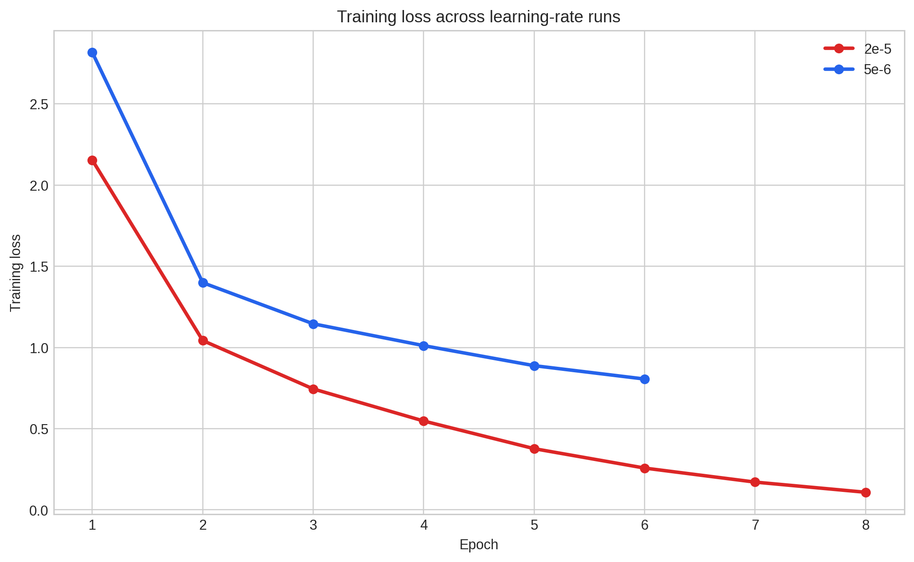

# Phase 7 full fine-tuning: overfitting and underfitting analysis

This is a retrospective analysis of **saved training logs and validation results**. It adds no training, inference, model selection, or test-set tuning. The experiment used 3,629 frozen training clips and evaluated all 732 frozen validation clips each epoch. The selected full fine-tuning checkpoint was chosen by minimum corpus validation CER before the 683-clip test was opened.

## What the recorded curves measure

Training loss is teacher-forced token cross-entropy on the training examples. Validation CER is the edit rate of freely generated IPA-like transcripts against the separate validation references. These quantities have different units and are **not** a train-versus-validation CER gap. A falling training loss with worsening validation CER is evidence that more optimization no longer improved the chosen recognition metric; it is consistent with later-epoch overfitting. Training-set CER and validation loss were not recorded, so a conventional numerical generalization gap cannot be calculated.

## Saved epoch evidence

| Run and decoding policy | Epoch | Training loss | Validation corpus CER | Selection |
|---|---:|---:|---:|---|
| `1e-5`, penalty 1.00 | 1 | 2.439 | 60.07% | |
| | 2 | 1.193 | 55.75% | |
| | **3** | **0.927** | **51.35%** | Best under this policy |
| | 4 | 0.762 | 56.18% | |
| | 5 | 0.613 | 51.51% | |
| | 6 | 0.506 | 55.48% | Stopped after patience 3 |
| `5e-6`, penalty 1.08 | 1 | 2.817 | 54.39% | |
| | 2 | 1.399 | 52.14% | |
| | **3** | **1.146** | **51.05%** | Best |
| | 4 | 1.011 | 53.27% | |
| | 5 | 0.888 | 51.09% | |
| | 6 | 0.806 | 53.70% | Stopped after patience 3 |
| `2e-5`, penalty 1.08 | 1 | 2.155 | 55.77% | |
| | 2 | 1.043 | 48.71% | |
| | 3 | 0.745 | 48.30% | |
| | 4 | 0.547 | 48.52% | |
| | **5** | **0.377** | **47.24%** | Selected checkpoint |
| | 6 | 0.257 | 48.59% | |
| | 7 | 0.171 | 49.40% | |
| | 8 | 0.108 | 49.95% | Stopped after patience 3 |

Sources: [initial F1 aggregate](PHASE7_F1_RESULTS_AGGREGATE.json), [learning-rate aggregate](PHASE7_F1_LR_RESULTS_AGGREGATE.json), and [learning-rate run report](PHASE7_F1_LR_RESULTS.md). Values above are rounded for reading; the aggregate JSON contains the recorded precision. The `1e-5` epoch trajectory used repetition penalty 1.00. Its separately re-decoded Epoch 3 checkpoint reached 48.39172% at penalty 1.08; that single-point result should not be substituted into the penalty-1.00 trajectory.

**Figure — Validation CER by epoch.** The two new independent runs used penalty 1.08. The `2e-5` run reached its minimum at Epoch 5; later epochs were worse. The initial `1e-5` curve came from the earlier penalty-1.00 run and has a different decoding policy.

**Figure — Training loss by epoch.** Training loss continued downward in all runs. It describes optimization of the training objective, while validation CER determined the checkpoint to keep.

## Interpretation

- **Later-epoch overfitting pattern:** In the selected `2e-5` run, training loss fell from 0.377 at Epoch 5 to 0.108 at Epoch 8, while validation CER rose from 47.24% to 49.95%, a deterioration of 2.71 percentage points. The independent `5e-6` run and original `1e-5` run show the same broad divergence after their respective best epochs, though their CER curves fluctuate rather than increase monotonically.
- **Early stopping was useful:** The maximum of 10 epochs was a ceiling. Patience-3 stopping and minimum-CER selection retained Epoch 5 for the selected run instead of using its final Epoch 8 weights.
- **Underfitting is not established for the selected checkpoint:** Full fine-tuning reduced validation CER substantially relative to the 103.13% zero-shot baseline, and `2e-5` was best among the tested full fine-tuning settings. A high residual CER still shows that the task is difficult; it does not by itself distinguish underfitting from label uncertainty, limited coverage, or genuine transcription errors.
- **Limits of the diagnosis:** Training loss and CER are not directly comparable. There is no recorded training-set CER, validation loss, multi-seed variability, or expert label adjudication. The evidence supports a practical checkpoint-selection decision, not a measured degree of memorization or a causal explanation of all residual errors.

The selected checkpoint later scored **44.57355% corpus CER** on all **683 held-out test clips**, compared with **101.23214%** for zero-shot B0 ([Phase 8 report](PHASE8_RESULTS.md)). The test and validation sets contain different recordings and components; their CER difference does not negate the later-epoch validation pattern. The final test was not used to revise the epoch or decoding settings.
