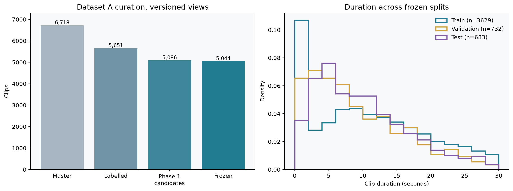
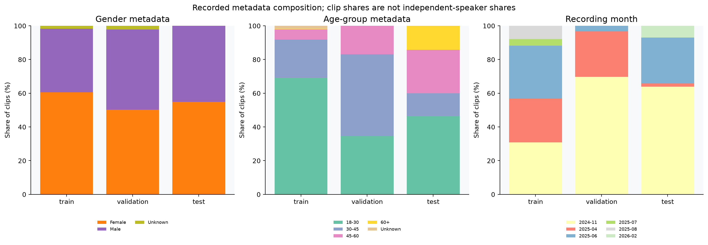
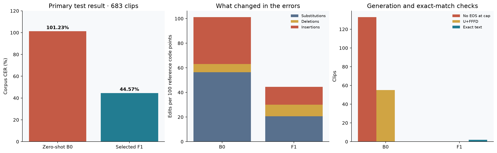
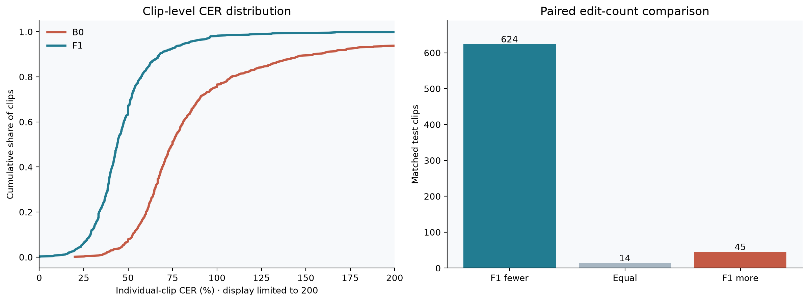
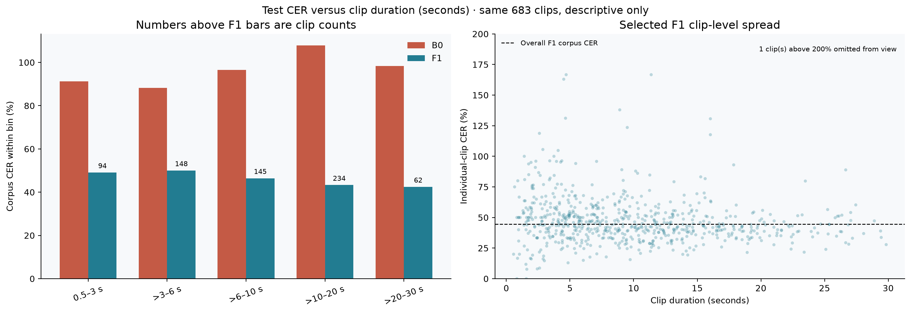
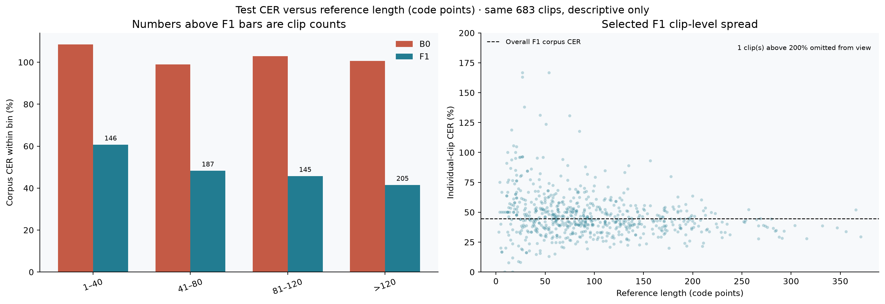
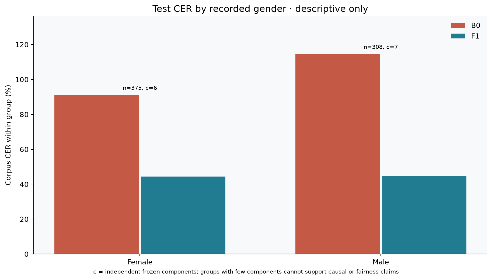
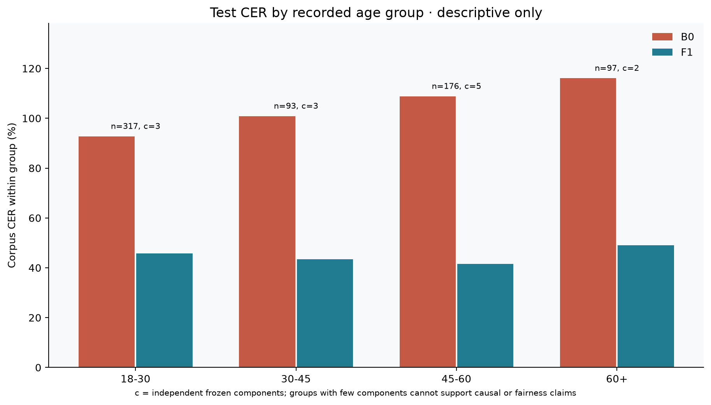
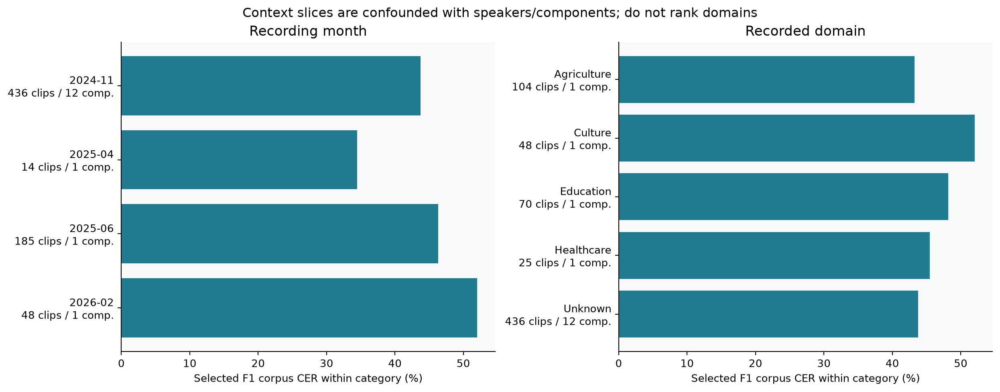

# Phase 8 descriptive EDA — frozen test and dataset balance

The [self-contained notebook](../notebooks/Phase-8-Descriptive-EDA-Public.ipynb) has the commented code and embedded aggregate figures.

This report was computed from the frozen `phase3_5b_v1` manifests and saved Phase 8 B0/F1 predictions. **No model inference, training, checkpoint selection, or decoding tuning was run.** All subgroup CER values use `(sum S + sum D + sum I) / sum reference code points` within that group; they are not averages of clip CERs.

## Frozen dataset overview

| split | clips | hours | components | duration_median_seconds | duration_p95_seconds | reference_codepoints |
| --- | --- | --- | --- | --- | --- | --- |
| train | 3629 | 10.85 | 15 | 9.76 | 25.90 | 383474 |
| validation | 732 | 1.88 | 16 | 7.46 | 23.28 | 64137 |
| test | 683 | 1.89 | 13 | 8.89 | 22.89 | 65577 |

**Figure 1 — Frozen data and duration.** Shows how the frozen Narration clips are divided among training, validation and test, with their duration distributions.

**Figure 2 — Recorded metadata.** Compares the split composition using recorded gender, age and other metadata; it does not establish population representativeness.

The train/test age composition differs: the 60+ label occurs in 17 training clips (0.5%) and 97 test clips (14.2%). This is a dataset-description fact, not proof that age caused any model error. Gender, age, month and domain are recorded metadata; their correctness was not independently adjudicated.

## Primary test result and error composition

| model | clips | reference_codepoints | substitutions | deletions | insertions | corpus_cer_percent | eos | cap_hits | replacement_outputs | exact_matches |
| --- | --- | --- | --- | --- | --- | --- | --- | --- | --- | --- |
| B0 | 683 | 65577 | 36940 | 4395 | 25050 | 101.23 | 550 | 133 | 55 | 0 |
| F1 | 683 | 65577 | 13525 | 6158 | 9547 | 44.57 | 683 | 0 | 0 | 2 |

**Figure 3 — Primary test outcome.** Contrasts corpus CER, edit types and generation diagnostics for B0 and the validation-selected F1 checkpoint on the same 683 clips.

The selected F1 model improves on B0 for 624 of 683 matched clips, ties on 14, and has more edits on 45. The paired, component-resampled 95% percentile interval for the B0-minus-F1 corpus CER reduction is **50.16 to 68.27 percentage points** across 5,000 replicates. This is exploratory uncertainty over the 13 observed components, not a guarantee for new speakers or domains.

**Figure 4 — Paired outcomes.** Shows the spread of per-clip CER and whether F1 makes fewer, equal or more edits than B0 on each matched clip.

## CER versus clip duration and reference length

| duration_band | clips | components | reference_codepoints | corpus_cer_percent |
| --- | --- | --- | --- | --- |
| 0.5–3 s | 94 | 12 | 1833 | 49.10 |
| >3–6 s | 148 | 12 | 7305 | 50.03 |
| >6–10 s | 145 | 12 | 11282 | 46.45 |
| >10–20 s | 234 | 12 | 31399 | 43.29 |
| >20–30 s | 62 | 10 | 13758 | 42.46 |

**Figure 5 — Duration slices.** Bars use corpus CER within each duration bin; points display individual test clips. All clips remain in the aggregate even when a scatter axis is zoomed.

**Figure 6 — Reference-length slices.** Short references have higher observed percentage error; a single edit also contributes more when the reference denominator is small.

The bin charts compare corpus CER within each bin. The scatter panels show individual-clip CER, which can exceed 100% when insertions are numerous. Duration and reference length, speaker mix and recording conditions are correlated; these slices do not isolate a causal duration effect.

## Recorded gender and age-group slices

| group | clips | components | reference_codepoints | corpus_cer_percent |
| --- | --- | --- | --- | --- |
| Female | 375 | 6 | 37168 | 44.36 |
| Male | 308 | 7 | 28409 | 44.86 |
| 18-30 | 317 | 3 | 29242 | 45.78 |
| 30-45 | 93 | 3 | 10417 | 43.36 |
| 45-60 | 176 | 5 | 18239 | 41.48 |
| 60+ | 97 | 2 | 7679 | 48.98 |

**Figure 7 — Recorded gender.** The female and male slices are close in this test set, with six and seven independent components respectively.

**Figure 8 — Recorded age.** Bars show test-set CER alongside clip and component counts; the 60+ slice contains only two components.

Female and male test CER are close in this split, but the groups contain only six and seven independent components. Age 60+ has only two components. These numbers cannot establish demographic parity, a causal age effect, or performance for the wider Nyishi population.

## Month and domain diagnostics

**Figure 9 — Recording context.** The month and domain panels identify variation among recorded categories; most named categories contain a single independent component.

The aggregate CSV tables are in [`docs/phase8_eda_tables/`](phase8_eda_tables/). Selected F1 slices are below; categories with one component cannot support a domain ranking.

| Recording Month | Clips | Components | F1 CER |
|---|---:|---:|---:|
| 2024-11 | 436 | 12 | 43.75% |
| 2025-04 | 14 | 1 | 34.46% |
| 2025-06 | 185 | 1 | 46.32% |
| 2026-02 | 48 | 1 | 52.03% |

| Domain | Clips | Components | F1 CER |
|---|---:|---:|---:|
| Agriculture | 104 | 1 | 43.22% |
| Culture | 48 | 1 | 52.03% |
| Education | 70 | 1 | 48.19% |
| Healthcare | 25 | 1 | 45.47% |
| Unknown | 436 | 12 | 43.75% |

Most named test domains and later recording months contain only one independent component, so their CER values are **descriptive case slices**, not a domain ranking. Test education level is entirely `Unknown` and is not analyzed.

## What to include in the submission report

Use the frozen split table, Figure 1 or 2 for dataset EDA, the overall test result/error chart, and the CER-by-duration chart. If space permits, include the gender/age table with its component counts and the caveat above. Keep month/domain figures in an appendix. Do not change the primary CER contract or select a new checkpoint from these test analyses.

## Verification and privacy

The notebook checked frozen manifest SHA-256 values, prediction ZIP integrity, exactly 683 unique clips per model, exact reference agreement with the frozen test manifest, and all published S/D/I, EOS, cap and replacement-character totals. Published outputs contain only aggregate counts and plots, with no IDs, references, hypotheses, audio or component mappings. Source predictions and manifests remain in their private locations.
