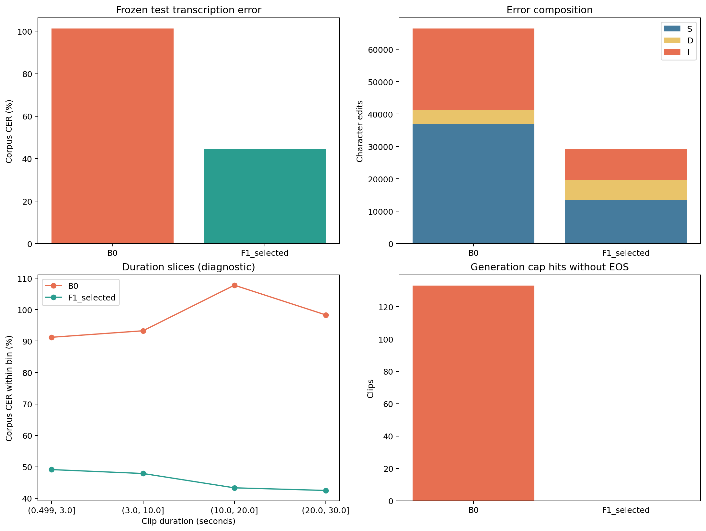

# Phase 8 — final sealed test results

## Declared comparison

The frozen Dataset A Narration test partition contains **683 clips**, **1.891057 hours**, and **65,577 NFD-normalized reference code points**. The final comparison was declared before viewing test outcomes: (1) B0 zero-shot `neurlang/ipa-whisper-base` and (2) the validation-selected full fine-tuning checkpoint trained at learning rate `2e-5`, Epoch 5, with repetition penalty `1.08`. B0 used single-clip greedy FP32 generation; the selected model used the validated batch-8 FP32 policy. Both used the same frozen reference normalization and corpus CER scorer. The test set was not used to select a checkpoint or decoding policy.

## Verified saved results

| Configuration | Corpus test CER | Substitutions | Deletions | Insertions | EOS endings | Cap hits without EOS | U+FFFD outputs | Generation time |
|---|---:|---:|---:|---:|---:|---:|---:|---:|
| B0 zero-shot | **101.23214%** | 36,940 | 4,395 | 25,050 | 550 / 683 | 133 | 55 | 740.26 s |
| Selected F1 | **44.57355%** | 13,525 | 6,158 | 9,547 | 683 / 683 | 0 | 0 | 163.75 s |

For both rows, CER is `(S + D + I) / 65,577 × 100`. The selected model reduces corpus CER by **56.66 absolute percentage points** versus B0. Substitutions and insertions fall substantially; deletions rise from 4,395 to 6,158, so the error shift should not be described as improvement in every category. The selected model ended all 683 generations with EOS, with no cap hits or U+FFFD outputs. This is the first measured outcome on the frozen test set for these declared configurations.

The selected model's earlier validation CER was **47.23950%** on 732 different clips. The test CER is lower by 2.67 points, but the partitions differ in recordings and components; this comparison is descriptive rather than evidence that tuning on test would help.

**Figure — Final test comparison.** The panels show corpus CER, edit composition, CER within duration ranges, and generation-cap failures. The duration curves are diagnostic slices; the overall corpus CER above remains the primary score.

## Checks and limits

- Both saved ZIPs passed archive integrity checks. Each prediction file has exactly 683 unique test IDs and 65,577 reference code points. Every saved reference matches the frozen local test manifest. Normalization, S/D/I counts, and EOS flags were recomputed from all saved predictions and matched the aggregate files.
- These checks validate the **saved outputs**. Model inference was not rerun locally, and the executed Kaggle notebook has not yet been supplied as a downloaded file. The [self-contained source notebook](../notebooks/Phase-8-Final-Sealed-Test-Kaggle.ipynb) records the declared procedure.
- Relative error remains sensitive to annotation uncertainty. Speaker/session identity uncertainty, recording-month shift, prompt overlap and the absence of expert Nyishi adjudication still limit interpretation.
- Do not tune the model, decoding penalty or checkpoint using the test result. A later study would need a new evaluation design rather than reuse this sealed set for selection.

See the [machine-readable aggregate](PHASE8_RESULTS_AGGREGATE.json), [aggregate plots ZIP](../artifacts/exports/phase8/test_aggregate_plots.zip), and [saved prediction ZIP](../artifacts/exports/phase8/test_predictions.zip). The prediction archive contains per-clip references, IDs and hypotheses.
