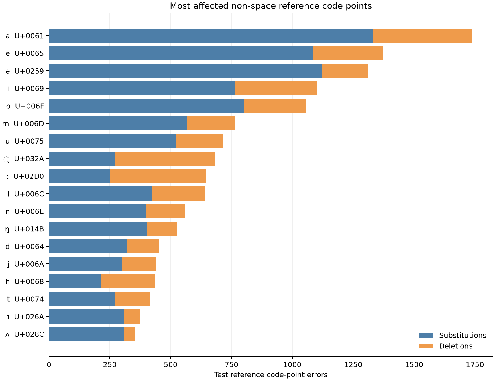
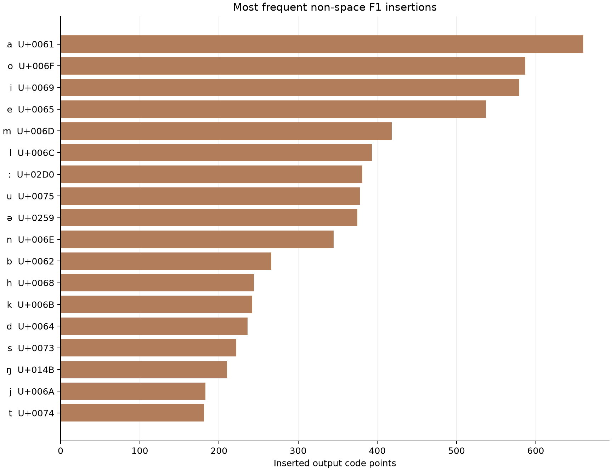
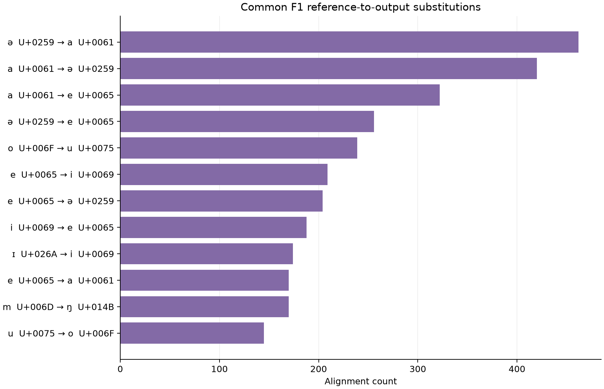
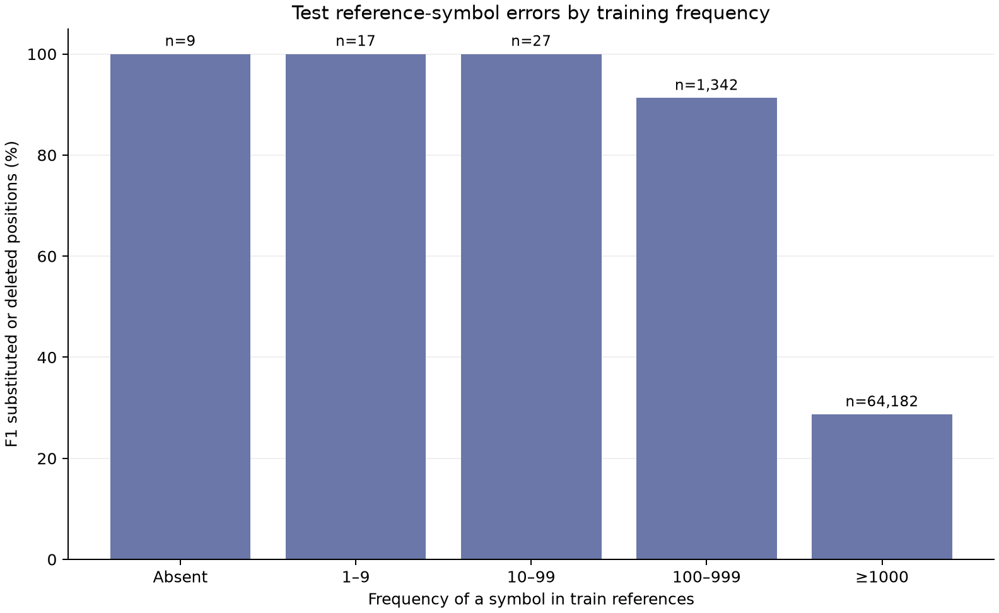
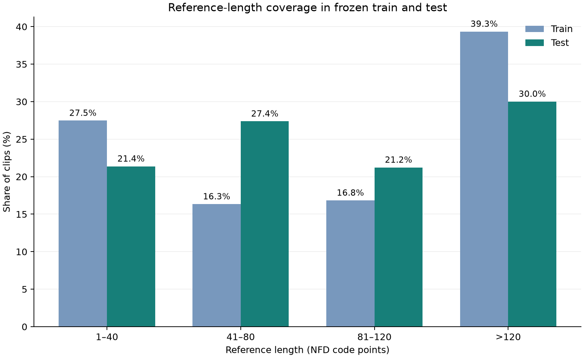
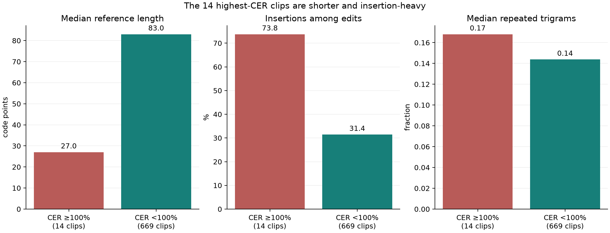
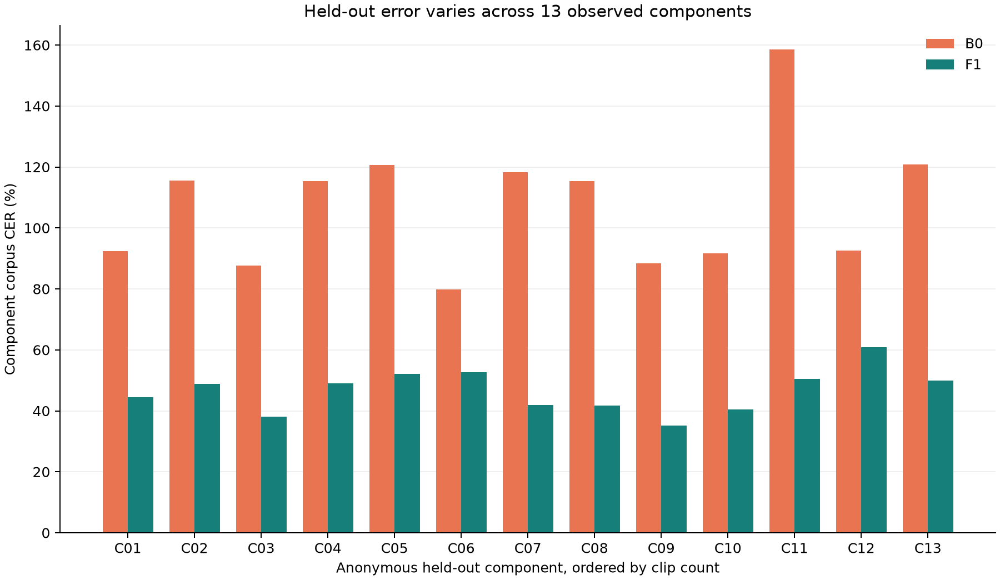

# Phase 8 descriptive diagnostics for the thesis

These analyses use the **saved** B0 and selected-F1 predictions for the same 683 held-out clips, plus the frozen 3,629-clip training and 683-clip test manifests. They describe the declared final result; **no model inference, training, checkpoint choice, decoding change, or new test-based tuning occurred**. The [reproducible script](../scripts/phase8_thesis_diagnostics.py) verifies bundle-manifest hashes, row membership and references, 65,577 test reference code points, and every saved S/D/I count before writing the [aggregate JSON](../assets/phase8/thesis_diagnostics/phase8_thesis_diagnostics_aggregate.json). It emits no IDs, transcription rows, audio, or component mapping.

## 1. Which IPA-like code points contribute to error?

The saved Phase 8 scorer uses Unicode **NFD code-point** Levenshtein distance. This audit reconstructs its alignment with the same match → substitution → deletion → insertion tie order. It tallies which *reference* code points were substituted or deleted and which *output* code points were inserted. Alignment paths can be ambiguous, so these are operational edit counts, **not expert-verified phoneme confusions**. A combining diacritic is counted separately from its base letter. Spaces are part of the scoring policy and are reported separately from the main non-space chart.

| Reference code point | Test occurrences | F1 substitutions from it | F1 deletions | Substitution-or-deletion share |
|---|---:|---:|---:|---:|
| `a` (U+0061) | 6,578 | 1,332 | 405 | 26.41% |
| `ə` (U+0259) | 1,853 | 1,120 | 193 | 70.86% |
| combining dental mark (U+032A) | 859 | 272 | 411 | 79.51% |
| length mark `ː` (U+02D0) | 774 | 250 | 396 | 83.46% |
| ordinary space (U+0020) | 10,868 | 985 | 1,352 | 21.50% |

The rates divide substitution-plus-deletion counts by **occurrences of that reference code point**; they do not include insertions. Frequent symbols can contribute many errors despite a lower rate. Of the **9,547 F1 insertions**, 1,785 are spaces. The full aggregate includes all inserted output code points, including 32 output symbols absent from the test references. The leading aligned substitution pair is `ə → a` (462 alignments), followed by `a → ə` (420). These are alignment descriptions, not claims about acoustic or linguistic causes.

**Figure 1 — Most affected reference code points.** Bars show the largest non-space substitution and deletion totals. The plot uses characters with Unicode labels so combining marks remain identifiable.

**Figure 2 — Frequent inserted symbols.** These counts have no reference-symbol denominator; an insertion lies between aligned reference positions.

**Figure 3 — Common alignment substitutions.** Multiple optimal alignments can exist for a pair of strings. The displayed counts follow the evaluator's deterministic tie order.

## 2. What does training-set symbol coverage show?

The frozen training references contain **83 distinct code points**, while test references contain **69**. Seven test-reference code points are absent from training, occupying only **9 of 65,577** test reference positions. The chart pools test positions according to how often their symbol appears in training. Its error is the share of reference positions aligned as a substitution or deletion; insertion errors are excluded because they cannot be assigned to a reference symbol.

| Training frequency of symbol | Distinct test symbols | Test positions | F1 substituted or deleted | Position error share |
|---|---:|---:|---:|---:|
| Absent | 7 | 9 | 9 | 100.00% |
| 1–9 | 8 | 17 | 17 | 100.00% |
| 10–99 | 7 | 27 | 27 | 100.00% |
| 100–999 | 18 | 1,342 | 1,225 | 91.28% |
| ≥1,000 | 29 | 64,182 | 18,405 | 28.68% |

**Figure 4 — Training frequency and test-symbol errors.** The first three bins together contain just **53 test positions**, so their 100% rates are fragile. The trend is consistent with sparse target coverage being a challenge, but symbol type, alignment ambiguity, and context also differ across bins. It does not establish a causal effect or justify changing labels after the test.

The frozen train and test reference-length compositions also differ:

| Reference length | Training clips | Train share | Test clips | Test share |
|---|---:|---:|---:|---:|
| 1–40 code points | 997 | 27.47% | 146 | 21.38% |
| 41–80 | 593 | 16.34% | 187 | 27.38% |
| 81–120 | 611 | 16.84% | 145 | 21.23% |
| >120 | 1,428 | 39.35% | 205 | 30.01% |

**Figure 5 — Reference-length coverage.** Training has a larger share of >120-code-point references; the test set has more 41–120-code-point references. These counts describe split composition, not an independent effect of length on error.

## 3. What distinguishes the 14 clips at or above 100% F1 CER?

| Diagnostic | 14 high-CER clips | Other 669 clips |
|---|---:|---:|
| Reference code points, total | 491 | 65,086 |
| Median reference length | 27 | 83 |
| Median duration | 4.68 s | 8.89 s |
| F1 substitutions / deletions / insertions | 221 / 5 / 635 | 13,304 / 6,153 / 8,912 |
| Insertions as share of edits | 73.75% | 31.41% |
| Median repeated-trigram fraction in prediction | 0.168 | 0.144 |
| EOS endings / cap hits | 14 / 0 | 669 / 0 |

**Figure 6 — Short references and insertions.** The high-CER group has shorter references and a higher insertion share. All 14 outputs ended with EOS, so these errors are **not generation-cap failures**. Repeated code-point trigrams occur somewhat more often in their predictions, but the difference is modest; repetition can also be legitimate. This grouped audit cannot determine whether particular insertions are hallucination, acoustic confusions, or reference-label errors without expert review.

Selection into this group is *defined* by high clip CER, so short denominators and many insertions are mathematically related to membership. Do not present these comparisons as causal risk factors or use them to retune the model on the test set.

## 4. How much does performance vary across held-out components?

The 683 test clips form **13 observed components**. The table uses anonymous labels ordered by clip count. It publishes no component IDs, recordings, transcripts, or label-to-ID mapping. Component corpus CER is the sum of edits divided by the sum of reference code points **within that component**.

| Anonymous component | Clips | Reference code points | B0 CER | F1 CER |
|---|---:|---:|---:|---:|
| C01 | 226 | 24,198 | 92.31% | 44.39% |
| C02 | 86 | 6,981 | 115.59% | 48.88% |
| C03 | 56 | 5,121 | 87.62% | 38.10% |
| C04 | 53 | 4,692 | 115.41% | 49.00% |
| C05 | 48 | 1,843 | 120.67% | 52.03% |
| C06 | 43 | 3,201 | 79.91% | 52.67% |
| C07 | 42 | 4,409 | 118.24% | 41.87% |
| C08 | 36 | 3,566 | 115.40% | 41.76% |
| C09 | 23 | 4,949 | 88.36% | 35.26% |
| C10 | 22 | 3,174 | 91.65% | 40.49% |
| C11 | 20 | 1,969 | 158.56% | 50.48% |
| C12 | 17 | 776 | 92.65% | 60.95% |
| C13 | 11 | 698 | 120.77% | 50.00% |

**Figure 7 — Variation among observed components.** F1 CER ranges from **35.26% to 60.95%** across these components, and F1 beats B0 on every one. Component sizes vary from **11 to 226 clips**, so an unweighted average of these bars would not reproduce overall corpus CER. A component can contain linked recordings and is not necessarily one independent speaker; these 13 observed components are not a representative population sample.

## Limits and suitable thesis use

The main result remains **44.57355% F1 versus 101.23214% B0 corpus CER** over all 683 held-out clips and 65,577 reference code points. These supplementary plots help explain which symbols and recording groups contribute to that result. They do not establish phonemic accuracy, causality, demographic fairness, or performance in songs or other domains. IPA-like references have not been independently adjudicated by a Nyishi expert. Use Figures 1, 4, 6, and 7 in the discussion if space allows; place the remaining figures and detailed component table in an appendix.
